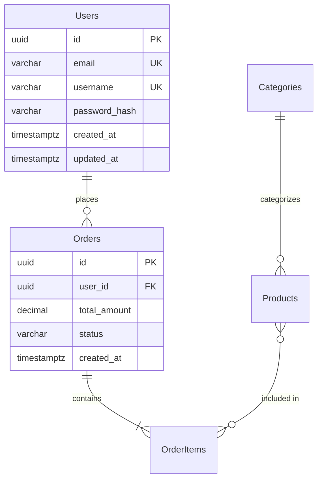

# Schema Design Rules

Universal database schema design rules and conventions. Apply regardless of database type.

## Mandatory Rules (MUST)

### 1. Every Table Must Have a Primary Key

- Unique record identification
- Referential integrity foundation
- Use UUID for distributed systems, auto-increment for simple cases
- Never use composite natural keys as PK (use surrogate key + unique constraint)

### 2. Explicit Foreign Keys with Cascade Behavior

- Every relationship MUST have an explicit FK constraint
- Specify ON DELETE behavior explicitly:
  - `CASCADE` — child removed when parent deleted (compositions)
  - `SET NULL` — child kept, FK nulled (optional associations)
  - `RESTRICT` — prevent parent deletion if children exist (critical references)
- Index all FK columns for JOIN performance

### 3. NOT NULL on Required Fields

- Default to NOT NULL unless the column is genuinely optional
- Always provide DEFAULT values where sensible
- Never use empty string as substitute for NULL

### 4. Timestamps on Every Table

- `created_at` — immutable, set on INSERT
- `updated_at` — auto-updated on every UPDATE
- Use timezone-aware types (TIMESTAMPTZ for PostgreSQL, UTC DATETIME for MySQL)

### 5. Naming Conventions

- Tables: `snake_case`, plural (`users`, `order_items`)
- Columns: `snake_case` (`first_name`, `created_at`)
- Indexes: `idx_{table}_{column}` or `idx_{table}_{col1}_{col2}`
- Foreign keys: `fk_{table}_{referenced_table}` or `{referenced_table}_id`
- Constraints: `chk_{table}_{rule}`, `uk_{table}_{column}`
- Triggers: `trg_{table}_{event}`

## Prohibited Actions (MUST NOT)

### 1. No EAV Pattern Abuse

Entity-Attribute-Value pattern (key-value tables) dramatically increases query complexity and degrades performance. Use only when:

- Attribute set is truly dynamic and unpredictable
- JSONB/JSON column is not an option
- Schema flexibility outweighs query performance needs

### 2. No Excessive Denormalization

- OLTP systems: normalize to 3NF (data integrity)
- OLAP/analytics: denormalization allowed (query performance)
- Read-heavy OLTP: selective denormalization with documented justification
- Every denormalization must be documented with rationale in SCHEMA.md

### 3. No Plaintext Sensitive Data

Never store in plaintext:

- Passwords (use bcrypt/argon2 hash)
- Credit card numbers (use tokenization)
- Social security numbers (use encryption at rest)
- API keys/secrets (use vault or encrypted columns)

Mark sensitive columns with comments:

```sql
password_hash VARCHAR(255) NOT NULL, -- SENSITIVE: bcrypt hash, never store plaintext
```

### 4. No Implicit Type Coercion

- Use explicit types matching the business domain
- Don't store dates as strings
- Don't store booleans as integers (except SQLite)
- Don't store money as floats (use DECIMAL/NUMERIC)

## Normalization Decision Guide

| Workload | Normalization Level | Rationale |
|----------|-------------------|-----------|
| OLTP (transactional) | 3NF | Data integrity, no update anomalies |
| OLAP (analytics) | 2NF or denormalized | Query performance, fewer JOINs |
| Read-heavy OLTP | 3NF + materialized views | Integrity with read performance |
| Write-heavy OLTP | 3NF strict | Minimize write amplification |
| Mixed | 3NF + selective caching | Balance integrity and performance |

## Relationship Patterns

### One-to-One (1:1)

```sql
-- FK + UNIQUE constraint on child table
CREATE TABLE user_profiles (
    id UUID PRIMARY KEY,
    user_id UUID NOT NULL UNIQUE REFERENCES users(id) ON DELETE CASCADE,
    ...
);
```

### One-to-Many (1:N)

```sql
-- FK on child table (no UNIQUE)
CREATE TABLE orders (
    id UUID PRIMARY KEY,
    user_id UUID NOT NULL REFERENCES users(id) ON DELETE CASCADE,
    ...
);
CREATE INDEX idx_orders_user_id ON orders(user_id);
```

### Many-to-Many (N:M)

```sql
-- Junction table with composite unique
CREATE TABLE post_tags (
    id UUID PRIMARY KEY,
    post_id UUID NOT NULL REFERENCES posts(id) ON DELETE CASCADE,
    tag_id UUID NOT NULL REFERENCES tags(id) ON DELETE CASCADE,
    CONSTRAINT uk_post_tags UNIQUE (post_id, tag_id)
);
CREATE INDEX idx_post_tags_post_id ON post_tags(post_id);
CREATE INDEX idx_post_tags_tag_id ON post_tags(tag_id);
```

### Self-Referencing (hierarchical)

```sql
-- Parent reference within same table
CREATE TABLE categories (
    id UUID PRIMARY KEY,
    name VARCHAR(255) NOT NULL,
    parent_id UUID REFERENCES categories(id) ON DELETE SET NULL,
    ...
);
CREATE INDEX idx_categories_parent_id ON categories(parent_id);
```

## Indexing Strategy

### Always Index

- Primary keys (auto-indexed)
- Foreign key columns (required for JOIN performance)
- Columns in WHERE clauses (frequent queries)
- Columns in ORDER BY (sorting)
- Unique constraint columns (auto-indexed)

### Consider Composite Indexes

- Multi-column WHERE conditions: index (col1, col2) — high selectivity first
- Cover queries: include all SELECT columns in index to avoid table lookup

### Avoid Over-Indexing

- Each index degrades INSERT/UPDATE performance
- Drop unused indexes (monitor with pg_stat_user_indexes or SHOW INDEX)
- Maximum ~5-7 indexes per table as guideline

## ERD Conventions (Mermaid)

All ERD diagrams use Mermaid `erDiagram` syntax:



### Cardinality Symbols

| Symbol | Meaning |
|--------|---------|
| `\|\|` | Exactly one |
| `o\|` | Zero or one |
| `}o` | Zero or many |
| `}\|` | One or many |
| `--` | Identifying relationship |
| `..` | Non-identifying relationship |

### Attribute Markers

| Marker | Meaning |
|--------|---------|
| `PK` | Primary Key |
| `FK` | Foreign Key |
| `UK` | Unique Key |

## MongoDB Inline Patterns

For MongoDB schemas (no separate reference file):

- Use `ObjectId` for `_id` (automatic)
- Embed related data for 1:few relationships (< 100 items)
- Reference via ObjectId for 1:many relationships (> 100 items)
- Use compound indexes for common query patterns
- Add schema validation rules (MongoDB 3.6+):

```javascript
db.createCollection("orders", {
    validator: {
        $jsonSchema: {
            bsonType: "object",
            required: ["userId", "status", "createdAt"],
            properties: {
                userId: { bsonType: "objectId" },
                status: { enum: ["pending", "processing", "shipped", "delivered"] },
                total: { bsonType: "decimal", minimum: 0 }
            }
        }
    }
});
```

- Document size limit: 16MB
- Array size guideline: < 1000 elements for embedded arrays

## SQLite Inline Patterns

For SQLite schemas (no separate reference file):

- `INTEGER PRIMARY KEY AUTOINCREMENT` for auto-increment IDs
- Use `TEXT` for UUIDs (no native UUID type)
- Limited types: NULL, INTEGER, REAL, TEXT, BLOB
- No native date/time types — use TEXT (ISO 8601) or INTEGER (Unix timestamp)
- Enable foreign keys explicitly: `PRAGMA foreign_keys = ON;`
- Single-writer mode — no concurrent write support
- No ALTER TABLE DROP COLUMN before SQLite 3.35.0

```sql
PRAGMA foreign_keys = ON;

CREATE TABLE users (
    id INTEGER PRIMARY KEY AUTOINCREMENT,
    email TEXT NOT NULL UNIQUE,
    name TEXT NOT NULL,
    created_at TEXT NOT NULL DEFAULT (datetime('now'))
);
```
