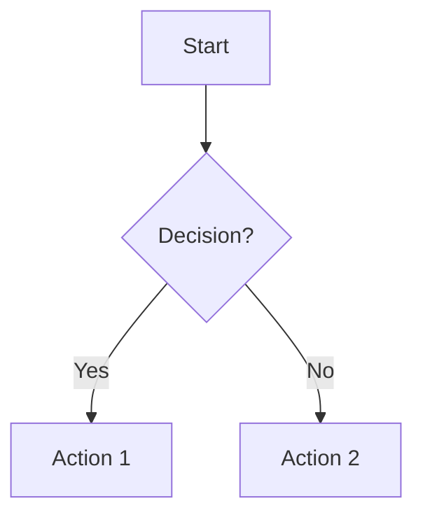
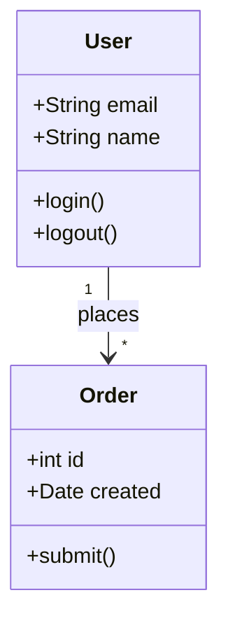
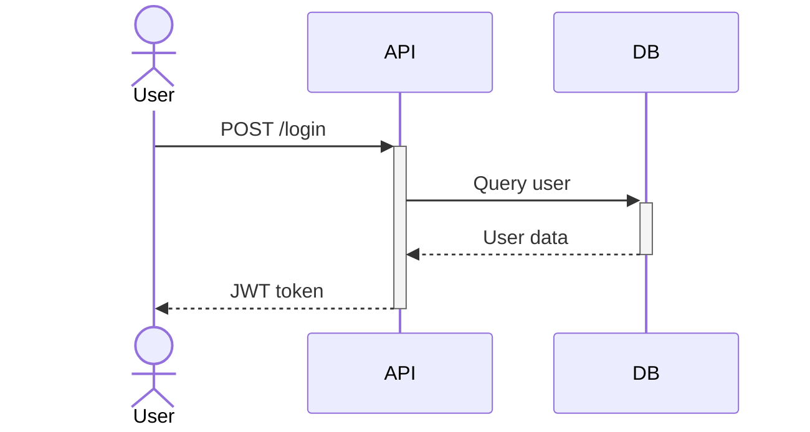
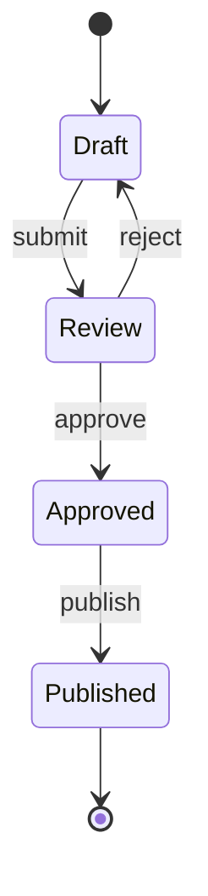
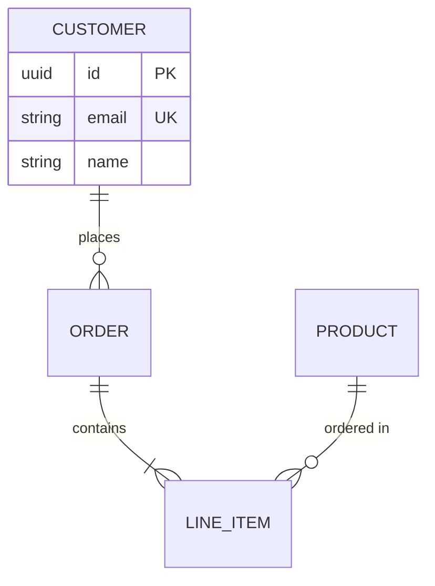
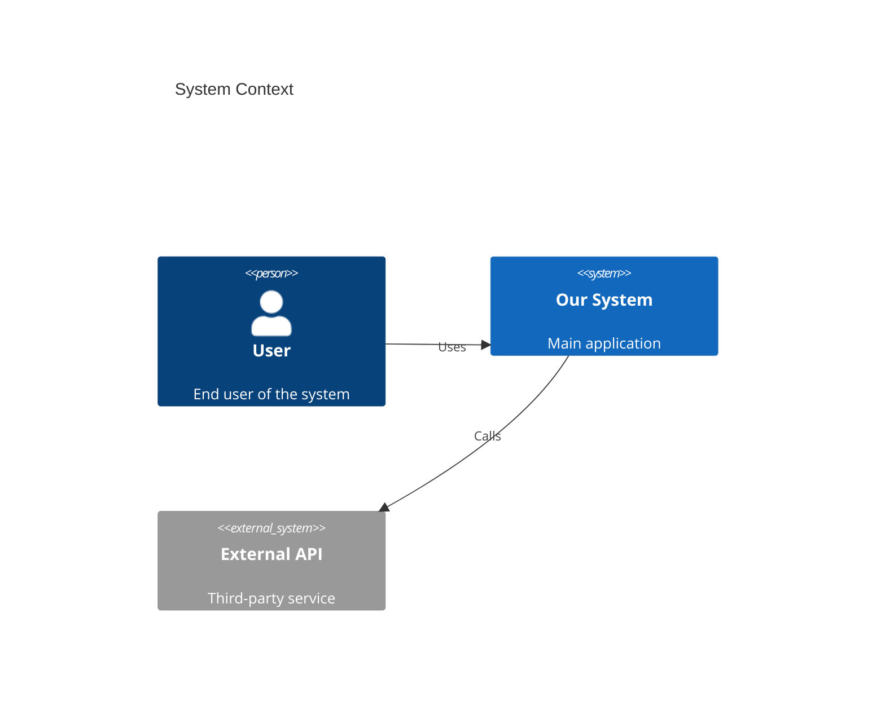
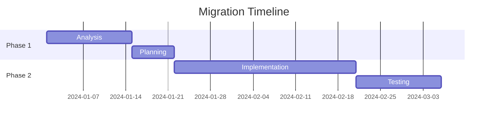
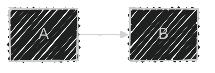

<!-- Imported from ai4developers/claude-code/claude-code-plugins/migration-plugin/skills/mermaid-diagrams by codex-knowledge-curation/scripts/persist_project_skills.py. -->

# Mermaid Diagrams

## For Agent Consumption

Do not invoke this skill directly. Read the `references/` files for syntax. This skill is a reference library, not an executable skill.

> **CRITICAL — NO LITERAL `\n` ESCAPE SEQUENCES**
>
> When writing mermaid code blocks, you MUST use actual newline
> characters (press Enter). NEVER use the literal two-character sequence `\n` in
> diagram source text. Mermaid does NOT interpret `\n` as a newline — it renders
> the literal characters `\n` on screen, producing broken, unreadable diagrams.
>
> WRONG: `A[Step 1\nDetails] --> B[Step 2\nMore info]`
> RIGHT:
>
> ```text
> A[Step 1] --> B[Step 2]
> ```
>
> If you need multi-line labels, use `<br>` tags:
> `A["Step 1<br>Details"] --> B["Step 2<br>More info"]`

**Output contract:**

- Always use `.md` files with fenced mermaid code blocks (` ```mermaid ... ``` `)

Create clear, maintainable diagrams using Mermaid's text-based syntax. Diagrams are rendered from simple text definitions, making them easy to update, review in pull requests, and maintain over time.

## Quick Start

When asked to create a diagram, first determine the appropriate type:

| Diagram Type | Declaration | Best For |
|--------------|-------------|----------|
| **Flowchart** | `flowchart TD` | Processes, algorithms, decision trees, user journeys |
| **Sequence Diagram** | `sequenceDiagram` | API flows, authentication, component interactions |
| **Class Diagram** | `classDiagram` | Domain modeling, OOP structures, entity relationships |
| **State Diagram** | `stateDiagram-v2` | State machines, lifecycle modeling, workflow states |
| **ERD** | `erDiagram` | Database schemas, table relationships |
| **C4 Diagram** | `C4Context` / `C4Container` / `C4Component` | System architecture at different abstraction levels |
| **Architecture Diagram** | `architecture-beta` | Cloud infrastructure, deployment layouts |
| **Gantt Chart** | `gantt` | Project timelines, migration schedules, task dependencies |
| **Timeline** | `timeline` | Historical events, release histories, milestones |
| **Mindmap** | `mindmap` | Knowledge mapping, brainstorming, topic hierarchies |
| **Pie Chart** | `pie` | Data distribution, proportional breakdowns |
| **XY Chart** | `xychart` | Bar/line charts, metrics visualization |
| **Block Diagram** | `block` | Manual-layout diagrams, precise positioning |
| **Sankey Diagram** | `sankey` | Flow quantities, resource distribution |
| **Packet Diagram** | `packet` | Network protocol headers, bit-level layouts |
| **Kanban Board** | `kanban` | Task boards, workflow status tracking |

## Basic Syntax

All Mermaid diagrams start with a diagram type declaration:



## Diagram Examples

### Class Diagram



### Sequence Diagram



### State Diagram



### Entity Relationship Diagram



### C4 Context Diagram



### Gantt Chart



## Configuration

Add YAML frontmatter for theming and styling:



**Available themes:** `default`, `forest`, `dark`, `neutral`, `base`

**Available looks:** `classic`, `handDrawn`

**Available layouts:** `dagre` (default), `elk` (better for complex diagrams)

## References

For detailed syntax and examples, see:

- [references/flowcharts.md](references/flowcharts.md) — Process flows and decision trees
- [references/sequence-diagrams.md](references/sequence-diagrams.md) — Interaction flows and messages
- [references/class-diagrams.md](references/class-diagrams.md) — OOP structures and relationships
- [references/state-diagrams.md](references/state-diagrams.md) — State machines and lifecycle modeling
- [references/erd-diagrams.md](references/erd-diagrams.md) — Database schema design
- [references/c4-diagrams.md](references/c4-diagrams.md) — Architectural views
- [references/architecture-diagrams.md](references/architecture-diagrams.md) — Infrastructure layouts
- [references/gantt-diagrams.md](references/gantt-diagrams.md) — Project timelines and schedules
- [references/additional-diagrams.md](references/additional-diagrams.md) — Pie, mindmap, timeline, sankey, block, packet, kanban, XY charts
- [references/advanced-features.md](references/advanced-features.md) — Theming, styling, and configuration

## Best Practices

1. **NEVER use `\n`** — Use real newlines or `<br>` for multi-line labels. Literal `\n` breaks diagrams.
2. **Start simple** — Begin with core entities, add detail incrementally
3. **Use clear naming** — Descriptive labels improve readability
4. **Add comments** — Use `%%` for documentation
5. **Keep diagrams focused** — One concept per diagram
6. **Choose the right type** — Match diagram type to what you're modeling
7. **Use ELK layout** — For complex diagrams with >20 nodes, set `layout: elk` in config
