# Additional Diagram Types

Reference for pie charts, mindmaps, timelines, sankey diagrams, block diagrams, packet diagrams, kanban boards, and XY charts.

> **NEVER use literal `\n`** — use `<br>` for multi-line labels.

## Contents

- [Pie Chart](#pie-chart)
- [Mindmap](#mindmap)
- [Timeline](#timeline)
- [XY Chart](#xy-chart)
- [Block Diagram](#block-diagram)
- [Sankey Diagram](#sankey-diagram)
- [Packet Diagram](#packet-diagram)
- [Kanban Board](#kanban-board)

---

## Pie Chart

**Declaration:** `pie`

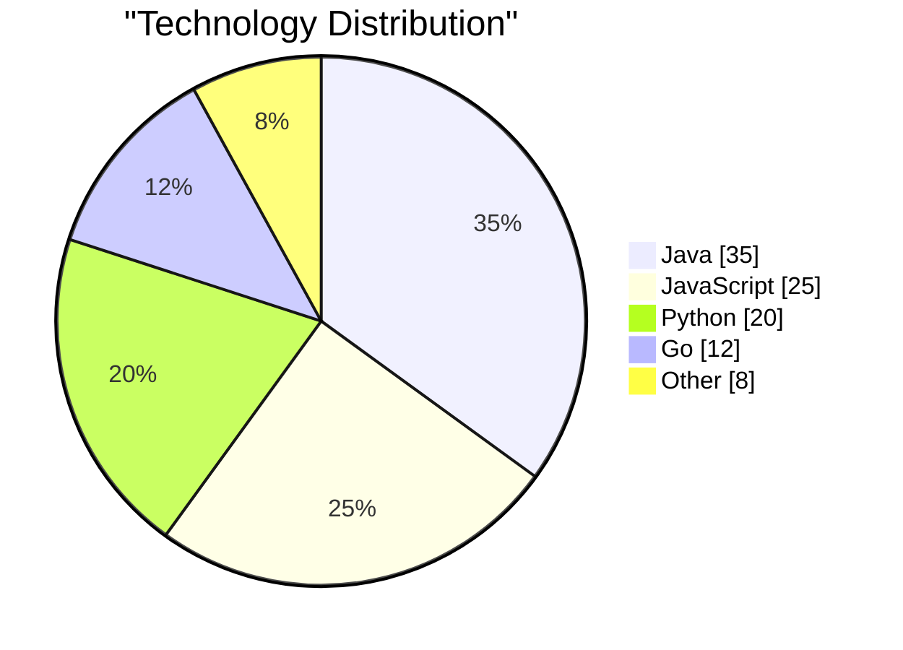

- `showData` — renders numeric values next to legend (optional)
- `title` — optional, must be in quotes
- Values must be positive numbers > 0
- Slices render clockwise in source order

**Config:**

```yaml
---
config:
  pie:
    textPosition: 0.75
---
```

`textPosition`: `0.0` (center) to `1.0` (outer edge), default `0.75`

---

## Mindmap

**Declaration:** `mindmap`

Hierarchy is defined by indentation level:

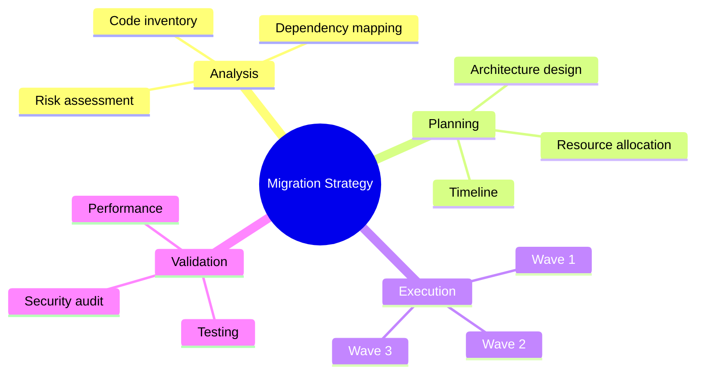

### Node Shapes

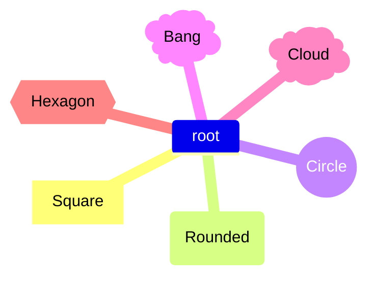

**Markdown in labels:** `**bold**`, `*italic*` supported.

**Config:**

```yaml
---
config:
  layout: tidy-tree
---
```

---

## Timeline

**Declaration:** `timeline`

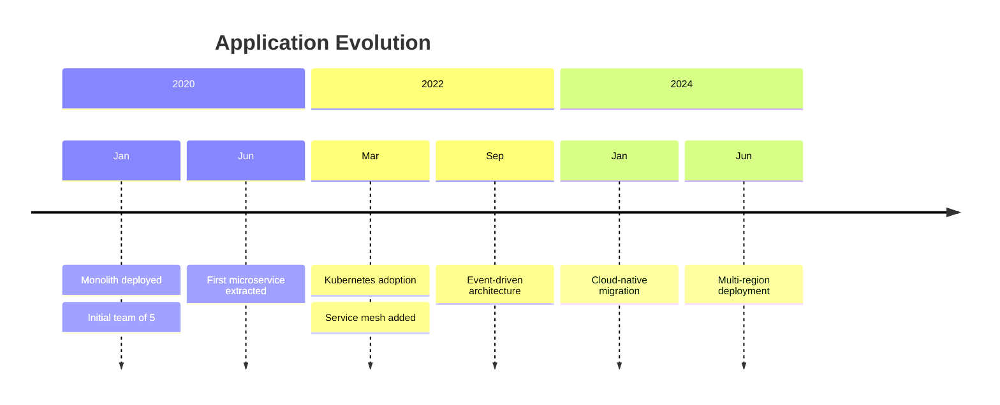

- Multiple events per time period: add indented lines with `:`
- `section` groups time periods visually
- Free-form strings for time periods (not limited to dates)

### Direction (v11.14.0+)

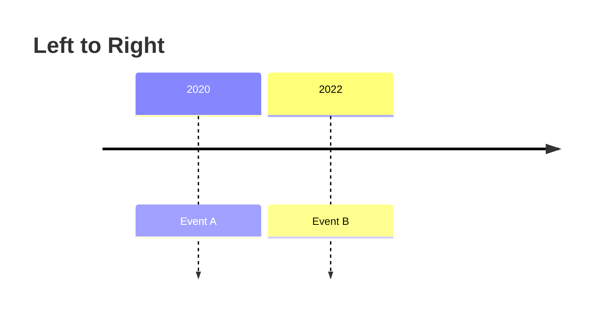

Directions: `LR` (default), `TD`

---

## XY Chart

**Declaration:** `xychart` or `xychart horizontal`

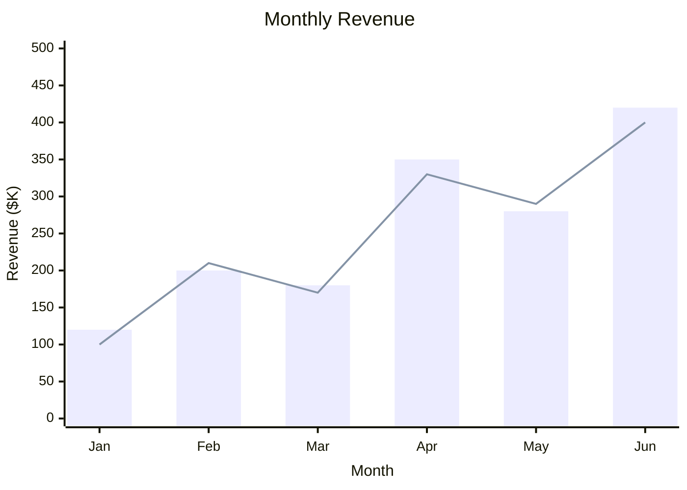

- Both `bar` and `line` series can coexist
- Multiple series of each type allowed
- Axes are optional (auto-range from data)

### Numeric X-Axis

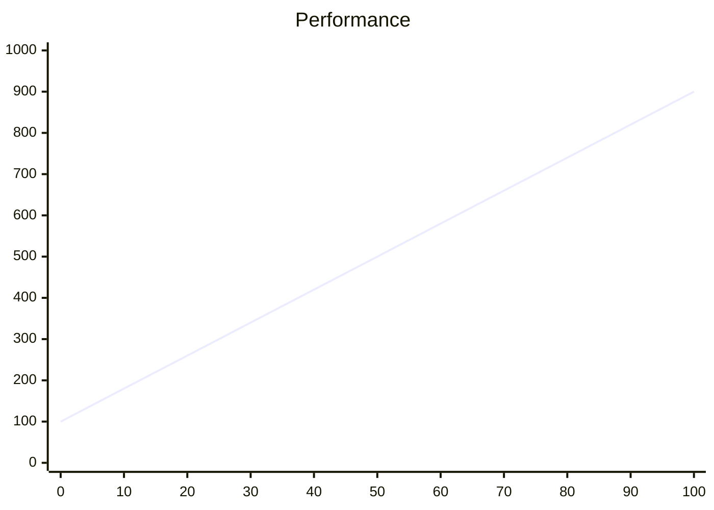

### Data Labels (v11.14.0+)

```yaml
---
config:
  xyChart:
    showDataLabel: true
    showDataLabelOutsideBar: true
---
```

---

## Block Diagram

**Declaration:** `block`

Manual-layout diagrams with full positioning control:

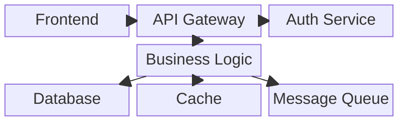

### Key Features

- `columns N` — set column count for auto-wrap
- `space` / `space:N` — empty cells for layout gaps
- Composite blocks: `parent[ child1 child2 ]`
- Shape support: `round`, `stadium`, `cylindrical`, `circle`, `rhombus`, `hexagon`, `parallelogram`, `trapezoid`, `double-circle`

---

## Sankey Diagram

**Declaration:** `sankey` (experimental)

CSV format with 3 columns — source, target, value:

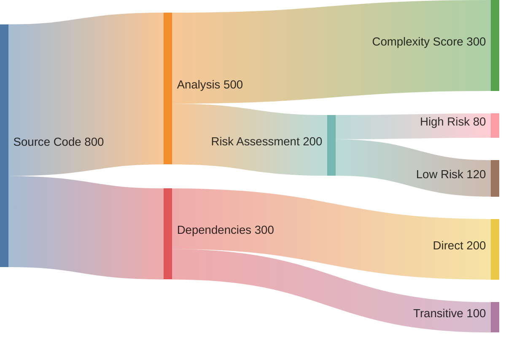

**CSV rules:**

- Empty lines allowed for visual separation
- Commas in names: `"Node, Name",Target,50`
- Escaped quotes: `"Node ""Quoted""",Target,50`

**Config:**

```yaml
---
config:
  sankey:
    linkColor: gradient
    nodeAlignment: justify
---
```

`linkColor`: `source`, `target`, `gradient`, `#hexcode`
`nodeAlignment`: `justify`, `center`, `left`, `right`

---

## Packet Diagram

**Declaration:** `packet`

### Range Syntax

Ranges must be contiguous — each row continues from where the previous ended:

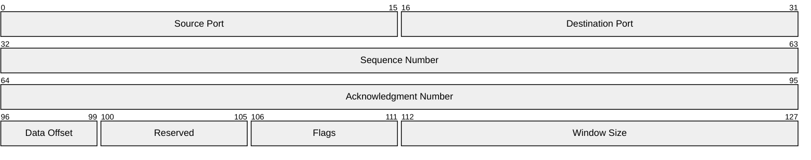

### Bit-Count Syntax (v11.7.0+)

Auto-increments position:

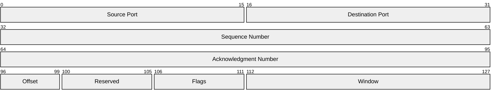

Both syntaxes can be mixed. Config: `bitsperrow`, `bitwidth`, `rowheight`, `showbits`

---

## Kanban Board

**Declaration:** `kanban`

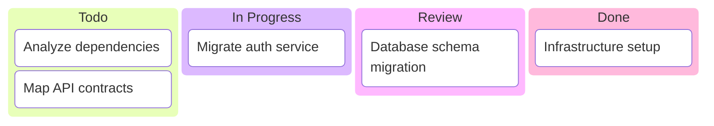

Metadata support (`@{ assigned, ticket, priority }`) requires Mermaid v11.4.0+ and proper indentation matching the task node. Check your renderer version before using metadata.

### Metadata Keys

| Key | Values |
|-----|--------|
| `assigned` | Free text (name) |
| `ticket` | Free text (ticket ID) |
| `priority` | `Very High`, `High`, `Low`, `Very Low` |

### Ticket Links

```yaml
---
config:
  kanban:
    ticketBaseUrl: 'https://jira.example.com/browse/#TICKET#'
---
```

`#TICKET#` is replaced with the `ticket` metadata value.

**Important:** Proper indentation is mandatory; all IDs must be unique.

---

## Best Practices

1. **NEVER use `\n`** — Use `<br>` in labels if multi-line text is needed
2. **Choose the right chart** — Match visualization to data type
3. **Keep data readable** — Limit pie slices to ~7, bar items to ~12
4. **Use sections** — Group timeline events and gantt tasks logically
5. **Label axes** — Always label XY chart axes with units
