# Advanced Mermaid Features

Advanced configuration, styling, theming, and other powerful features for creating professional diagrams.

## Contents

- [YAML Configuration](#yaml-configuration)
- [Themes](#themes)
- [Custom Theme Variables](#custom-theme-variables)
- [Layout Options](#layout-options)
- [Look Options](#look-options)
- [Complete Configuration Example](#complete-configuration-example)
- [Flowchart Styling](#flowchart-styling)
- [Subgraph Styling](#subgraph-styling)
- [Click Events and Links](#click-events-and-links)
- [Comments and Documentation](#comments-and-documentation)
- [Complex Styling Example](#complex-styling-example)
- [Accessibility Tips](#accessibility-tips)
- [Performance Tips](#performance-tips)
- [Integration](#integration)
- [Best Practices](#best-practices)

## YAML Configuration

Add YAML configuration at the top of diagrams:

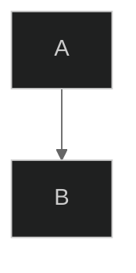

## Themes

### Built-in Themes

| Theme | Description |
|-------|-------------|
| `default` | Standard blue theme |
| `forest` | Green earth tones |
| `dark` | Dark mode friendly |
| `neutral` | Grayscale professional |
| `base` | Minimal, customization-ready |

### Theme Examples

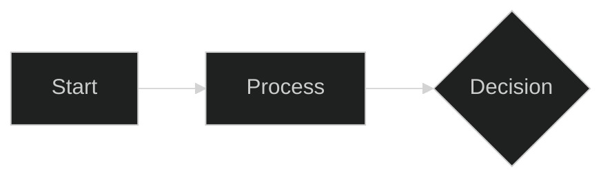

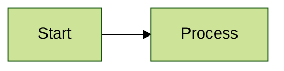

## Custom Theme Variables

Override specific colors:

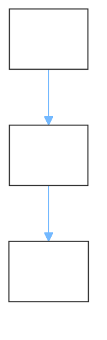

## Layout Options

### Dagre Layout (Default)

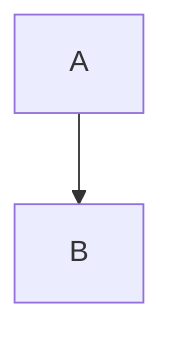

### ELK Layout (Advanced)

For complex diagrams with better automatic layout:

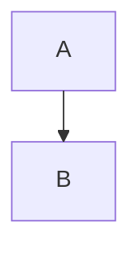

**ELK node placement strategies:**

- `SIMPLE` - Basic placement
- `NETWORK_SIMPLEX` - Network optimization
- `LINEAR_SEGMENTS` - Linear arrangement
- `BRANDES_KOEPF` - Balanced (default)

## Look Options

### Classic Look

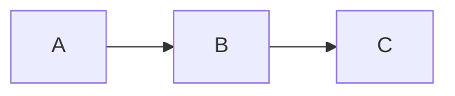

### Hand-Drawn Look

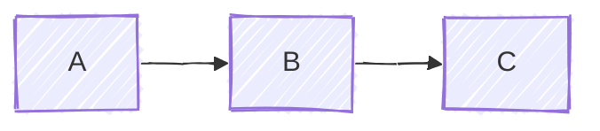

## Complete Configuration Example

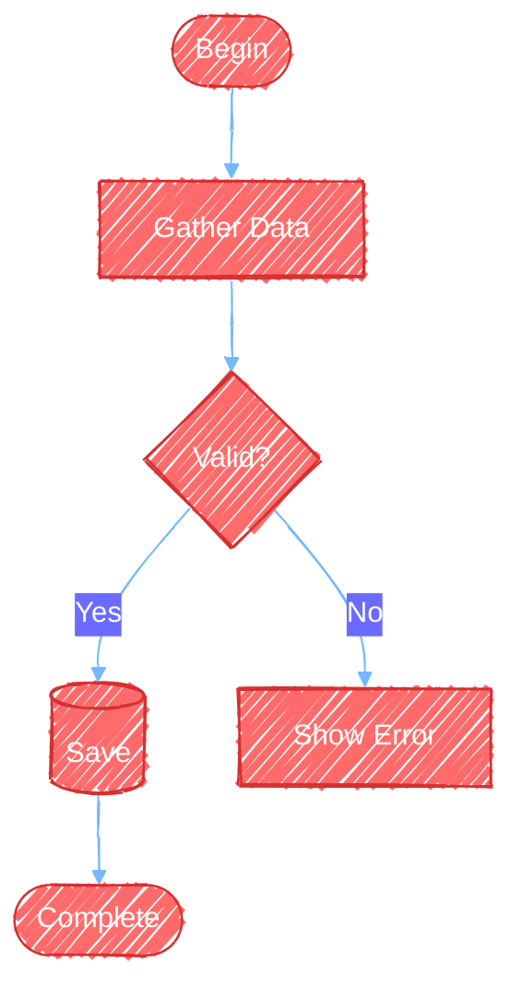

## Flowchart Styling

### Class-based Styling

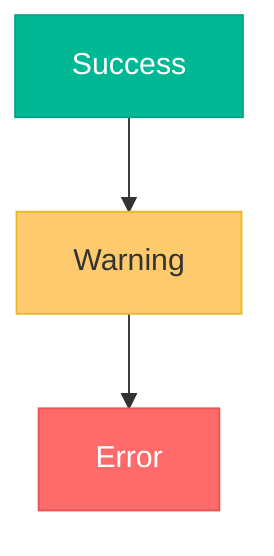

### Node-specific Styling

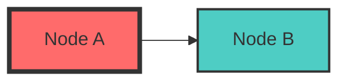

### Link Styling

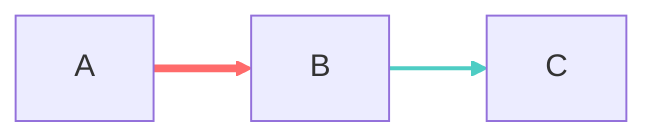

## Subgraph Styling

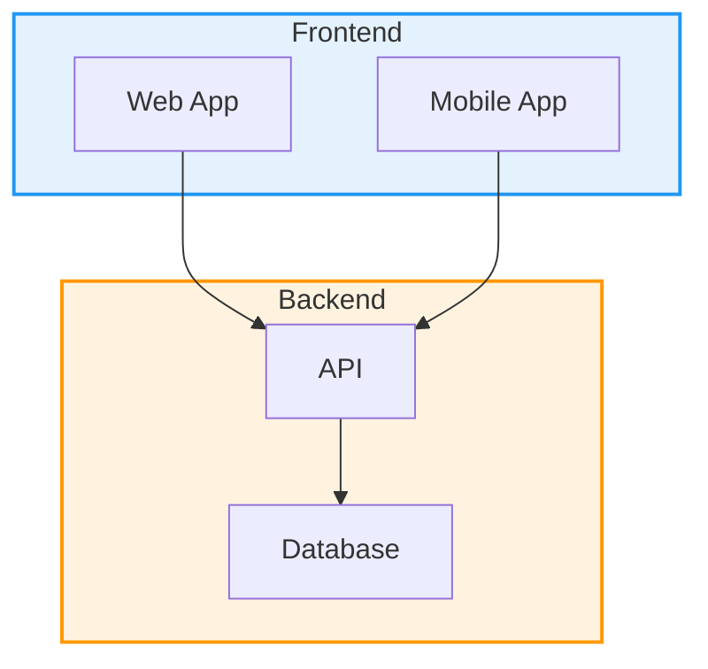

## Click Events and Links

Add interactive elements:

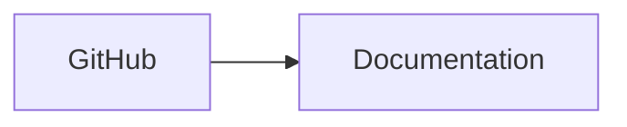

## Comments and Documentation

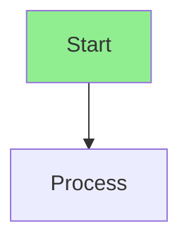

## Complex Styling Example

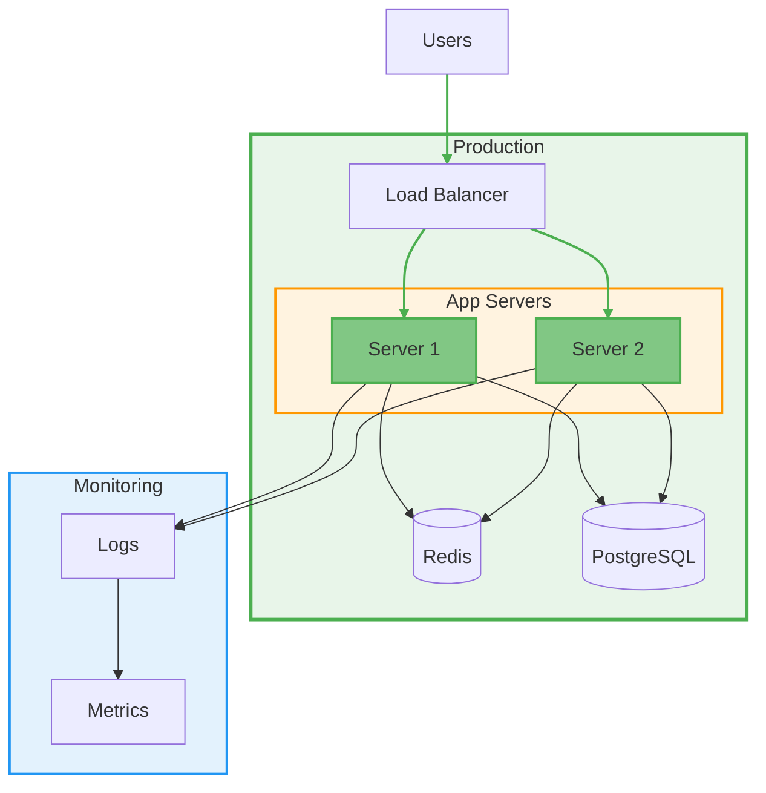

## Accessibility Tips

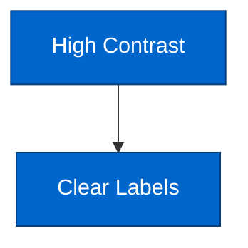

- Use high contrast color combinations
- Don't rely solely on color to convey meaning
- Include descriptive text labels
- Test with color blindness simulators

## Performance Tips

For large diagrams:

```mermaid
---
config:
  layout: elk
  elk:
    mergeEdges: true
---
flowchart TD
    %% ELK handles complex layouts better
    %% Merge edges reduces visual clutter
```

- Use ELK layout for diagrams with >20 nodes
- Enable edge merging for simplified connections
- Split very large diagrams into multiple views
- Use subgraphs to organize complexity
- Limit styling to essential elements

## Integration

### Markdown Files

````markdown
# Architecture

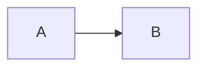
````

### HTML

```html
<script type="module">
    import mermaid from 'https://cdn.jsdelivr.net/npm/mermaid@10/dist/mermaid.esm.min.mjs';
    mermaid.initialize({
        startOnLoad: true,
        theme: 'dark'
    });
</script>

<pre class="mermaid">
    flowchart LR
        A --> B
</pre>
```

### React

```jsx
import mermaid from 'mermaid';

mermaid.initialize({
    startOnLoad: true,
    theme: 'forest'
});

function Diagram() {
    useEffect(() => {
        mermaid.contentLoaded();
    }, []);

    return (
        <div className="mermaid">
            flowchart LR
                A --> B
        </div>
    );
}
```

## Curve Types for Flowcharts

Control edge routing via frontmatter:


Options: `basis`, `bumpX`, `bumpY`, `cardinal`, `catmullRom`, `linear`, `monotoneX`, `monotoneY`, `natural`, `step`, `stepAfter`, `stepBefore`

## Diagram-Specific Theme Variables

### Sequence Diagrams

`actorBkg`, `actorBorder`, `actorTextColor`, `actorLineColor`, `signalColor`, `signalTextColor`, `labelBoxBkgColor`, `labelBoxBorderColor`, `activationBorderColor`, `activationBkgColor`, `sequenceNumberColor`

### Pie Charts

`pie1`–`pie12`, `pieTitleTextSize`, `pieTitleTextColor`, `pieSectionTextSize`, `pieStrokeColor`

### Timeline

`cScale0`–`cScale11` (section colors), `disableMulticolor` (config flag)

## Theme Gotchas

- Theme engine only accepts hex colors (e.g., `#ff0000`) — not CSS color names
- Only the `base` theme supports full `themeVariables` customization
- Derived variables are computed automatically from primary colors

## Best Practices

1. **NEVER use `\n`** — Use `<br>` in labels if multi-line text is needed
2. **Use themes consistently** — Same theme for related diagrams
3. **Don't over-style** — Too many colors reduces clarity
4. **Test hand-drawn look** — Some diagrams work better with classic
5. **Use ELK for complex layouts** — When dagre creates crossed lines
6. **Comment configurations** — Explain non-obvious styling
7. **Keep accessible** — Sufficient color contrast
8. **Test exports** — Verify rendering in target format
9. **Version control configs** — Track theme changes
