# Architecture Diagrams

Architecture diagrams (Mermaid v11.1.0+) visualize cloud infrastructure, deployment relationships, and system topology.

## Contents

- [Basic Syntax](#basic-syntax)
- [Groups](#groups)
- [Services](#services)
- [Default Icons](#default-icons)
- [Connections](#connections)
- [Junctions](#junctions)
- [Complete Example: Web Application Infrastructure](#complete-example-web-application-infrastructure)
- [Microservices Architecture](#microservices-architecture)
- [Multi-Region Deployment](#multi-region-deployment)
- [CI/CD Pipeline Infrastructure](#ci-cd-pipeline-infrastructure)
- [Data Pipeline](#data-pipeline)
- [Best Practices](#best-practices)

## Basic Syntax

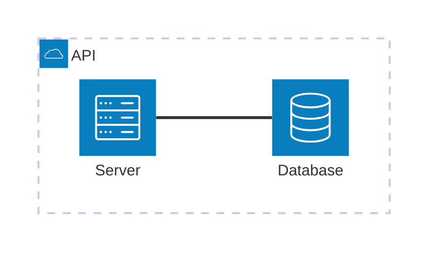

## Groups

Groups organize related services (like VPCs, regions, or logical groupings):

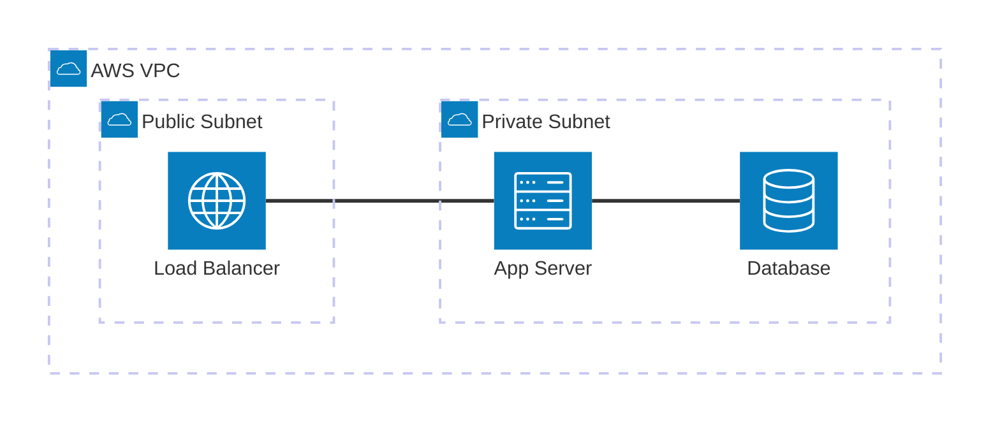

## Services

Services represent individual nodes:

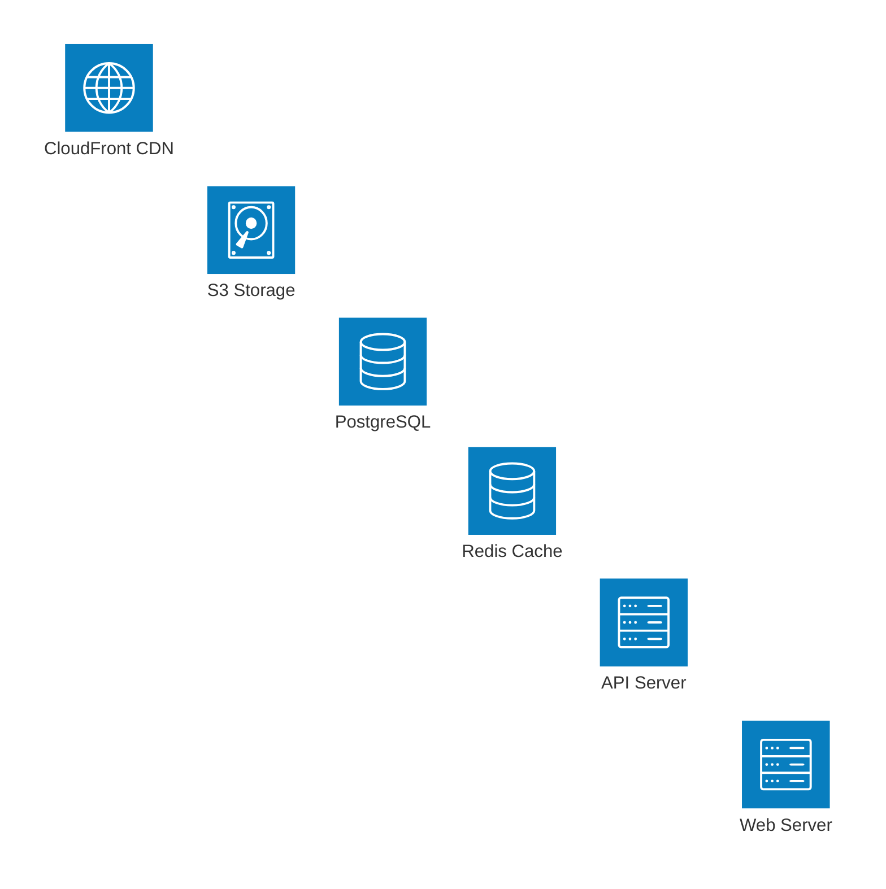

## Default Icons

Built-in icons:

- `cloud` - Cloud/group boundary
- `database` - Database systems
- `disk` - Storage
- `internet` - External/internet-facing
- `server` - Application servers

## Connections

### Basic Connection

### Directional Arrows

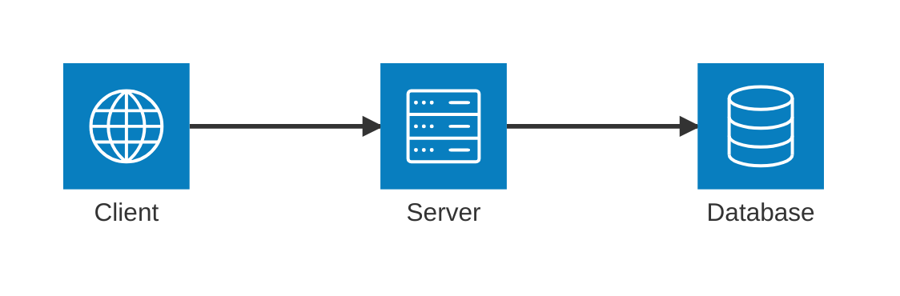

### Connection Points

Use compass directions: `T` (Top), `B` (Bottom), `L` (Left), `R` (Right)

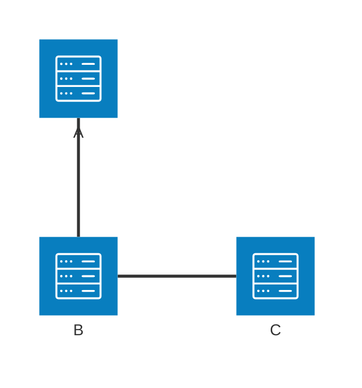

## Junctions

Junctions enable branching patterns (load balancing, fan-out):

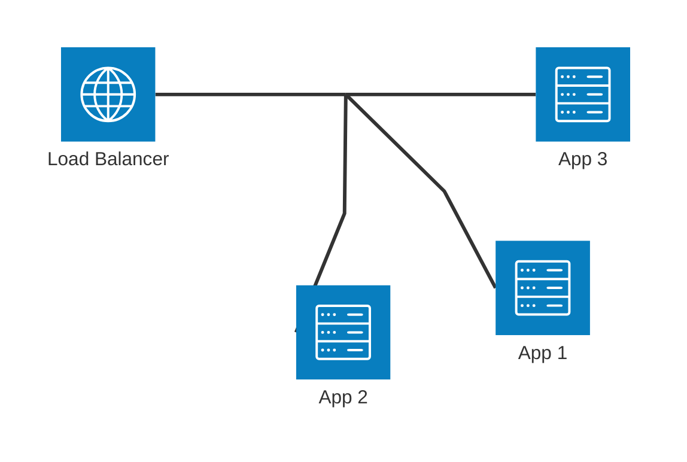

## Complete Example: Web Application Infrastructure

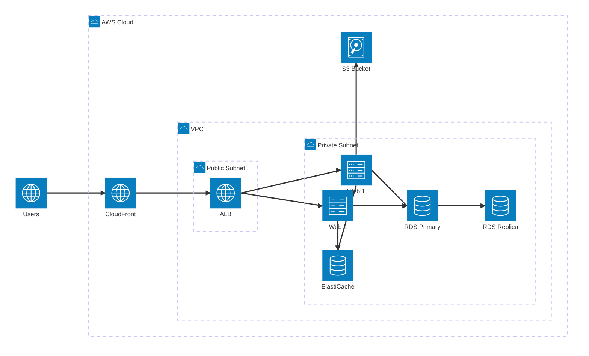

## Microservices Architecture

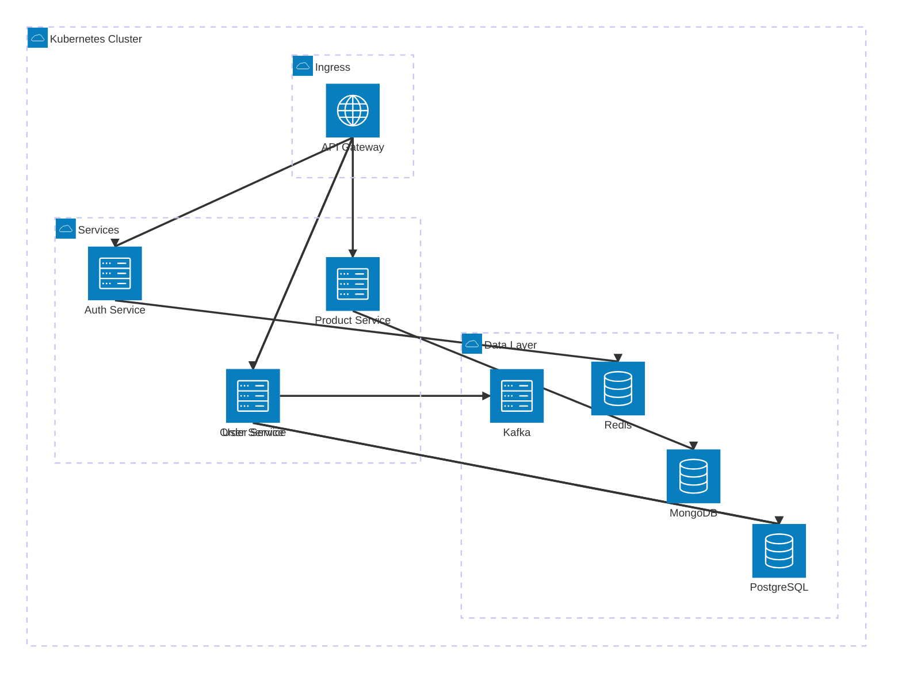

## Multi-Region Deployment

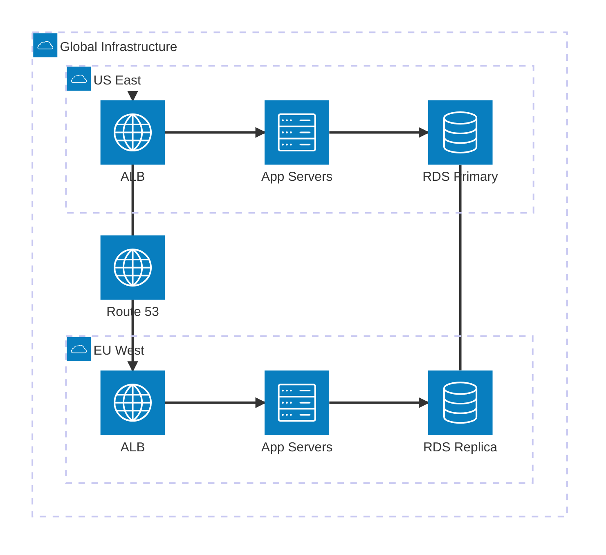

## CI CD Pipeline Infrastructure

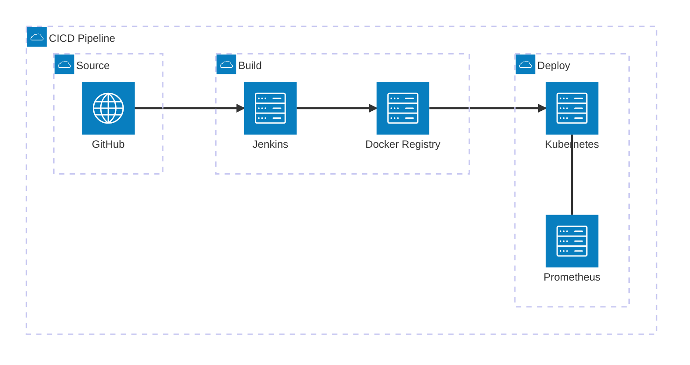

## Data Pipeline

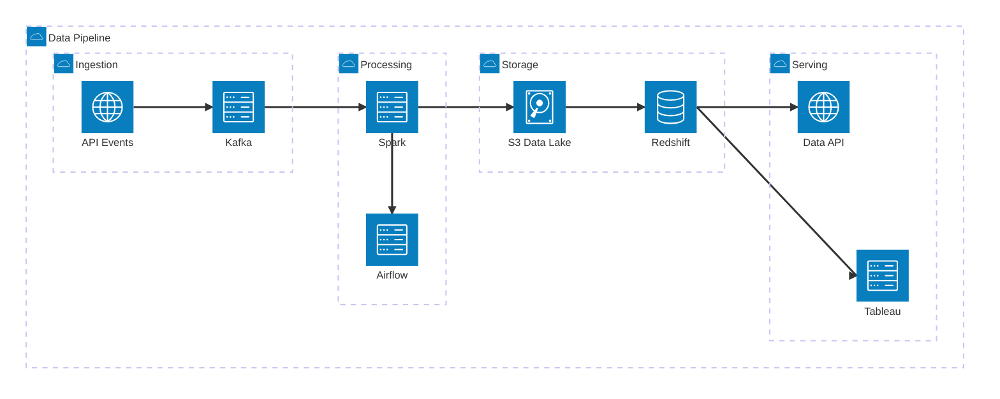

## Bidirectional Connections

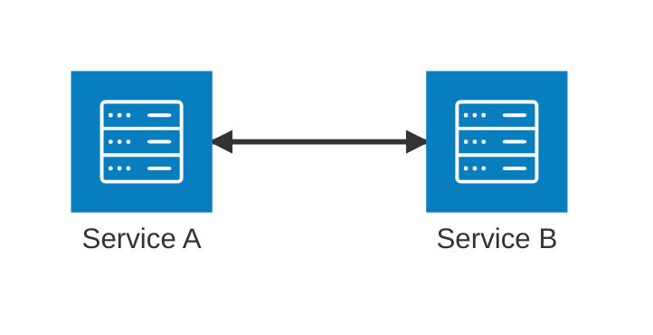

## External Icons

Icons from iconify.design (200k+ icons) can be registered and used:

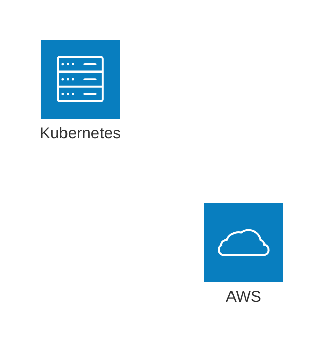

Built-in icons: `cloud`, `database`, `disk`, `internet`, `server`

## Best Practices

1. **NEVER use `\n`** — Use ` ` in labels if multi-line text is needed
2. **Group by logical boundary** — VPCs, subnets, services
3. **Use consistent icons** — Same icon types for same service categories
4. **Show data flow direction** — Use arrows to indicate request/response flow
5. **Include external services** — Show internet-facing components
6. **Label clearly** — Meaningful names for all services
7. **Use junctions for fan-out** — Load balancers, message distribution
8. **Layer your groups** — Nest groups to show hierarchy
9. **Keep it focused** — One architectural view per diagram
10. **Split complex diagrams** — Multiple focused diagrams over one cluttered diagram
