# Class Diagrams

Class diagrams visualize object-oriented systems, showing entities, their properties, methods, and relationships.

## Contents

- [Basic Syntax](#basic-syntax)
- [Visibility Modifiers](#visibility-modifiers)
- [Relationships](#relationships)
- [Multiplicity](#multiplicity)
- [Annotations](#annotations)
- [Complete Example: E-Commerce Domain](#complete-example-e-commerce-domain)
- [Design Patterns](#design-patterns)
- [Best Practices](#best-practices)

## Basic Syntax

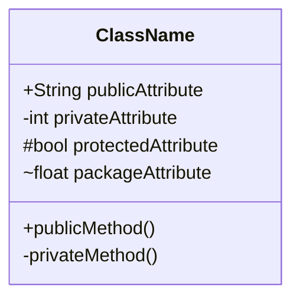

## Visibility Modifiers

| Symbol | Visibility |
|--------|------------|
| `+` | Public |
| `-` | Private |
| `#` | Protected |
| `~` | Package/Internal |

## Relationships

### Association (loose connection)

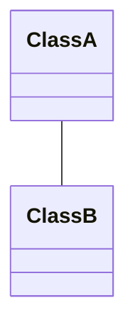

### Composition (strong ownership - child cannot exist without parent)

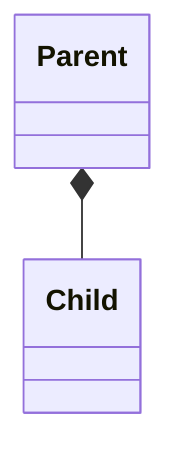

### Aggregation (weak ownership - child can exist independently)

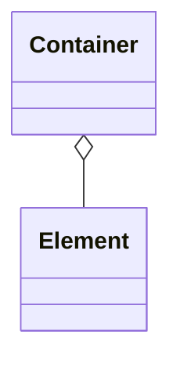

### Inheritance

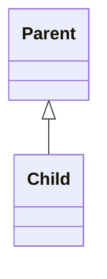

### Dependency

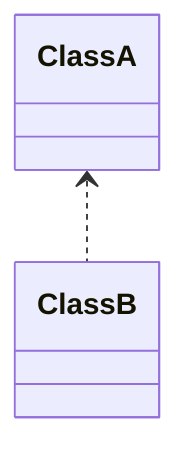

### Implementation (interface)

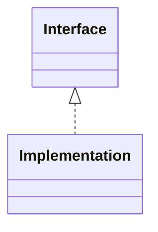

## Multiplicity

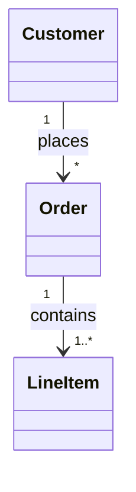

| Notation | Meaning |
|----------|---------|
| `1` | Exactly one |
| `0..1` | Zero or one |
| `*` | Many (zero or more) |
| `1..*` | One or more |
| `n..m` | Range from n to m |

## Annotations

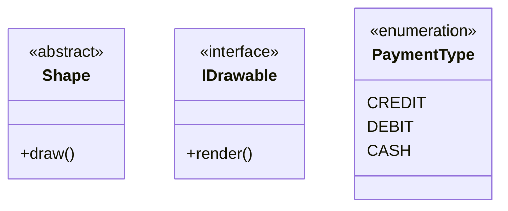

## Complete Example: E-Commerce Domain

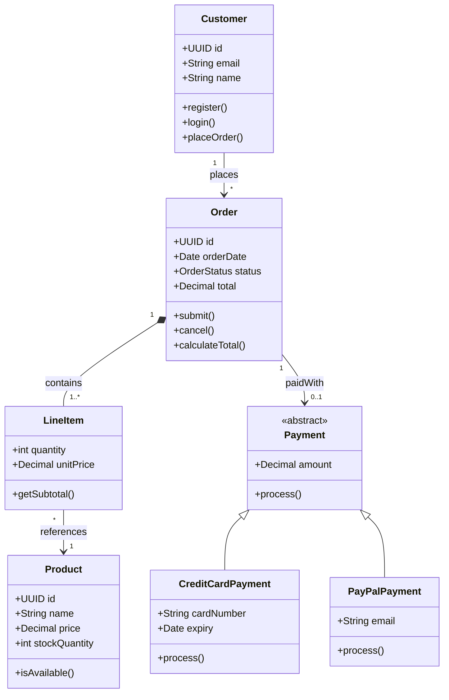

## Design Patterns

### Repository Pattern

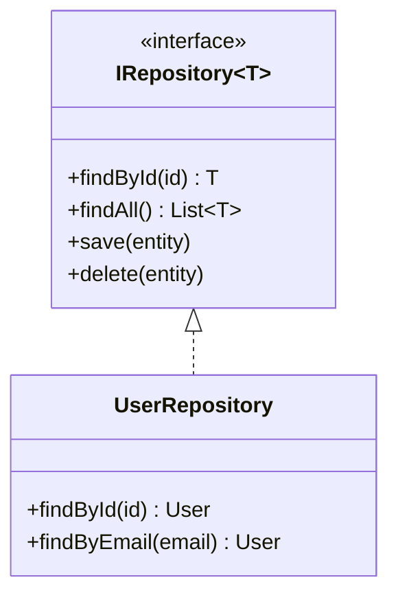

### Factory Pattern

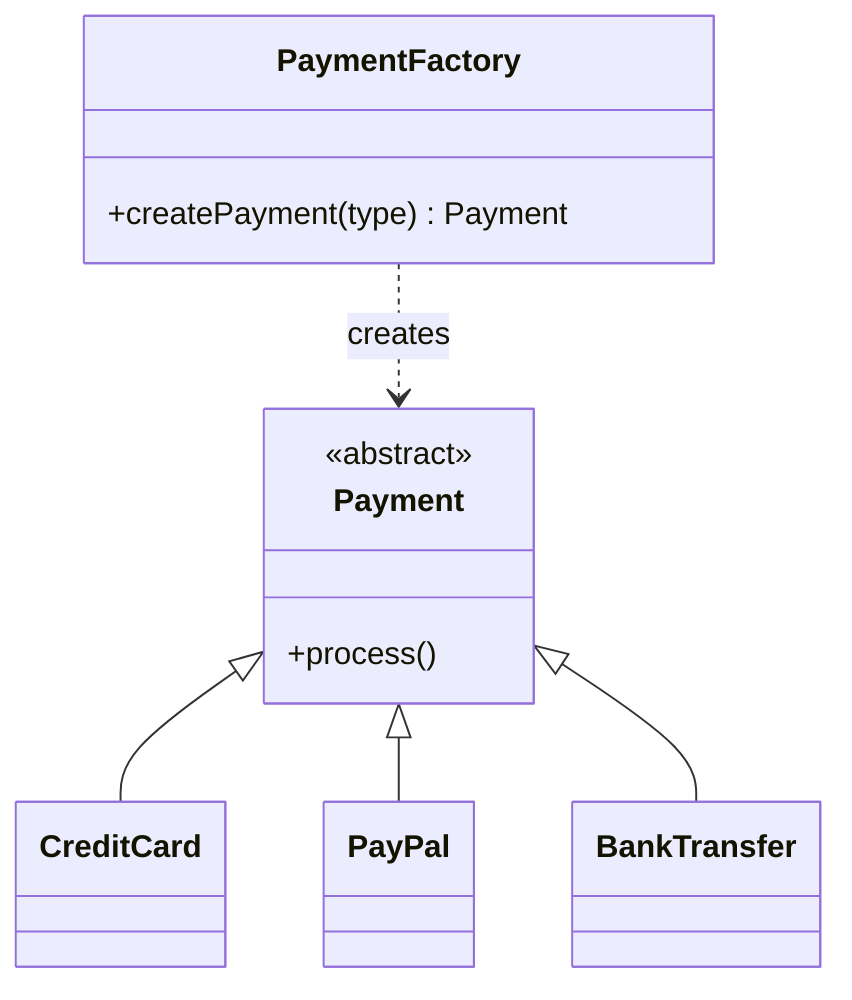

### Strategy Pattern

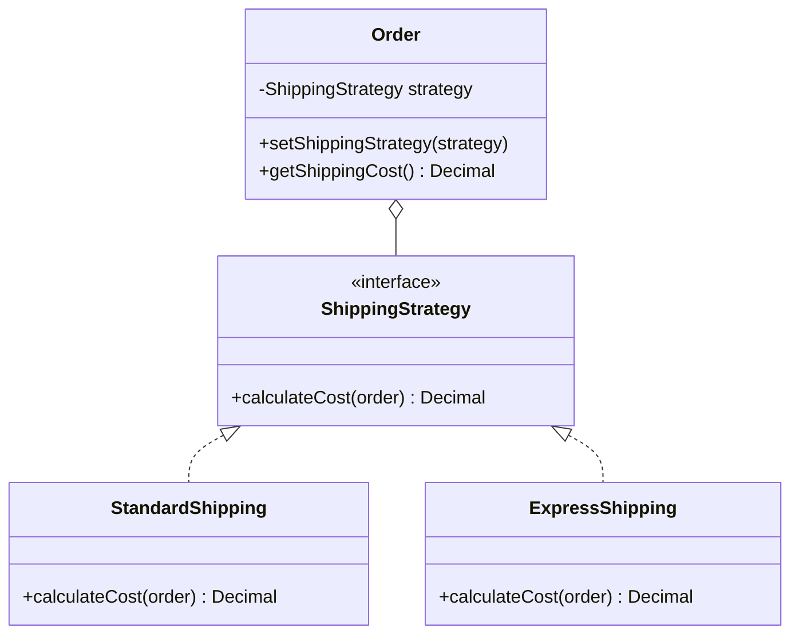

## Namespaces

Group related classes:

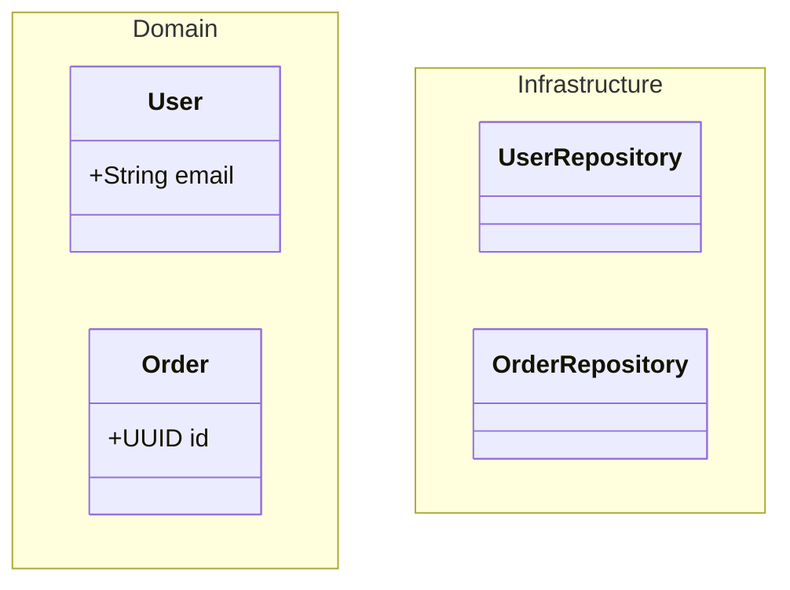

## Notes

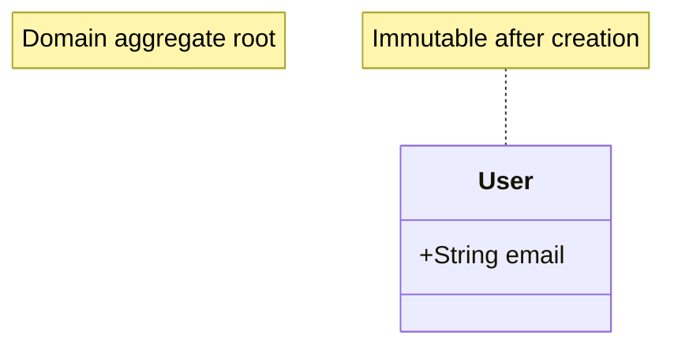

## Lollipop Interface

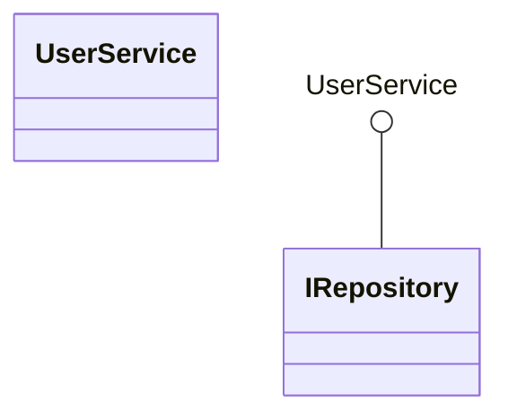

## Direction

Control layout direction:

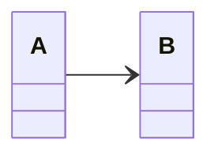

Directions: `TB` (top-bottom, default), `BT`, `LR`, `RL`

## Styling

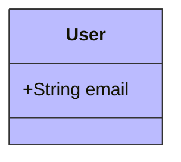

## Best Practices

1. **NEVER use `\n`** — Use ` ` in labels if multi-line text is needed
2. **Focus on core entities** — Omit trivial details
3. **Choose appropriate relationships** — Use composition vs aggregation correctly
4. **Show multiplicity** — Document cardinality explicitly
5. **Use annotations** — Mark interfaces, abstracts, enums
6. **Use namespaces** — Group related classes logically
7. **Document business rules** — Add notes for important constraints
