# Entity Relationship Diagrams (ERD)

ERDs model database schemas, showing tables (entities), their columns (attributes), and relationships between tables. Essential for database design and documentation.

## Contents

- [Basic Syntax](#basic-syntax)
- [Entity Attributes](#entity-attributes)
- [Relationships](#relationships)
- [Data Types](#data-types)
- [Complete Example: E-Commerce Database](#complete-example-e-commerce-database)
- [Blog Platform Schema](#blog-platform-schema)
- [Common Patterns](#common-patterns)
- [Best Practices](#best-practices)

## Basic Syntax

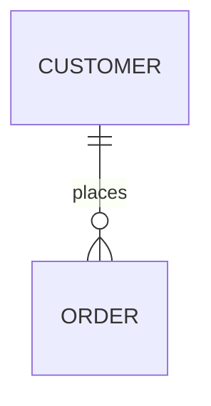

## Entity Attributes

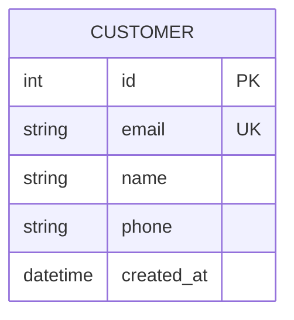

**Attribute format:** `type name constraints`

**Common constraints:**

- `PK` - Primary Key
- `FK` - Foreign Key
- `UK` - Unique Key
- `NN` - Not Null

## Relationships

### Cardinality Symbols

| Symbol | Meaning |
|--------|---------|
| `\|\|` | Exactly one |
| `\|o` | Zero or one |
| `}|` | One or many |
| `}o` | Zero or many |

### Relationship Lines

- `--` Standard relationship
- `..` Identifying relationship

### Common Patterns

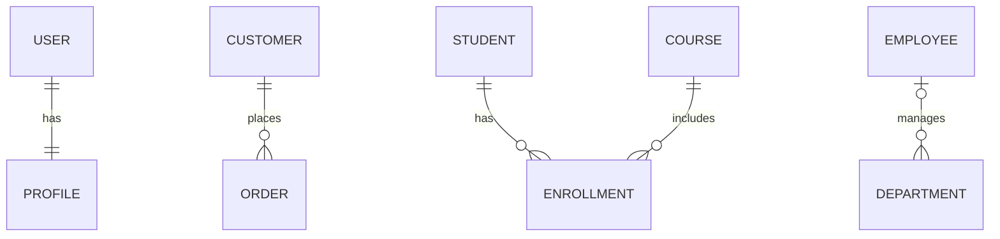

## Data Types

Common database types to use:

- `int`, `bigint`, `smallint`
- `varchar`, `text`, `char`
- `decimal`, `float`, `double`
- `boolean`, `bool`
- `date`, `datetime`, `timestamp`
- `json`, `jsonb`
- `uuid`
- `blob`, `bytea`

## Complete Example: E-Commerce Database

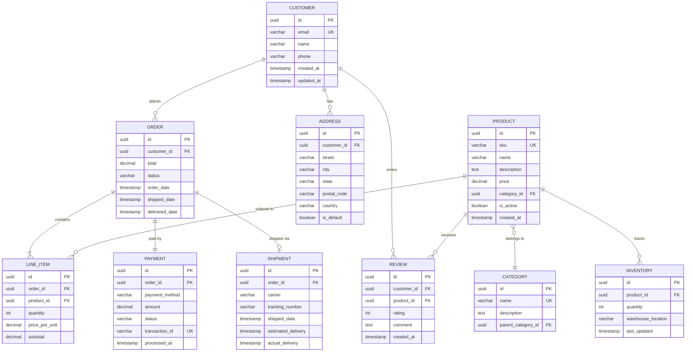

## Blog Platform Schema

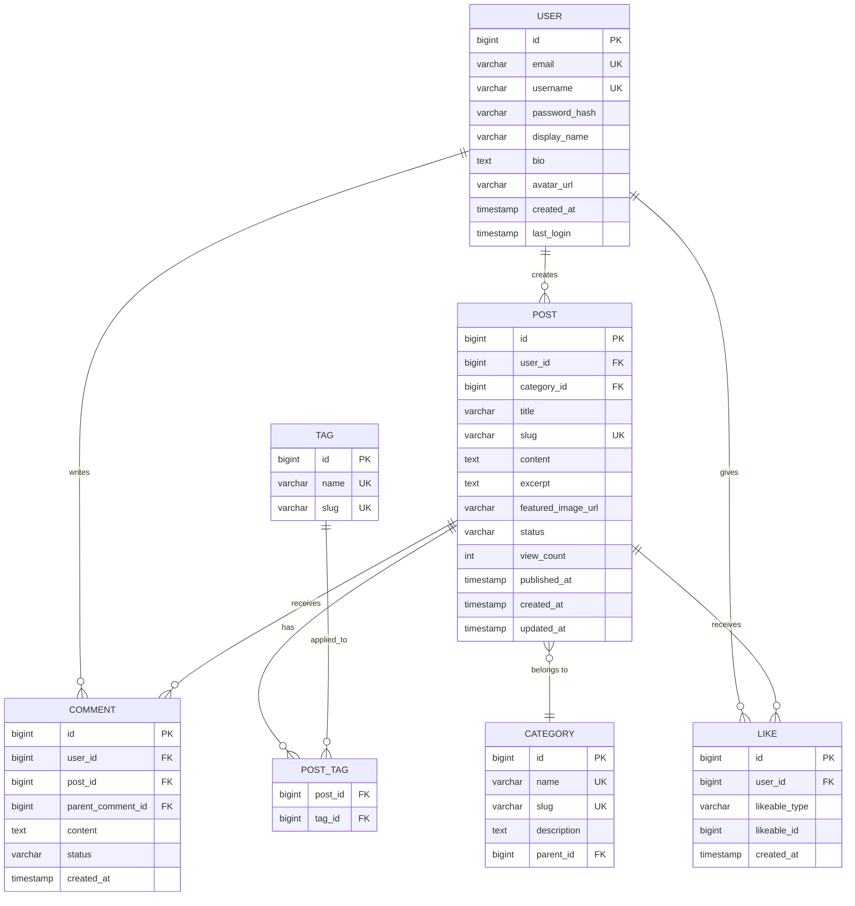

## Common Patterns

### Self-Referencing (Hierarchical)

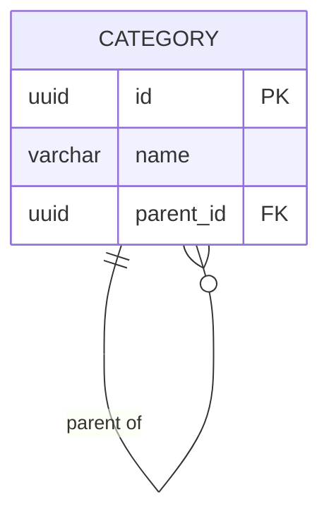

### Junction Table (Many-to-Many)

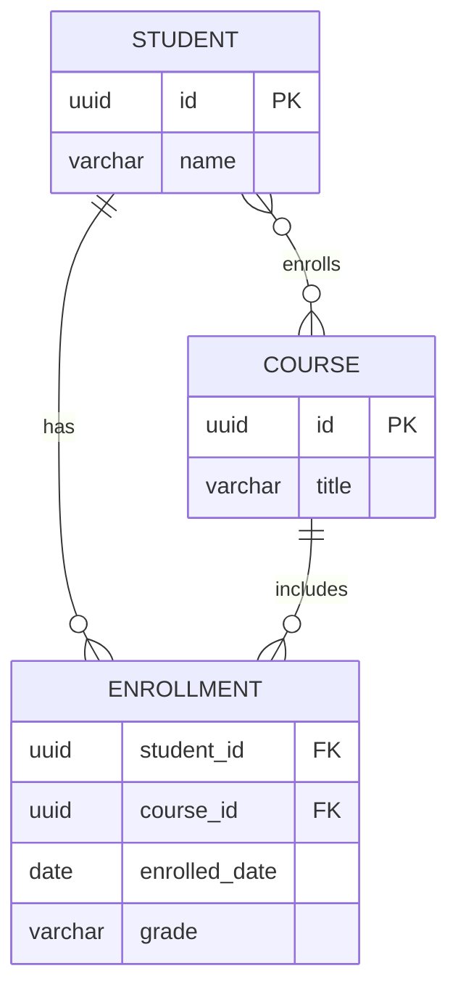

### Polymorphic Relationship

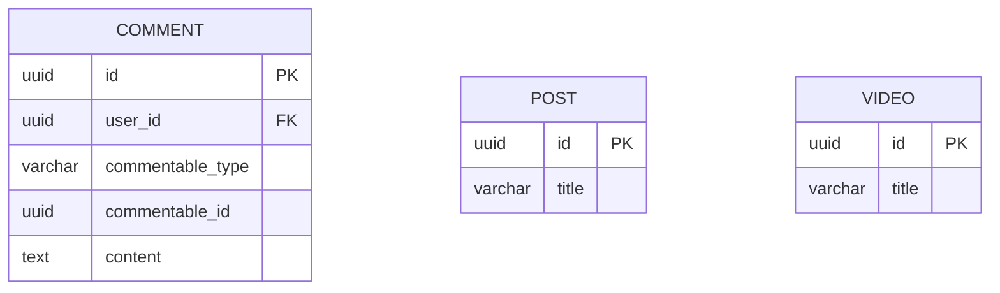

### Soft Deletes

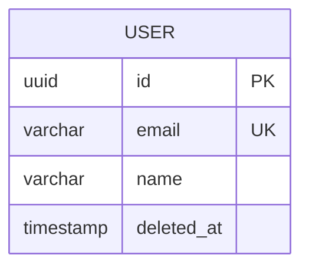

### Audit Trail

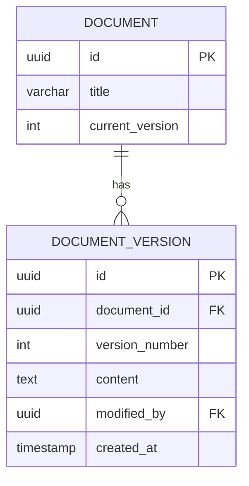

## Direction

Control layout direction:

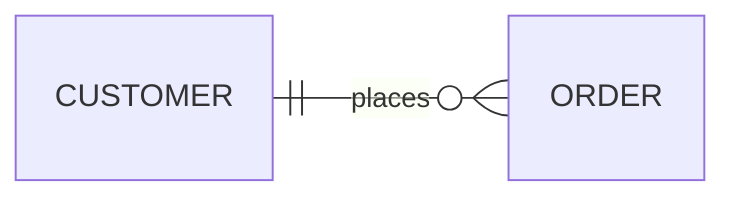

Directions: `TB` (default), `BT`, `LR`, `RL`

## Entity Aliases

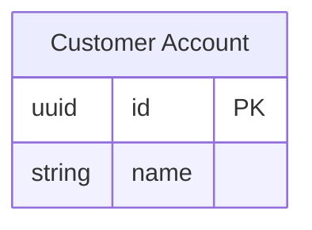

## Layout

For complex ERDs, use ELK layout via YAML frontmatter:

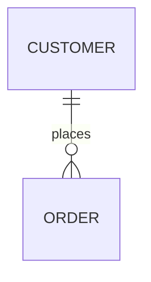

## Best Practices

1. **NEVER use `\n`** — Use ` ` in labels if multi-line text is needed
2. **UPPERCASE entity names** — Standard convention
3. **Singular names** — `USER` not `USERS`
4. **Define all constraints** — PKs, FKs, UKs, NOT NULL
5. **Show cardinality accurately** — Be precise about relationships
6. **Include timestamps** — `created_at`, `updated_at` for auditing
7. **Document computed columns** — Mark derived values
8. **Consider junction tables** — Explicitly model many-to-many
9. **Use appropriate types** — Match database-specific types
10. **Plan for soft deletes** — Add `deleted_at` columns
11. **Version critical data** — Maintain history for important entities
