# Flowcharts

Flowcharts visualize processes, algorithms, decision trees, and user journeys. They show step-by-step progression through a system or workflow.

## Contents

- [Basic Syntax](#basic-syntax)
- [Node Shapes](#node-shapes)
- [Connections](#connections)
- [Subgraphs](#subgraphs)
- [Styling](#styling)
- [Complete Example: User Registration Flow](#complete-example-user-registration-flow)
- [Algorithm Example: Binary Search](#algorithm-example-binary-search)
- [CI/CD Pipeline](#cicd-pipeline)
- [E-Commerce Checkout](#e-commerce-checkout)
- [Common Patterns](#common-patterns)
- [Best Practices](#best-practices)

## Basic Syntax

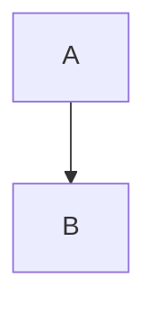

**Directions:**

- `TD` or `TB` - Top to Bottom (default)
- `BT` - Bottom to Top
- `LR` - Left to Right
- `RL` - Right to Left

## Node Shapes

### Standard Shapes

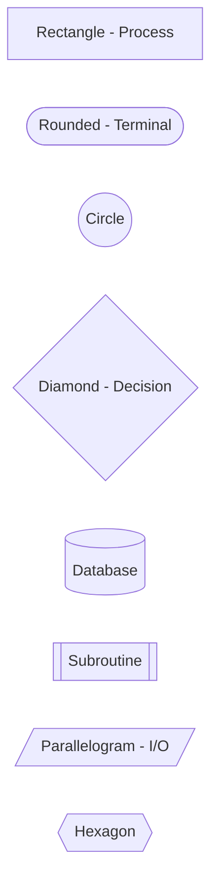

| Shape | Syntax | Use Case |
|-------|--------|----------|
| Rectangle | `[text]` | Process steps |
| Rounded | `([text])` | Start/End terminals |
| Diamond | `{text}` | Decisions |
| Circle | `((text))` | Connectors |
| Cylinder | `[(text)]` | Database |
| Subroutine | `[[text]]` | Predefined process |
| Parallelogram | `[/text/]` | Input/Output |
| Hexagon | `{{text}}` | Preparation |
| Asymmetric | `>text]` | Flags, signals |
| Double circle | `(((text)))` | End events |

### Extended Shapes (v11.3.0+)

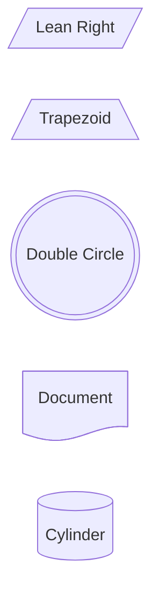

Available extended shapes: `lean-l`, `lean-r`, `trap-t`, `trap-b`, `dbl-circ`, `doc`, `lin-doc`, `docs`, `cyl`, `h-cyl`, `lin-cyl`, `rect`, `lin-rect`, `div-rect`, `st-rect`, `bow-rect`

## Connections

### Basic Arrow

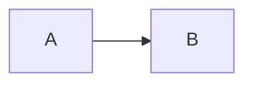

### With Labels

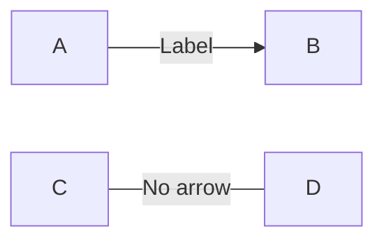

### Dotted Lines

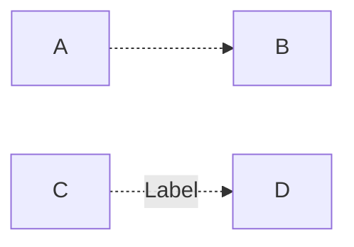

### Thick Lines

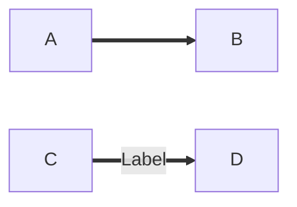

### Invisible Links

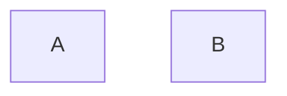

Useful for layout control without visible connections.

### Special End Markers

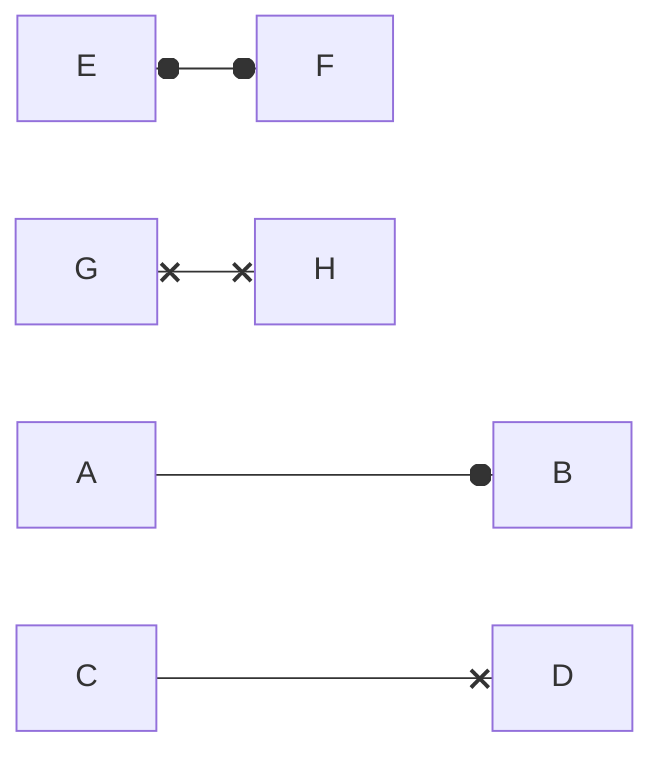

- `o` — circle end
- `x` — cross end

### Chaining

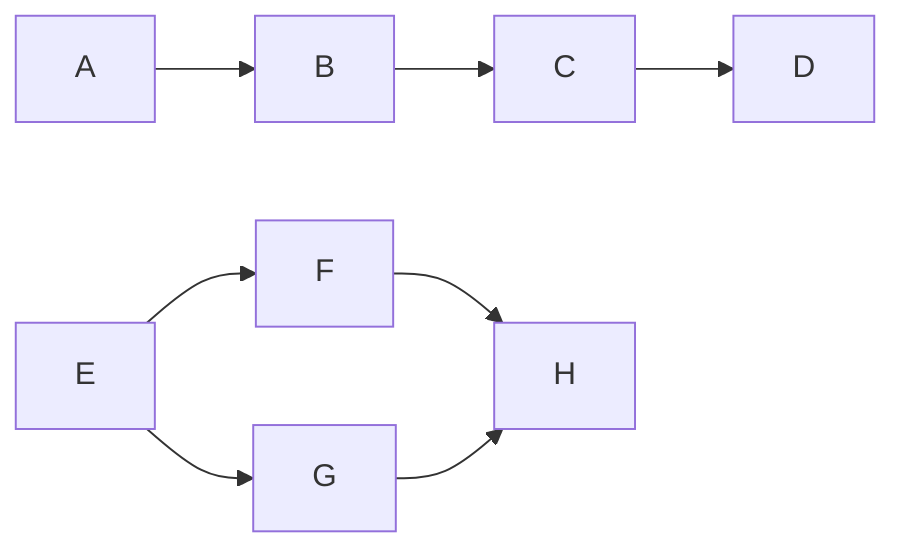

### Edge Animations (v11.0+)

```mermaid
flowchart LR
    A --> B
    e1@-->A-->B
    e1@{ animate: true }
```

## Subgraphs

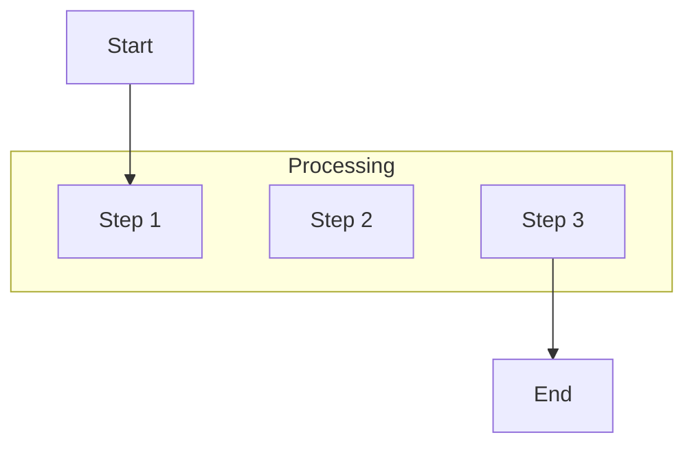

### Nested Subgraphs

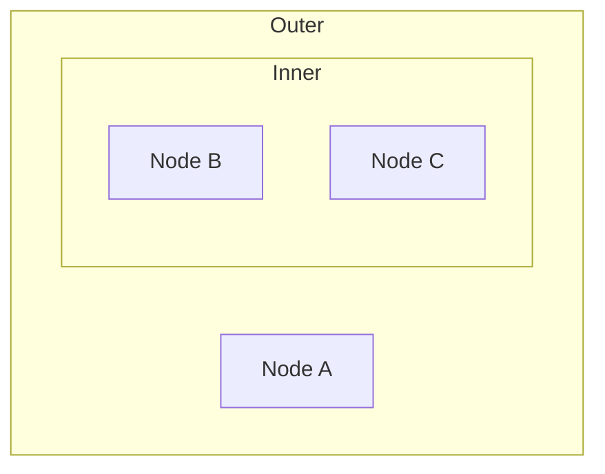

### Subgraph Direction

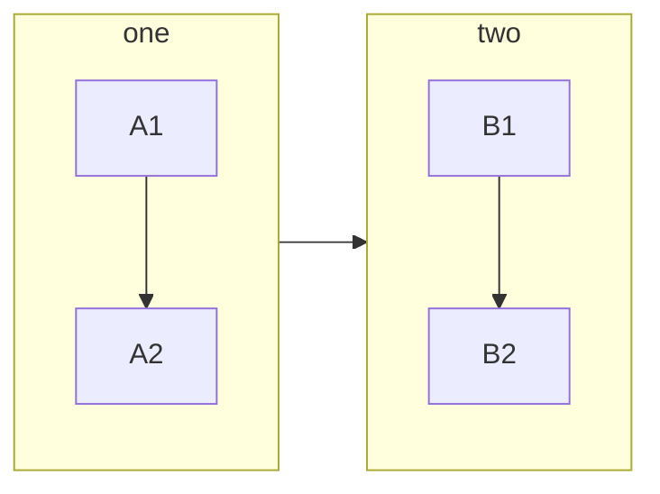

## Styling

### Individual Nodes

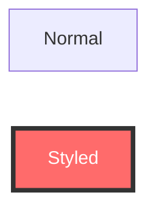

### Class-based

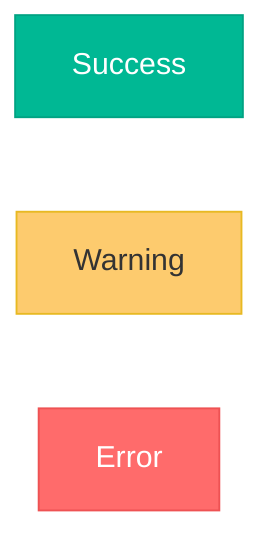

### Link Styling

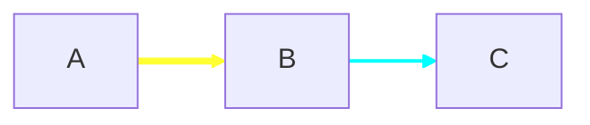

## Complete Example: User Registration Flow

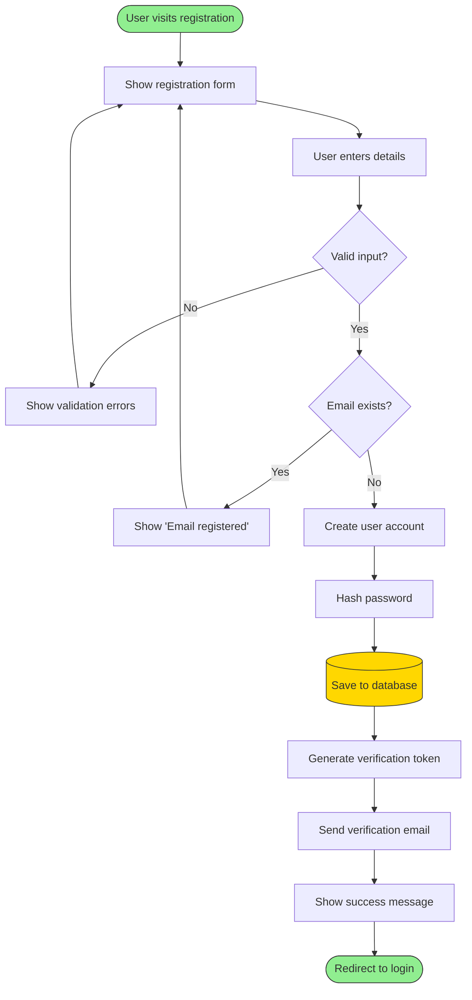

## Algorithm Example: Binary Search

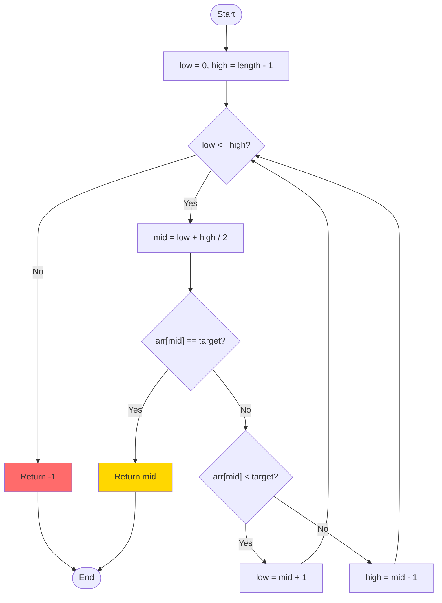

## CI/CD Pipeline

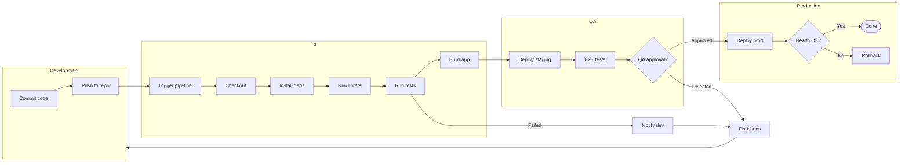

## E-Commerce Checkout

```mermaid
flowchart TD
    Start([Checkout]) --> Auth{Authenticated?}

    Auth -->|No| Login[Redirect to login]
    Login --> Auth

    Auth -->|Yes| Cart{Cart empty?}
    Cart -->|Yes| EmptyCart[Show empty message]
    EmptyCart --> Browse[Browse products]

    Cart -->|No| Address[Shipping address]
    Address --> ValidateAddr{Valid?}
    ValidateAddr -->|No| Address
    ValidateAddr -->|Yes| Shipping[Select shipping]

    Shipping --> Payment[Payment details]
    Payment --> ValidatePay{Valid?}
    ValidatePay -->|No| Payment

    ValidatePay -->|Yes| Review[Order review]
    Review --> Confirm{Confirm?}

    Confirm -->|No| Edit{Edit what?}
    Edit -->|Address| Address
    Edit -->|Shipping| Shipping
    Edit -->|Payment| Payment

    Confirm -->|Yes| ProcessPay[Process payment]
    ProcessPay --> PayResult{Success?}

    PayResult -->|No| PayError[Payment error]
    PayError --> RetryPay{Retry?}
    RetryPay -->|Yes| Payment
    RetryPay -->|No| Cancel([Cancelled])

    PayResult -->|Yes| CreateOrder[(Create order)]
    CreateOrder --> ReduceStock[Update inventory]
    ReduceStock --> SendConfirm[Send confirmation]
    SendConfirm --> Success([Order complete])

    style Success fill:#90EE90
    style Cancel fill:#FF6B6B
```

## Common Patterns

### Linear Flow

```mermaid
flowchart LR
    A[Step 1] --> B[Step 2] --> C[Step 3]
```

### Branching Decision

```mermaid
flowchart TD
    A[Input] --> B{Condition?}
    B -->|Yes| C[Path 1]
    B -->|No| D[Path 2]
    C --> E[Merge]
    D --> E
```

### Loop

```mermaid
flowchart TD
    A[Initialize] --> B[Process]
    B --> C{Continue?}
    C -->|Yes| B
    C -->|No| D[Exit]
```

### Error Handling

```mermaid
flowchart TD
    A[Try] --> B{Success?}
    B -->|Yes| C[Continue]
    B -->|No| D[Handle error]
    D --> E{Retry?}
    E -->|Yes| A
    E -->|No| F[Abort]
```

## Best Practices

1. **NEVER use `\n`** — Use `<br>` in labels if multi-line text is needed
2. **Use meaningful labels** — Action-oriented node text
3. **Consistent shapes** — Same shapes for same action types
4. **Diamonds for decisions** — Standard yes/no convention
5. **Natural flow direction** — Top-to-bottom or left-to-right
6. **Mark terminals** — Stadium shapes for start/end
7. **Group related steps** — Use subgraphs logically
8. **Color code** — Highlight different action types
9. **Minimize crossing lines** — Reorganize for clarity
10. **Keep focused** — One process per diagram
