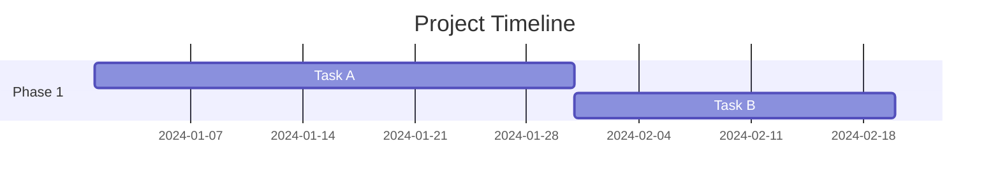
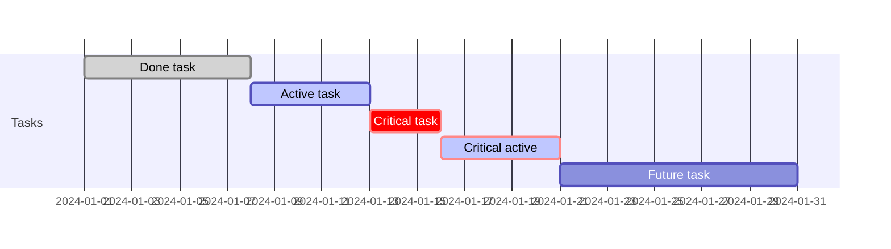
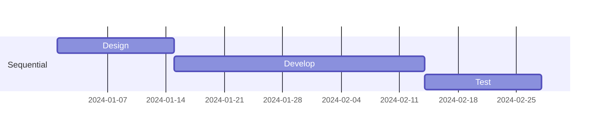
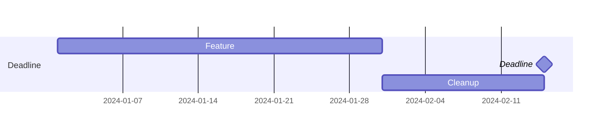
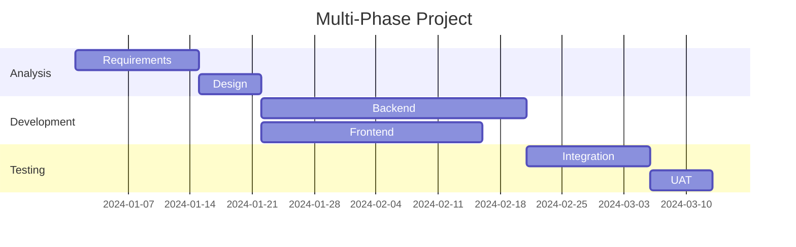
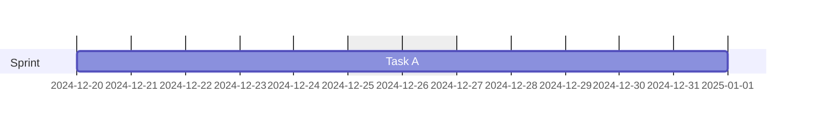
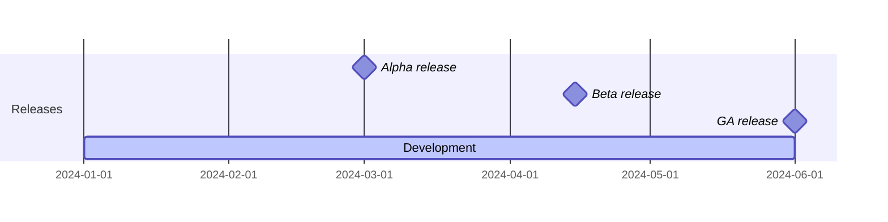
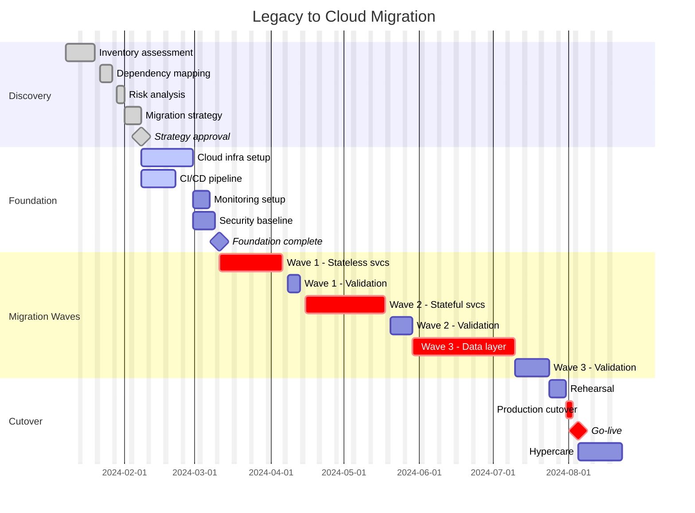
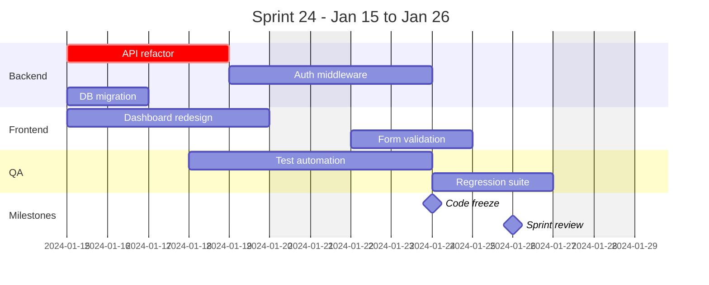

# Gantt Charts

Gantt charts visualize project timelines, task dependencies, and schedules. Ideal for migration planning, release schedules, and sprint planning.

> **NEVER use literal `\n`** — use `<br>` for multi-line labels.

## Contents

- [Basic Syntax](#basic-syntax)
- [Date Formats](#date-formats)
- [Task Syntax](#task-syntax)
- [Task Tags](#task-tags)
- [Dependencies](#dependencies)
- [Sections](#sections)
- [Axis Configuration](#axis-configuration)
- [Exclusions](#exclusions)
- [Milestones](#milestones)
- [Complete Example: Migration Plan](#complete-example-migration-plan)
- [Sprint Planning Example](#sprint-planning-example)
- [Best Practices](#best-practices)

## Basic Syntax



## Date Formats

```mermaid
gantt
    dateFormat YYYY-MM-DD
```

Supported formats: `YYYY-MM-DD`, `DD-MM-YYYY`, `YYYY-MM-DDTHH:mm:ss` and other moment.js formats.

## Task Syntax

```text
Task name :taskId, startDate, duration
Task name :taskId, startDate, endDate
Task name :taskId, after otherId, duration
```

### Duration Units

- `ms` — milliseconds
- `s` — seconds
- `m` — minutes
- `h` — hours
- `d` — days
- `w` — weeks
- `M` — months
- `y` — years

## Task Tags

Tags must come first, before the task ID:



| Tag | Effect |
|-----|--------|
| `done` | Grayed out, completed |
| `active` | Highlighted as in-progress |
| `crit` | Red/critical path styling |
| `milestone` | Diamond marker, zero duration |

## Dependencies

### After (starts when dependency ends)



### Until (v10.9.0+) — task must finish by a deadline



## Sections



## Axis Configuration

```mermaid
gantt
    title Timeline
    dateFormat YYYY-MM-DD
    axisFormat %Y-%m-%d
    tickInterval 1week
```

Axis format tokens: `%Y` (year), `%m` (month), `%d` (day), `%H` (hour), `%M` (minute)

Tick intervals: `1day`, `1week`, `1month`, `1year` (or multiples like `2week`)

## Exclusions



- `weekends` — excludes Saturday and Sunday
- Specific dates — comma-separated
- `weekend friday` — changes weekend to Friday/Saturday

## Milestones



## Complete Example: Migration Plan



## Sprint Planning Example



## Best Practices

1. **NEVER use `\n`** — Use `<br>` in labels if multi-line text is needed
2. **Use task IDs** — Enable dependencies with `after`
3. **Mark critical path** — Use `crit` tag for blocking tasks
4. **Use milestones** — Mark key decision points and deadlines
5. **Exclude non-work days** — `excludes weekends` for realistic timelines
6. **Group with sections** — Organize by phase, team, or workstream
7. **Show dependencies** — Use `after` to chain sequential tasks
8. **Keep readable** — Limit to ~30 tasks per chart; split larger plans
