# State Diagrams

State diagrams model state machines, lifecycle transitions, and workflow states. Use `stateDiagram-v2` for the modern syntax.

> **NEVER use literal `\n`** — use ` ` for multi-line labels.

## Contents

- [Basic Syntax](#basic-syntax)
- [States](#states)
- [Transitions](#transitions)
- [Start and End](#start-and-end)
- [Composite States](#composite-states)
- [Fork and Join](#fork-and-join)
- [Choice](#choice)
- [Concurrency](#concurrency)
- [Notes](#notes)
- [Direction](#direction)
- [Complete Example: Order Lifecycle](#complete-example-order-lifecycle)
- [Authentication Flow](#authentication-flow)
- [Best Practices](#best-practices)

## Basic Syntax

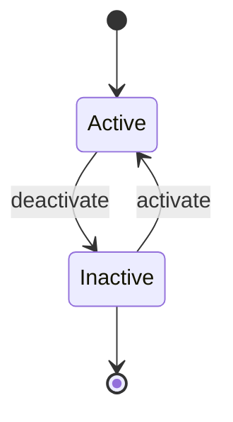

## States

### Simple State

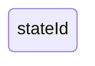

### Named State

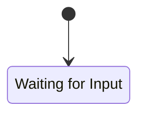

### State with Description

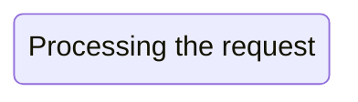

## Transitions

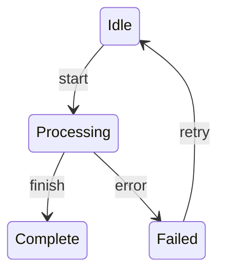

## Start and End

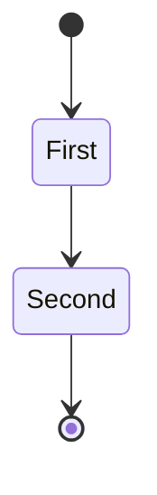

- `[*]` at the start = initial state
- `[*]` at the end = final state

## Composite States

Nested states within a parent:

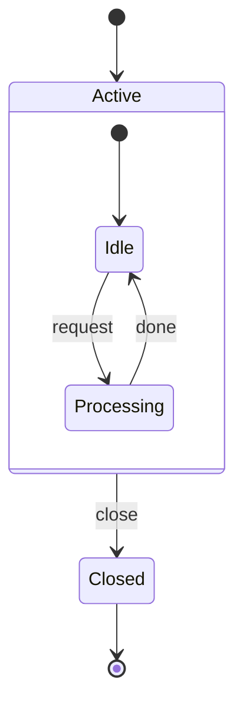

### Deeply Nested

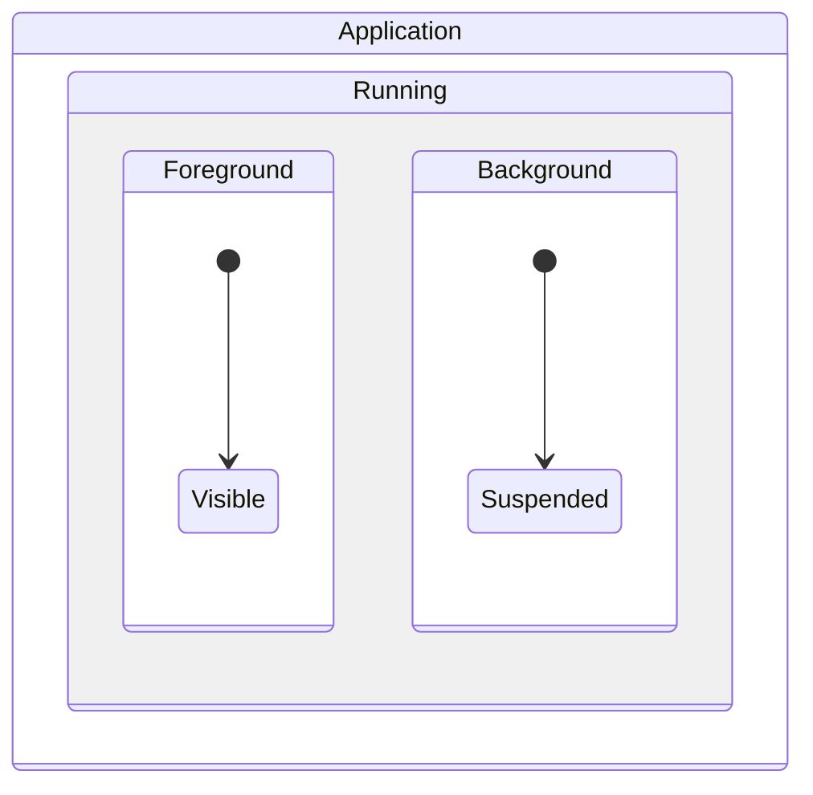

## Fork and Join

Parallel execution paths:

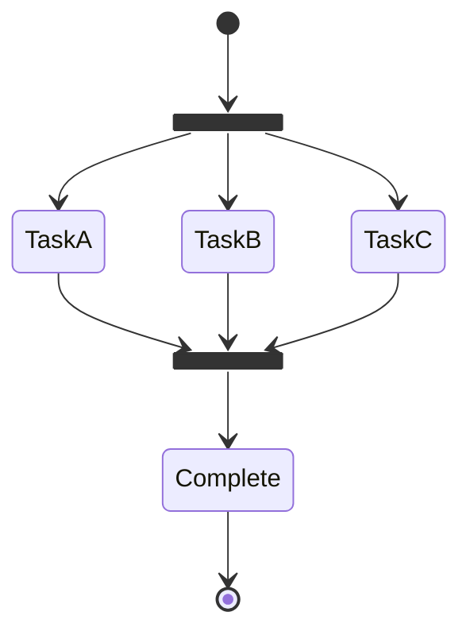

## Choice

Conditional branching:

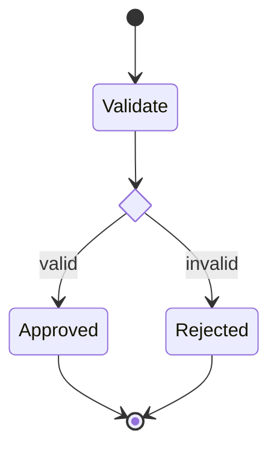

## Concurrency

Parallel regions within a state (separated by `--`):

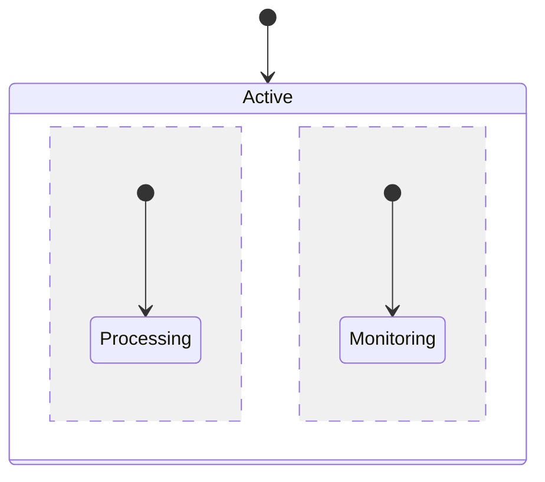

## Notes

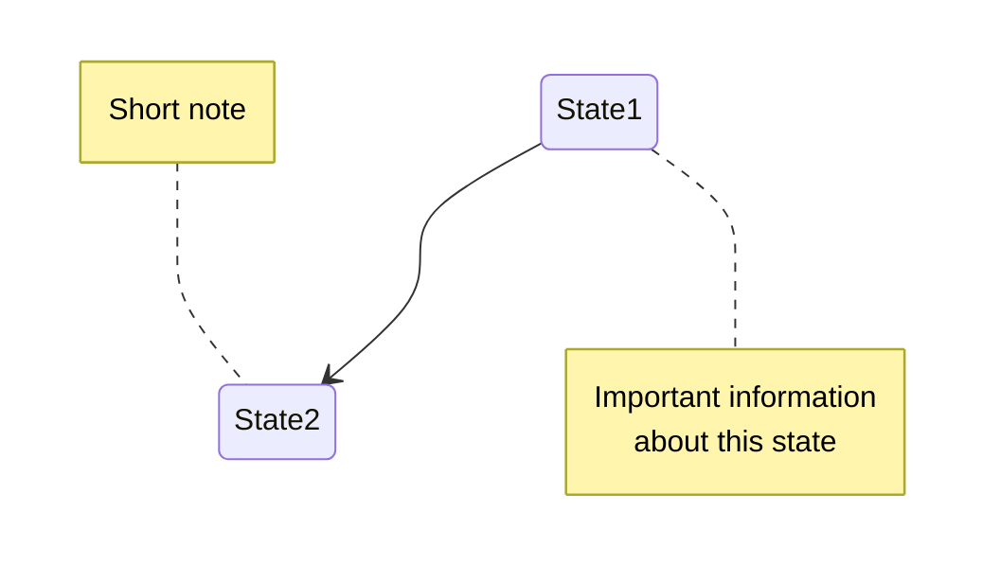

## Direction

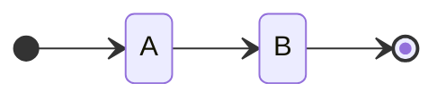

Directions: `TB` (default), `LR`, `RL`, `BT`

## Complete Example: Order Lifecycle

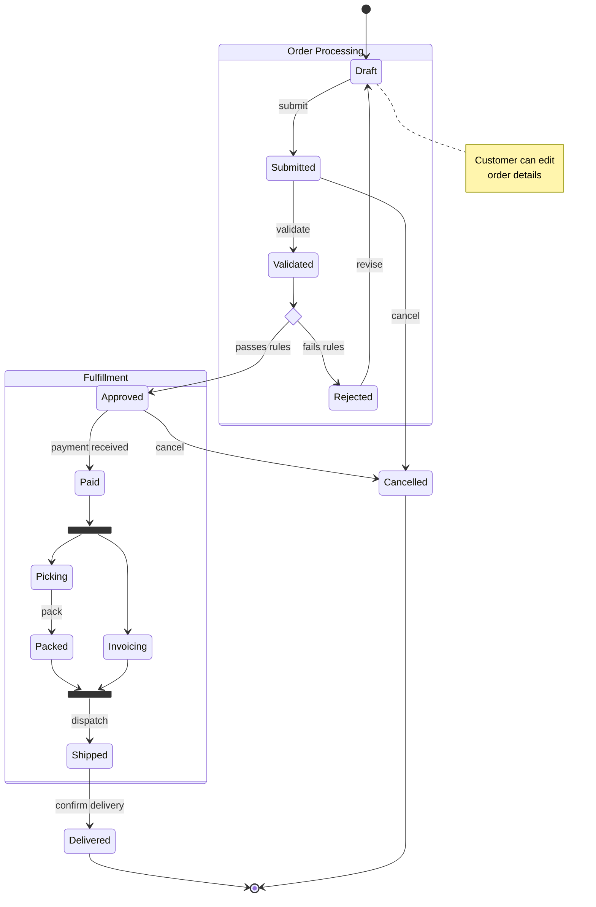

## Authentication Flow

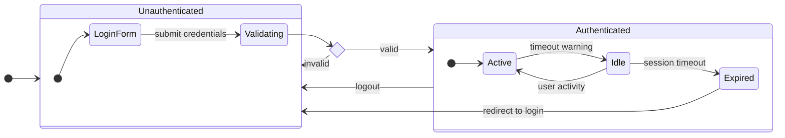

## Best Practices

1. **NEVER use `\n`** — Use ` ` in labels if multi-line text is needed
2. **Use `[*]` for start/end** — Clearly mark entry and exit points
3. **Label transitions** — Describe the trigger/event for each transition
4. **Use composite states** — Group related states logically
5. **Use `<<choice>>`** — For conditional branching instead of multiple transitions
6. **Use `<<fork>>`/`<<join>>`** — For parallel execution paths
7. **Add notes** — Explain business rules or constraints
8. **Keep flat when possible** — Only nest when it adds clarity
9. **Show error/cancel paths** — Don't just model the happy path
