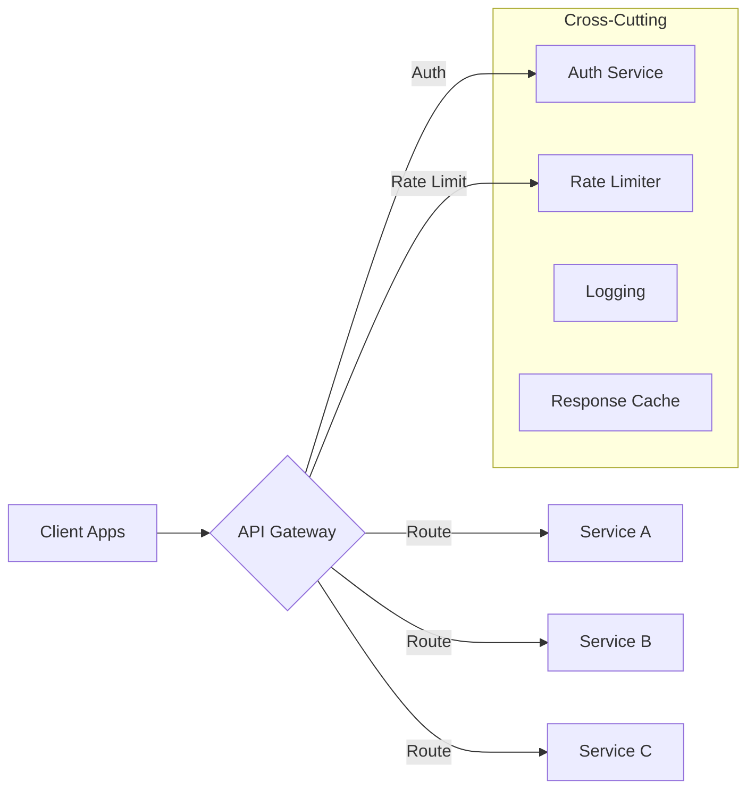
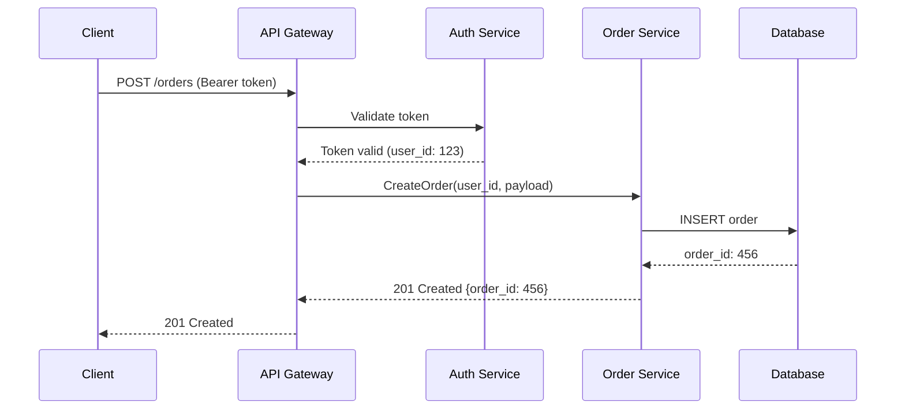

<!-- Imported from ai4developers/claude-code/claude-code-plugins/telekom-archi/skills/api-design by codex-knowledge-curation/scripts/persist_project_skills.py. -->

# API Design Skill

You help users design clean, consistent, and well-documented APIs. You follow API-first design principles — the contract comes before the implementation.

## Design Process

### 1. Understand the API Context

Before designing, clarify:
- **Who are the consumers?** Internal services, partner integrations, public developers?
- **What style fits?** REST for CRUD-heavy, GraphQL for flexible queries, gRPC for internal service-to-service, AsyncAPI for events.
- **What are the constraints?** Latency requirements, payload sizes, backward compatibility needs.

### 2. Choose the Right Style

| Style | Best For | Contract Format |
|-------|----------|----------------|
| REST | CRUD, external APIs, broad compatibility | OpenAPI 3.1 |
| GraphQL | Flexible queries, frontend-driven | GraphQL SDL |
| gRPC | Internal services, high performance, streaming | Protocol Buffers |
| AsyncAPI | Event-driven, webhooks, message queues | AsyncAPI 3.0 |

### 3. REST API Design Principles

**Resource Naming:**
- Use nouns, not verbs: `/orders` not `/getOrders`
- Plural for collections: `/customers/{id}/orders`
- Nest only for strong parent-child: max 2 levels deep
- Use kebab-case for multi-word: `/order-items`

**HTTP Methods:**
| Method | Purpose | Idempotent | Safe |
|--------|---------|------------|------|
| GET | Read | Yes | Yes |
| POST | Create | No | No |
| PUT | Full replace | Yes | No |
| PATCH | Partial update | No* | No |
| DELETE | Remove | Yes | No |

*PATCH idempotency depends on implementation — JSON Patch operations can be designed to be idempotent, but the HTTP spec does not require it.

**Status Codes:**
- `200` OK, `201` Created, `204` No Content
- `400` Bad Request, `401` Unauthorized, `403` Forbidden, `404` Not Found, `409` Conflict, `422` Unprocessable
- `500` Internal Error, `503` Service Unavailable

**Error Response Format:**
```json
{
  "error": {
    "code": "VALIDATION_ERROR",
    "message": "Human-readable description",
    "details": [
      { "field": "email", "issue": "Invalid email format" }
    ],
    "trace_id": "abc-123"
  }
}
```

**Pagination:**
```text
GET /orders?page=2&size=20
GET /orders?cursor=eyJpZCI6MTAwfQ&size=20
```
- Use cursor-based for large/real-time datasets
- Use offset-based for simpler UIs
- Always include `total_count`, `next`, `previous` in response

**Versioning:**
- URL path: `/v1/orders` (simplest, most visible)
- Header: `Accept: application/vnd.api.v2+json` (cleaner URLs)
- Query param: `/orders?version=2` (avoid — easy to forget)

### 4. API Security Patterns

- **Authentication:** OAuth 2.0 + JWT for user-facing, API keys for service-to-service
- **Authorization:** RBAC or ABAC, enforce at gateway and service level
- **Rate Limiting:** Token bucket or sliding window, return `429` with `Retry-After`
- **Input Validation:** Validate at the edge (gateway) and at the service
- **CORS:** Explicit allow-lists, no wildcards in production

### 5. API Gateway Patterns

When designing API gateways, use this Mermaid diagram:



### 6. AsyncAPI / Event-Driven Design

For event-driven APIs:
- Define **channels** (topics/queues) and **messages** (schemas)
- Use CloudEvents spec for event envelope
- Include `event_type`, `source`, `timestamp`, `correlation_id`
- Document retry and dead-letter queue behavior

**Event naming:** `{domain}.{entity}.{action}` — e.g., `orders.order.created`, `payments.payment.failed`

### 7. Mermaid Diagrams for APIs

**Sequence diagram for API flows:**


## Output Format

When designing an API, produce:
1. **API overview** — purpose, consumers, style choice rationale
2. **Resource/endpoint listing** with methods, paths, request/response schemas
3. **Mermaid sequence diagram** for key flows
4. **Error handling strategy**
5. **OpenAPI snippet** (YAML) for the core endpoints

Save to `docs/architecture/api-design.md`.

## Reference Files
- **[references/openapi-patterns.md](references/openapi-patterns.md)** — OpenAPI 3.1 templates and common patterns
