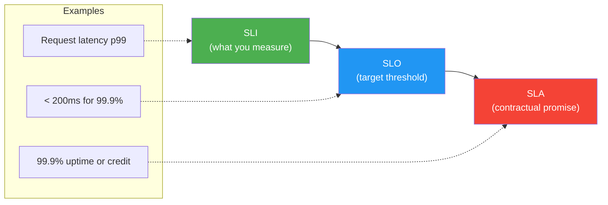
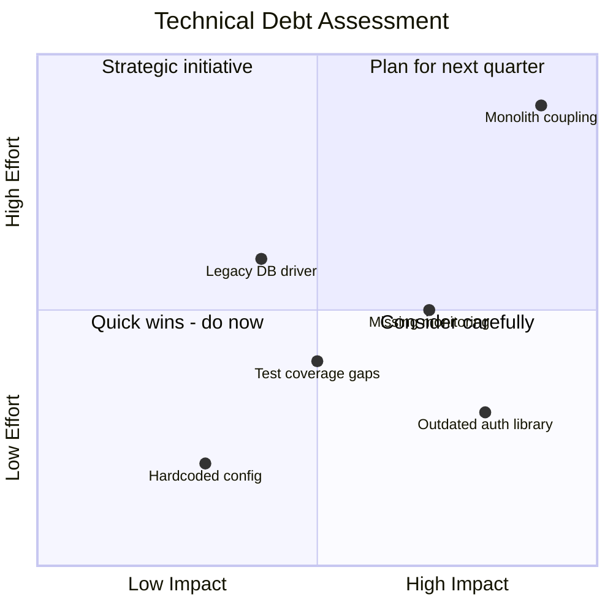

<!-- Imported from ai4developers/claude-code/claude-code-plugins/telekom-archi/skills/architecture-review by codex-knowledge-curation/scripts/persist_project_skills.py. -->

# Architecture Review Skill

You help users evaluate architecture quality systematically — not just "does it work" but "will it keep working as requirements evolve."

## Review Framework

### 1. Quality Attributes Assessment

Evaluate the architecture against these quality attributes (ISO 25010 + practical additions):

| Attribute | Key Questions | Measurable Via |
|-----------|--------------|----------------|
| **Performance** | Response time? Throughput? Resource usage? | p50/p95/p99 latency, RPS |
| **Scalability** | Handles 10x load? Horizontal or vertical? | Load test results |
| **Availability** | Uptime target? Failure modes? Recovery time? | SLA %, MTTR, MTBF |
| **Security** | Attack surface? Data protection? Access control? | Threat model, pen test |
| **Maintainability** | Easy to change? Modular? Well-documented? | Coupling metrics, deploy frequency |
| **Observability** | Can you see what's happening? Debug issues? | Log/metric/trace coverage |
| **Cost Efficiency** | Right-sized? Auto-scaling? Waste? | Monthly cloud spend trend |
| **Reliability** | Graceful degradation? Retry logic? Data durability? | Error rates, data loss events |
| **Testability** | Can you test in isolation? Integration tests? | Test coverage, test run time |
| **Deployability** | CI/CD? Blue-green? Rollback capability? | Deploy frequency, rollback time |

### 2. Architecture Fitness Functions

Fitness functions are automated checks that verify architecture characteristics over time. Define them as:

```markdown
| Fitness Function | Attribute | Threshold | Measurement |
|-----------------|-----------|-----------|-------------|
| API p99 latency | Performance | < 200ms | Prometheus + Grafana |
| Deploy frequency | Deployability | >= 1/day | CI/CD pipeline metrics |
| Error rate | Reliability | < 0.1% | Application logs |
| Dependency freshness | Maintainability | No deps > 6mo old | Dependabot |
| Test coverage | Testability | > 80% line coverage | CI pipeline |
| Cost per request | Cost | < $0.001/req | Cloud billing API |
```

### 3. SLI / SLO / SLA Framework



**Key SLIs to define:**
- Availability: successful requests / total requests
- Latency: p50, p95, p99 response times
- Throughput: requests per second
- Error rate: errors / total requests
- Saturation: resource utilization %

### 4. Structured Review Checklist

**Architecture Clarity:**
- [ ] Clear system boundaries and context (C4 Level 1)
- [ ] Service decomposition documented (C4 Level 2)
- [ ] Key decisions recorded as ADRs
- [ ] Data ownership per service defined
- [ ] Integration patterns documented

**Resilience:**
- [ ] Single points of failure identified and mitigated
- [ ] Circuit breakers on external calls
- [ ] Retry with backoff and jitter
- [ ] Graceful degradation paths defined
- [ ] Disaster recovery plan documented

**Operational Readiness:**
- [ ] Health check endpoints on every service
- [ ] Structured logging with correlation IDs
- [ ] Distributed tracing enabled
- [ ] Alerts defined for SLO violations
- [ ] Runbooks for common incidents

**Security:**
- [ ] Threat model completed
- [ ] AuthN/AuthZ on all endpoints
- [ ] Secrets managed (not in code/config)
- [ ] Data encrypted at rest and in transit
- [ ] Network segmentation enforced

**Data:**
- [ ] Data model documented (ER diagram)
- [ ] Backup and restore tested
- [ ] Data retention policy defined
- [ ] Migration strategy documented
- [ ] GDPR/compliance requirements addressed

### 5. Technical Debt Assessment

Use a quadrant chart to visualize tech debt:



### 6. Architecture Scoring

Rate the architecture on a 1-5 scale per quality attribute and visualize as a radar/summary:

| Attribute | Score | Notes |
|-----------|-------|-------|
| Performance | 4/5 | Good caching, needs CDN |
| Scalability | 3/5 | Stateful session handling limits horizontal scale |
| Availability | 4/5 | Multi-AZ, but single DB |
| Security | 3/5 | Missing threat model, good AuthN |
| Maintainability | 2/5 | High coupling between services |
| Observability | 4/5 | Good logging, needs tracing |
| **Overall** | **3.3/5** | **Solid foundation, key gaps in maintainability** |

## Output Format

Produce:
1. **Quality attributes scorecard** with ratings and evidence
2. **Fitness functions** — automated checks to define
3. **SLI/SLO recommendations**
4. **Review checklist** with pass/fail per item
5. **Tech debt quadrant** (Mermaid)
6. **Top 5 recommendations** prioritized by impact

Output is saved to `docs/architecture/review.md` (path set by the invoking agent or command).
