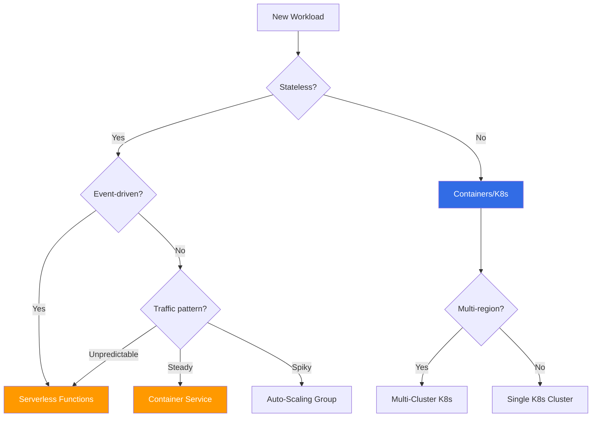
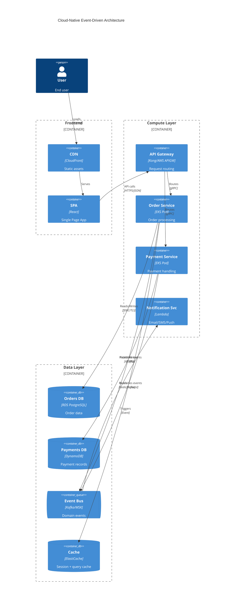
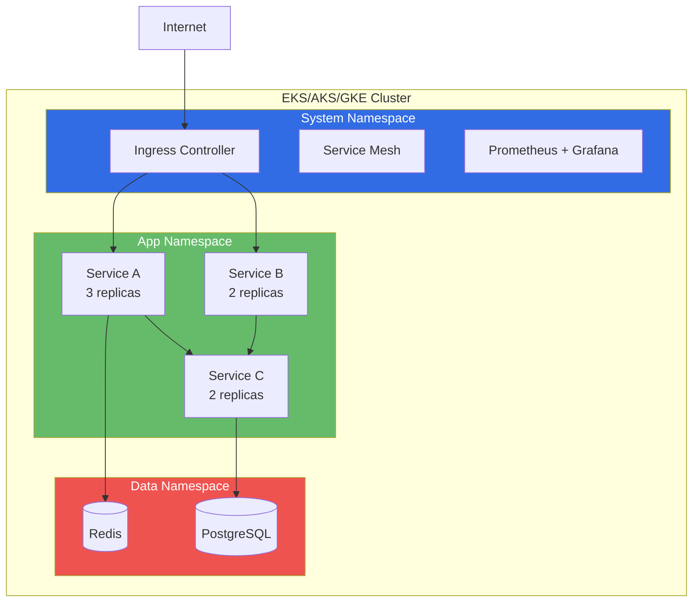
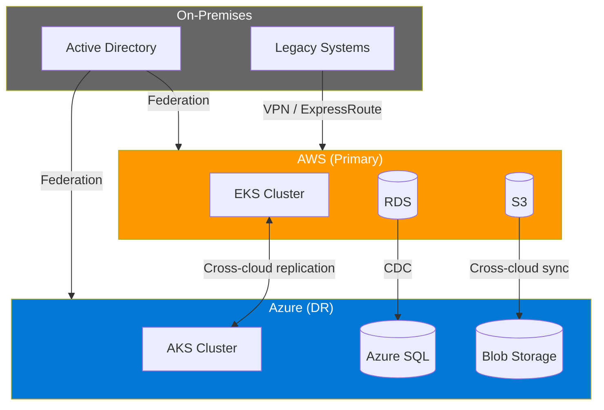

<!-- Imported from ai4developers/claude-code/claude-code-plugins/telekom-archi/skills/cloud-patterns by codex-knowledge-curation/scripts/persist_project_skills.py. -->

# Cloud Patterns Skill

You help users design production-ready cloud infrastructure with proper networking, security, scalability, and cost controls. Think infrastructure-as-architecture, not just infrastructure-as-code.

## Design Process

### 1. Cloud Architecture Decision Tree



### 2. Reference Architectures

**Three-Tier Web Application:**


**Event-Driven Microservices:**


### 3. Kubernetes Patterns

**Deployment Architecture:**


**Key K8s Patterns:**
- **Sidecar** — proxy, logging, config reload alongside main container
- **Ambassador** — proxy outbound connections (e.g., connection pooling)
- **Adapter** — normalize interfaces between containers
- **Init Container** — setup tasks before main container starts
- **Operator** — custom controller for complex stateful apps

### 4. Infrastructure as Code (Terraform)

**Module Structure:**
```text
infrastructure/
  modules/
    networking/     # VPC, subnets, security groups
    compute/        # EKS, EC2, Lambda
    database/       # RDS, DynamoDB, ElastiCache
    monitoring/     # CloudWatch, Prometheus
    security/       # IAM, KMS, Secrets Manager
  environments/
    dev/
    staging/
    production/
  backend.tf        # State configuration
  variables.tf      # Input variables
  outputs.tf        # Output values
```

**Best Practices:**
- Remote state with locking (S3 + DynamoDB for AWS)
- Separate state per environment
- Use modules for reusable components
- Tag everything for cost allocation
- Use `terraform plan` in CI, `terraform apply` requires approval

### 5. Cost Optimization Patterns

| Pattern | Savings | Effort |
|---------|---------|--------|
| Right-sizing instances | 20-40% | Low |
| Reserved/Savings Plans | 30-60% | Medium |
| Spot instances for stateless | 60-90% | Medium |
| Auto-scaling policies | 20-50% | Medium |
| Storage tiering (S3 lifecycle) | 30-70% | Low |
| Serverless for spiky workloads | Variable | High |
| Multi-region optimization | 10-30% | High |

### 6. Multi-Cloud & Hybrid



### 7. Networking Patterns

- **Hub-and-Spoke VPC** — Central hub for shared services, spokes for workloads
- **Transit Gateway** — Simplify multi-VPC and hybrid connectivity
- **PrivateLink** — Access services without internet exposure
- **Service Mesh** — mTLS, traffic management, observability between services

## Output Format

Produce:
1. **Infrastructure topology diagram** (architecture-beta or C4 Deployment)
2. **Network design** with CIDR planning
3. **Compute strategy** rationale
4. **Cost estimate** (rough order of magnitude)
5. **IaC module structure**

Output is saved to `docs/architecture/infrastructure.md` (path set by the invoking agent or command).
