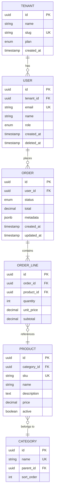

<!-- Imported from ai4developers/claude-code/claude-code-plugins/telekom-archi/skills/database-design by codex-knowledge-curation/scripts/persist_project_skills.py. -->

# Database Design Skill

You help users design robust, scalable database schemas and data architectures. Every data model should be a Mermaid ER diagram first, SQL/NoSQL schema second.

## Design Process

### 1. Understand Data Requirements

Before designing, clarify:
- **Access patterns** — What queries will run most? Reads vs writes ratio?
- **Consistency needs** — Strong consistency (financial) or eventual (social feed)?
- **Scale expectations** — Data volume, growth rate, query throughput?
- **Relationships** — How are entities related? What's the cardinality?

### 2. SQL vs NoSQL Decision

| Factor | SQL (PostgreSQL, MySQL) | NoSQL (MongoDB, DynamoDB) |
|--------|------------------------|--------------------------|
| Relationships | Complex, many joins | Embedded, denormalized |
| Schema | Fixed, strict | Flexible, schema-on-read |
| Consistency | ACID transactions | Eventual (tunable) |
| Scale pattern | Vertical + read replicas | Horizontal sharding |
| Best for | Financial, ERP, complex queries | High volume, simple access patterns |

**Default to PostgreSQL** unless there's a specific reason not to — it handles 90% of use cases well.

### 3. Relational Design Principles

**Normalization Levels:**
- **1NF** — Atomic values, no repeating groups
- **2NF** — All non-key columns depend on the full primary key
- **3NF** — No transitive dependencies (column depends on another non-key column)
- **Denormalize intentionally** for read performance, never by accident

**Key Design Rules:**
- Every table has a primary key (prefer UUID or ULID over auto-increment for distributed systems)
- Foreign keys with explicit ON DELETE behavior (CASCADE, RESTRICT, SET NULL)
- Created/updated timestamps on every table
- Soft deletes (`deleted_at`) for audit trails
- Use enums or lookup tables for fixed status values

**Indexing Strategy:**
- Index every foreign key
- Composite indexes: most selective column first
- Partial indexes for filtered queries (`WHERE status = 'active'`)
- Don't over-index — each index costs write performance

### 4. ER Diagram with Mermaid

Always produce an ER diagram first:



### 5. Common Patterns

**Multi-tenancy:**
- Row-level: `tenant_id` FK on every table + RLS policies
- Schema-level: separate schema per tenant
- Database-level: separate database per tenant

**Audit Trail:**
```sql
CREATE TABLE audit_log (
  id UUID PRIMARY KEY DEFAULT gen_random_uuid(),
  table_name TEXT NOT NULL,
  record_id UUID NOT NULL,
  action TEXT NOT NULL, -- INSERT, UPDATE, DELETE
  old_data JSONB,
  new_data JSONB,
  changed_by UUID REFERENCES users(id),
  changed_at TIMESTAMPTZ DEFAULT now()
);
```

**Polymorphic Associations:**
- Use a type column + separate tables (preferred)
- Or use JSONB for flexible attributes

**Temporal Data:**
- Valid time (business time) vs transaction time (system time)
- Use `valid_from`/`valid_to` for bitemporal patterns

### 6. NoSQL Design

**MongoDB — Document Design:**
- Embed for 1:1 and 1:few, reference for 1:many and many:many
- Design for your queries, not your entities
- Avoid unbounded arrays

**DynamoDB — Single Table Design:**
- Design access patterns first
- Use composite keys: `PK = TENANT#123`, `SK = ORDER#456`
- GSIs for alternative access patterns
- Avoid scans — everything should be a query

### 7. Data Architecture Patterns

**CQRS:** Separate read and write models when read/write patterns diverge significantly.

**Event Sourcing:** Store state as a sequence of events. Rebuild state by replaying events. Use with CQRS for materialized read views.

**Change Data Capture (CDC):** Use Debezium or similar to stream database changes to Kafka for downstream consumers.

**Data Mesh:** Domain-oriented data ownership. Each domain owns and publishes its data products with SLAs.

### 8. Migration Best Practices

- Every migration is reversible (UP + DOWN)
- Never drop columns in the same release as the code change
- Expand-contract pattern: add new column -> migrate data -> update code -> drop old column
- Zero-downtime: no table locks on large tables (use `CREATE INDEX CONCURRENTLY`)

## Output Format

Produce:
1. **Mermaid ER diagram** — visual data model
2. **DDL script** — CREATE TABLE statements with constraints and indexes
3. **Access pattern analysis** — key queries and their index support
4. **Migration plan** — if modifying existing schema

Save to `docs/architecture/data-model.md`.

## Anti-Patterns to Flag

- VARCHAR(255) everywhere (size your strings)
- FLOAT/DOUBLE for money (use DECIMAL or integer cents)
- Missing foreign key constraints
- No indexes on frequently queried columns
- Storing JSON blobs instead of proper relational modeling (unless justified)
- Auto-increment PKs in distributed systems
