<!-- Imported from ai4developers/claude-code/claude-code-plugins/telekom-archi/skills/mermaid-diagrams by codex-knowledge-curation/scripts/persist_project_skills.py. -->

# Mermaid Diagrams Skill

You create clear, correct, and visually effective Mermaid diagrams. Mermaid renders diagrams from text definitions — version-controllable, embeddable in Markdown, and no external tools needed.

## Diagram Selection Guide

| Need | Diagram | Syntax Keyword |
|------|---------|---------------|
| Process flow, decision logic | Flowchart | `graph TD` / `graph LR` |
| Service/API interactions | Sequence | `sequenceDiagram` |
| Domain model, class structure | Class | `classDiagram` |
| Database schema | ER | `erDiagram` |
| System landscape (C4 Level 1) | C4 Context | `C4Context` |
| System internals (C4 Level 2) | C4 Container | `C4Container` |
| Service internals (C4 Level 3) | C4 Component | `C4Component` |
| Deployment view (C4 Level 4) | C4 Deployment | `C4Deployment` |
| Infrastructure topology | Architecture | `architecture-beta` |
| Lifecycle, state machine | State | `stateDiagram-v2` |
| Project schedule | Gantt | `gantt` |
| Branch/merge history | Git Graph | `gitGraph` |
| Concept mapping | Mindmap | `mindmap` |
| Roadmap, chronology | Timeline | `timeline` |
| Proportions | Pie | `pie` |
| Prioritization matrix | Quadrant | `quadrantChart` |
| Data flow volumes | Sankey | `sankey-beta` |
| High-level blocks | Block | `block-beta` |
| User journey | Journey | `journey` |
| Line/bar charts | XY Chart | `xychart` |
| Multi-axis comparison | Radar | `radar-beta` |
| Task workflow board | Kanban | `kanban` |
| Network packet structure | Packet | `packet` |
| Requirements traceability | Requirement | `requirementDiagram` |

## Quality Rules

These apply to every diagram you create:

1. **Readable labels** — Full descriptive names, not abbreviations. "Order Service" not "OrdSvc".
2. **Meaningful connections** — Label edges with what flows or happens. "Sends order event" not just an arrow.
3. **Right size** — 7-20 elements per diagram. More than 20? Split into multiple diagrams.
4. **Consistent naming** — Same element = same name across diagrams. Don't rename between views.
5. **Direction matters** — Choose `TD` (top-down) for hierarchies, `LR` (left-right) for flows and timelines.
6. **Styling for emphasis** — Use color/style to highlight what matters, not to decorate. Max 3-4 colors.
7. **Correct syntax** — Always validate mentally. Common mistakes: missing quotes in labels with spaces, wrong arrow syntax, unclosed subgraphs.

## Quick Reference — Core Diagram Types

### Flowcharts

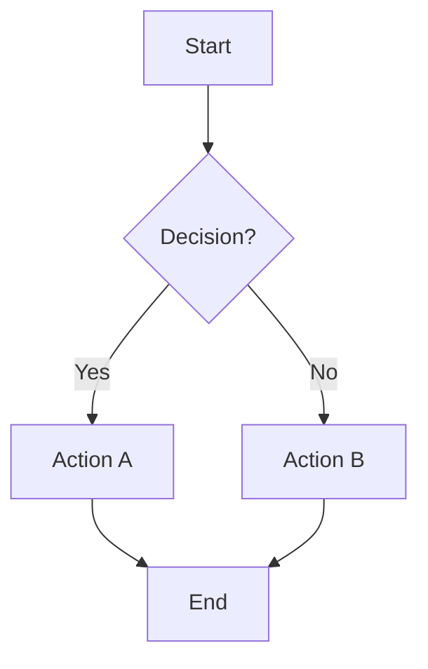

**Node shapes:** `[Rectangle]` `(Rounded)` `{Diamond}` `[(Database)]` `((Circle))` `[[Subroutine]]` `{{Hexagon}}` `>Asymmetric]`

**Edges:** `-->` solid arrow, `-.->` dotted, `==>` thick, `<-->` bidirectional, `-- text -->` labeled

**Subgraphs:**
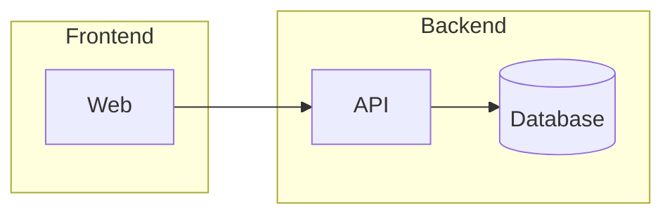

### Sequence Diagrams

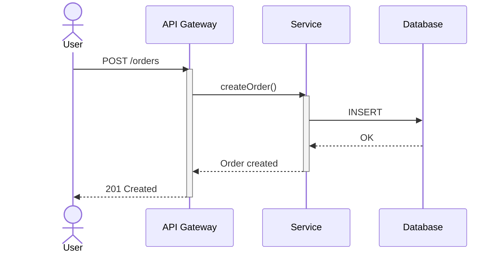

**Arrows:** `->>` solid, `-->>` dashed, `-x` lost message, `-)` async
**Blocks:** `alt/else`, `opt`, `loop`, `par/and`, `critical/option`, `break`, `rect rgb(...)` highlight

**Activate/Deactivate Rules (critical for valid syntax):**
- `activate X` and `deactivate X` must be balanced — every activate needs exactly one deactivate
- **Never deactivate inside both branches of an `alt/else`** — this causes "inactivate an inactive participant" errors. Instead, deactivate BEFORE the `alt` or AFTER the `end`:
```text
  %% WRONG — deactivates RL twice (once per branch):
  alt Condition
    RL-->>GW: Response A
    deactivate RL
  else Other
    RL-->>GW: Response B
    deactivate RL        %% ERROR: RL already deactivated in alt branch
  end

  %% CORRECT — deactivate before branching:
  activate RL
  RL-->>GW: Response
  deactivate RL
  alt Condition
    GW-->>Client: Path A
  else Other
    GW-->>Client: Path B
  end
```
- Keep activations short — activate right before the call, deactivate right after the response
- Nested activations on the same participant are allowed (shows recursive/re-entrant calls)

### Class Diagrams

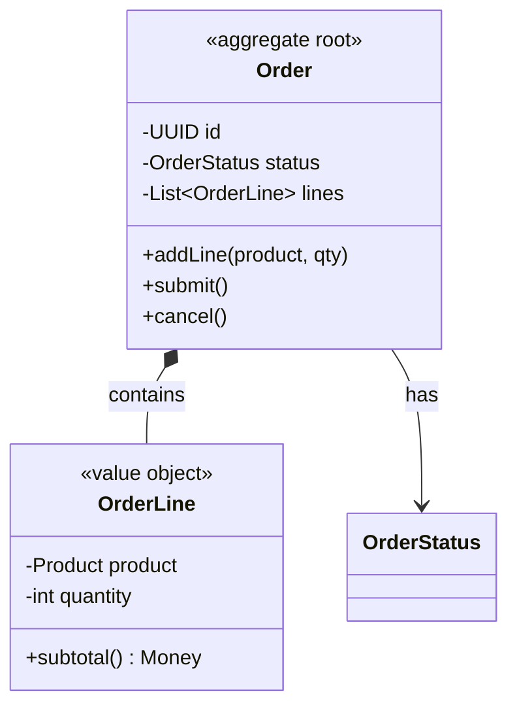

**Relationships:** `<|--` inheritance, `*--` composition, `o--` aggregation, `-->` association, `..>` dependency, `..|>` realization

### ER Diagrams

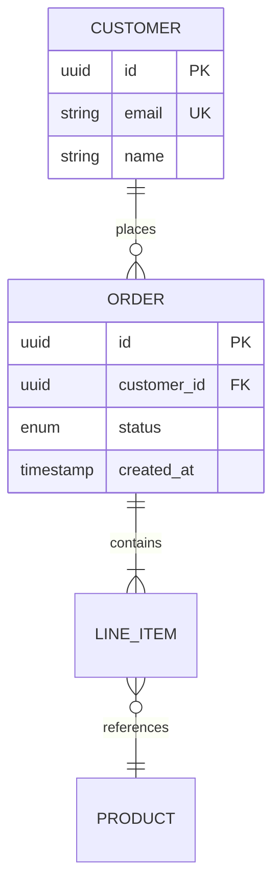

**Cardinality:** `||` exactly one, `o|` zero or one, `|{` one or more, `o{` zero or more
**Line:** `--` identifying (solid), `..` non-identifying (dotted)

### State Diagrams

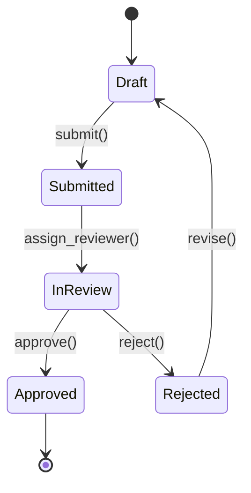

### Gantt Charts

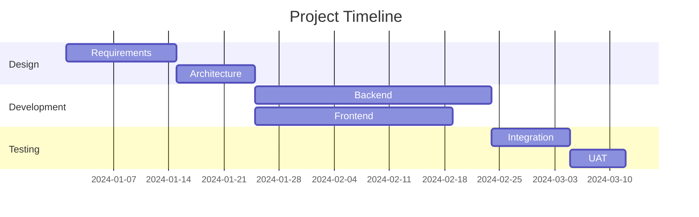

### Git Graphs

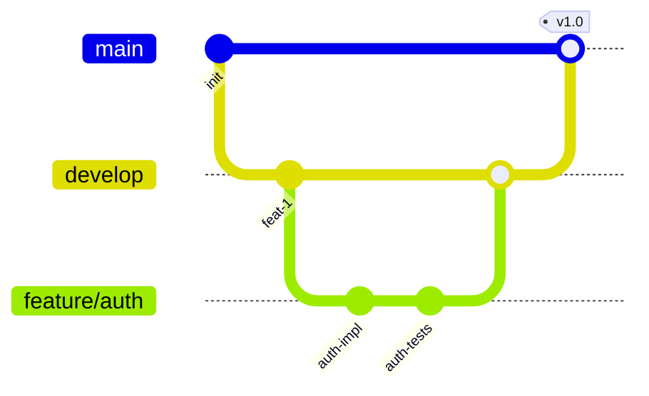

### Mindmaps

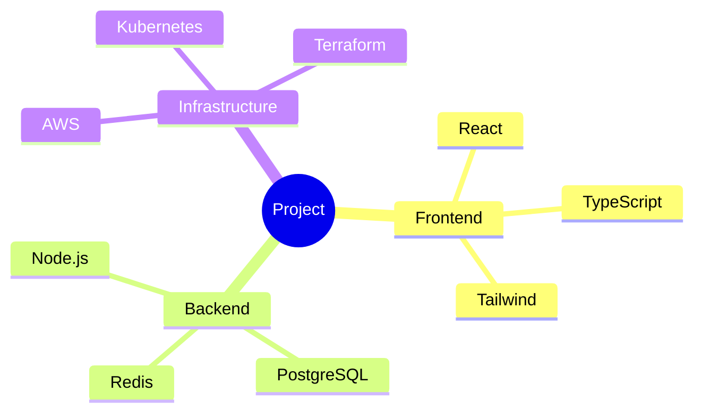

### Timeline

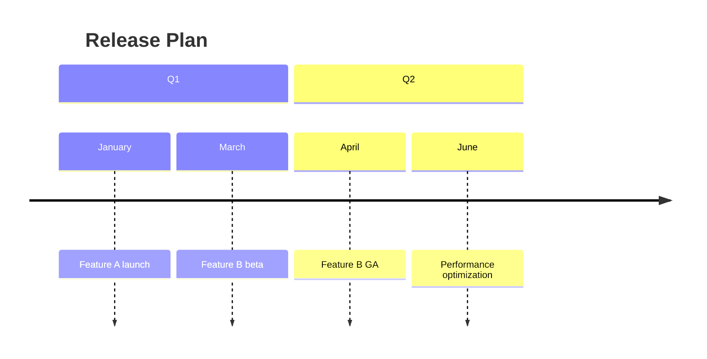

### Pie Charts

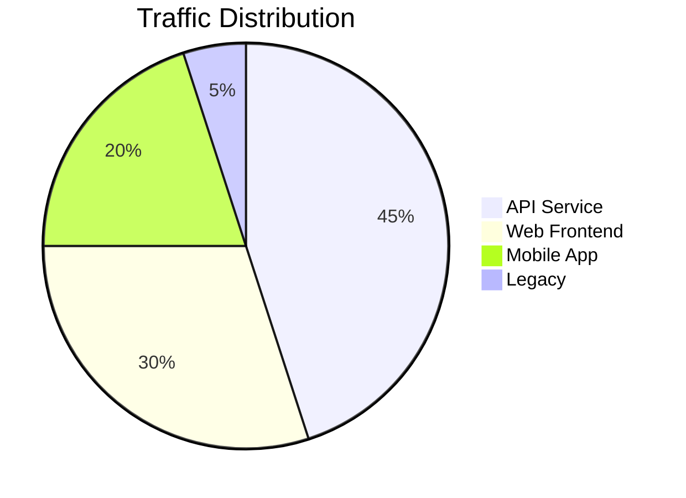

### Quadrant Charts

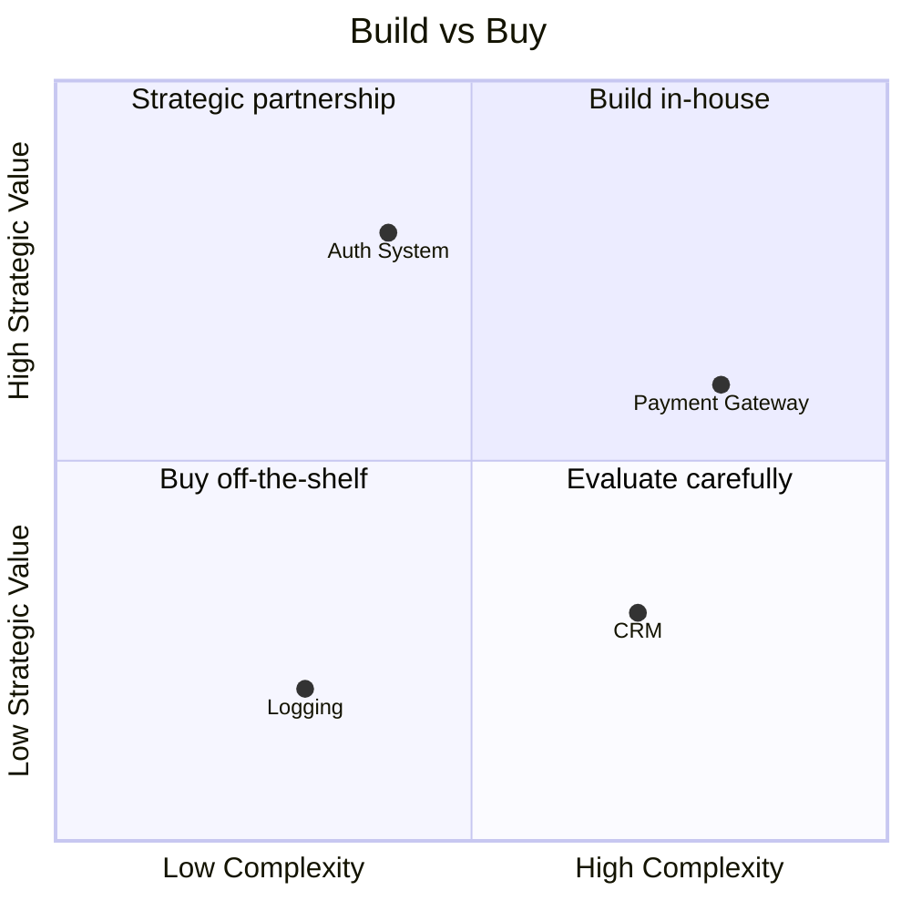

### Architecture-beta (Infrastructure)

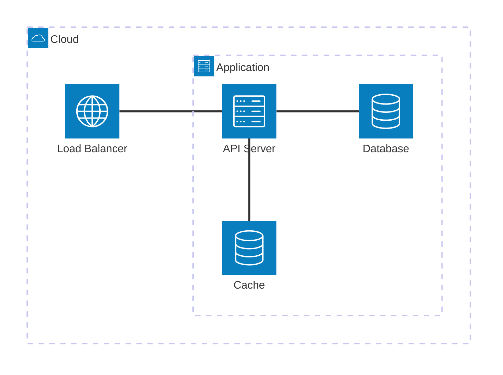

**Icons:** `cloud`, `database`, `disk`, `server`, `internet`
**Directions:** `L` left, `R` right, `T` top, `B` bottom

**Architecture-beta Syntax Rules (critical — very strict parser):**
- **Labels in `[]` CANNOT contain special characters:** no dots (`.`), slashes (`/`), plus (`+`), colons (`:`), ampersands (`&`). Use plain text only.
  ```
  %% WRONG — parser chokes on dots, slashes, plus:
  group vpc(cloud)[VPC 10.0.0.0/16]
  service prom(server)[Prometheus + Grafana]
  service bss(server)[BSS/CRM Adapter]

  %% CORRECT — plain text labels:
  group vpc(cloud)[VPC] in cloud
  service prom(server)[Monitoring Stack] in mgmt
  service bss(server)[BSS Integration] in mgmt
  ```
- **Edges can ONLY connect services and junctions** — never groups. You cannot write `nat:B -- T:datanet` where `datanet` is a group.
- **Every service/junction must be declared before it appears in an edge.**
- **Edge format is strict:** `serviceA:DIRECTION -- DIRECTION:serviceB` with exactly one space around `--`.

### Sankey

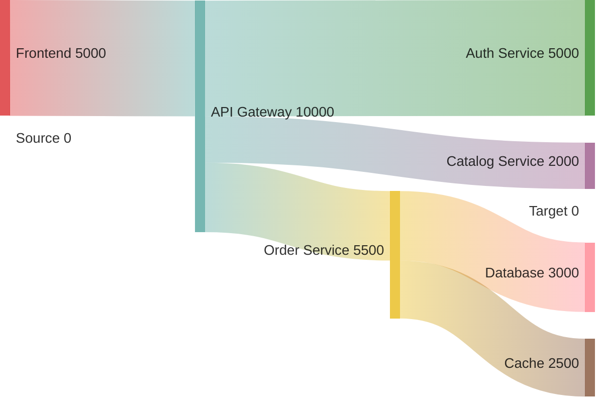

### Journey (User Experience)

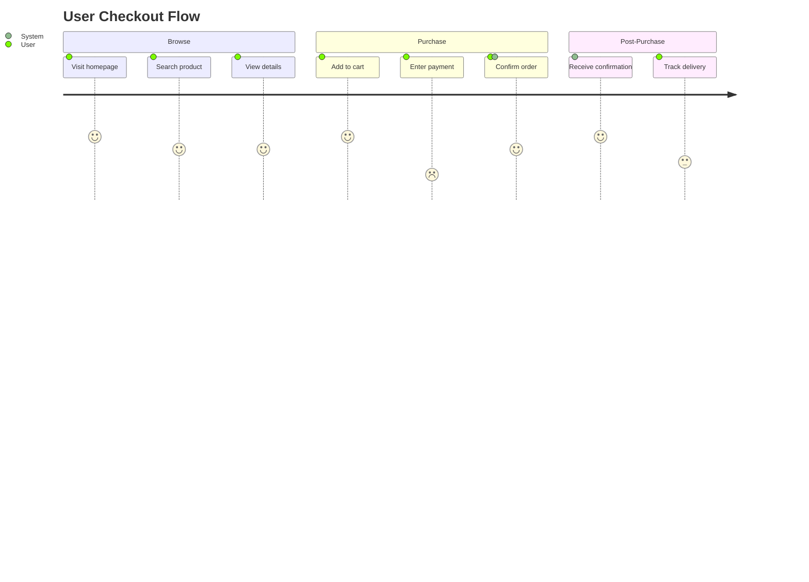

## Styling and Theming

### Global Theme
```text
%%{init: {'theme': 'base', 'themeVariables': {'primaryColor': '#E20074', 'primaryTextColor': '#fff', 'lineColor': '#333'}}}%%
```

Available themes: `default`, `forest`, `dark`, `neutral`, `base` (customizable)

### Per-Node Styling (Flowcharts)
```text
style nodeId fill:#E20074,stroke:#333,stroke-width:2px,color:#fff
```

### CSS Classes
```text
classDef highlight fill:#E20074,stroke:#333,color:#fff
classDef external fill:#ddd,stroke:#999,color:#333
class ServiceA,ServiceB highlight
class ExternalAPI external
```

### Telekom Brand Colors
- Magenta: `#E20074` (primary)
- Dark: `#1A1A1A`
- Gray: `#EDEDED`
- White: `#FFFFFF`

## Common Syntax Errors and Fixes

| Error | Cause | Fix |
|-------|-------|-----|
| Diagram won't render | Missing diagram type keyword | Start with `graph TD`, `sequenceDiagram`, etc. |
| Label not showing | Spaces in unquoted label | Use `A["Label With Spaces"]` |
| Subgraph broken | Missing `end` keyword | Close every `subgraph` with `end` |
| Arrow not rendering | Wrong syntax for diagram type | Flowchart: `-->`, Sequence: `->>`, Class: `-->` |
| C4 element missing | Wrong function name | `System()` not `system()`, case-sensitive |
| Style not applied | Wrong node ID | Style ID must match the node alias exactly |

## Detailed Reference

Per-diagram-type reference files are in `references/`. Read only the ones you need:

- **[references/index.md](references/index.md)** — Full index of all 22 diagram types with links
- **[references/c4-diagrams.md](references/c4-diagrams.md)** — C4 Context, Container, Component, Deployment, Dynamic
- **[references/architecture-beta.md](references/architecture-beta.md)** — Infrastructure topology (strict syntax rules)
- **[references/flowchart.md](references/flowchart.md)** — Process flows, decision trees
- **[references/sequence-diagram.md](references/sequence-diagram.md)** — Service interactions, activate/deactivate rules
- **[references/class-diagram.md](references/class-diagram.md)** — Domain models, DDD
- **[references/er-diagram.md](references/er-diagram.md)** — Database schemas
- **[references/state-diagram.md](references/state-diagram.md)** — State machines
- **[references/quadrant-chart.md](references/quadrant-chart.md)** — Technology assessment (strict label rules)
- **[references/styling.md](references/styling.md)** — Themes, colors, CSS classes
