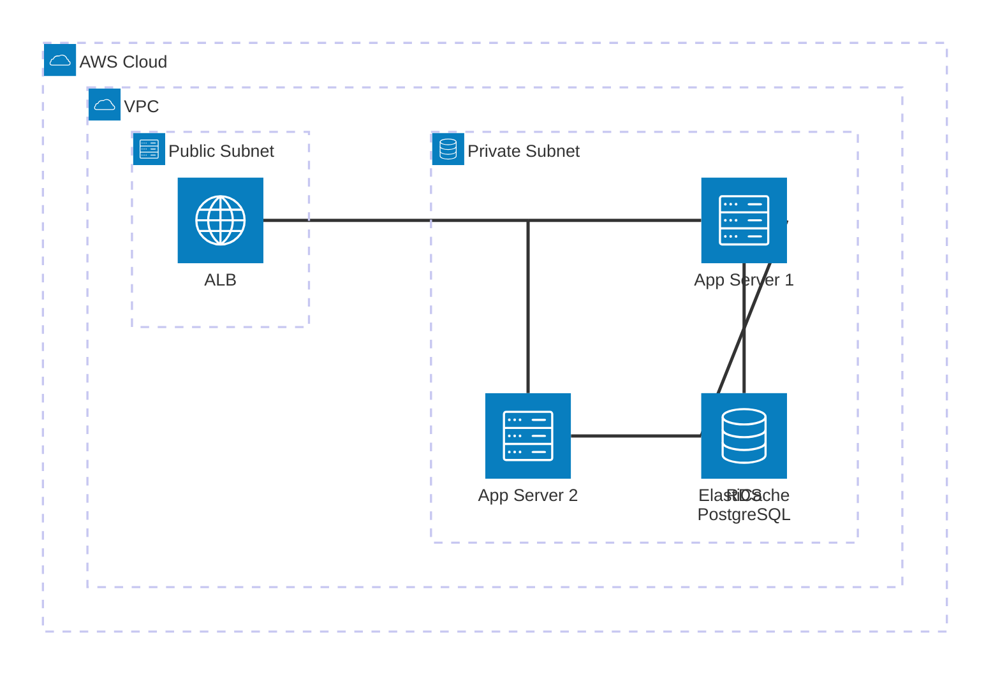

# Architecture-beta Diagrams

The `architecture-beta` diagram type is ideal for infrastructure and cloud topology views.

## Syntax

```
architecture-beta

  group groupAlias(icon)[Label]
  group nestedGroup(icon)[Label] in parentGroup

  service serviceAlias(icon)[Label] in groupAlias
  junction junctionAlias in groupAlias

  serviceA:L -- R:serviceB
  serviceA:T -- B:serviceC
```

## Available Icons

Default icons: `cloud`, `database`, `disk`, `server`, `internet`

Custom icons from iconify.design: use format `name:icon-name` (e.g., `logos:aws`, `logos:kubernetes`)

## Edge Directions

Edges connect from a side of one service to a side of another:
- `L` (left), `R` (right), `T` (top), `B` (bottom)
- Arrow direction: `<--` (left), `-->` (right), `--` (undirected)

## Syntax Rules (strict parser — common pitfalls)

- **Labels in `[]` must be plain text only** — no dots (`.`), slashes (`/`), plus (`+`), colons (`:`), ampersands (`&`), parentheses, or **hyphens (`-`)**. Write `[VPC]` not `[VPC 10.0.0.0/16]`. Write `[Monitoring Stack]` not `[Prometheus + Grafana]`. Write `[SD WAN]` not `[SD-WAN]`. Write `[Tier 1]` not `[Tier-1]`. Write `[CU CP]` not `[CU-CP]`.
- **Edges connect services and junctions ONLY** — never groups. `nat:B -- T:someGroup` is invalid.
- **Edge format:** `serviceA:DIR -- DIR:serviceB` with exactly one space around `--`.
- **Declare before use** — every service/junction must appear before any edge referencing it.

## Example — Cloud Infrastructure


