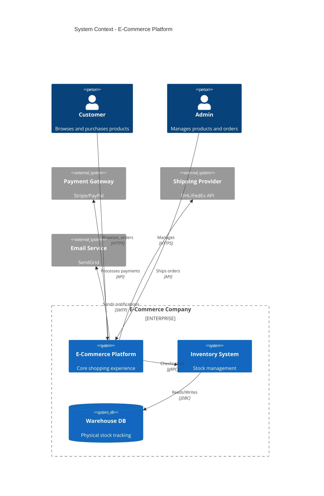
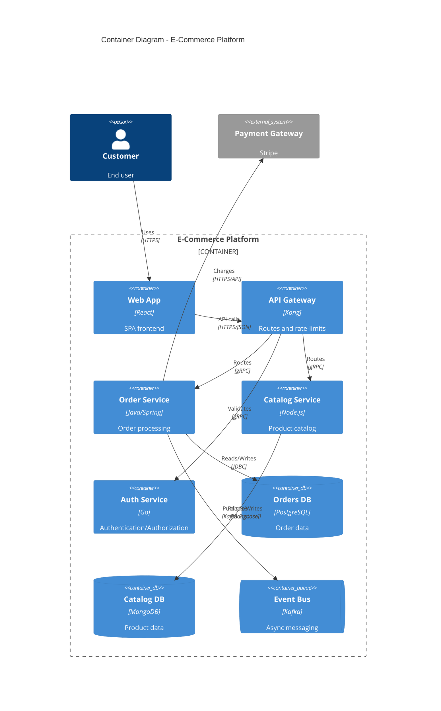

# C4 Diagrams

C4 diagrams are the primary tool for architecture documentation. Mermaid supports all four C4 levels plus dynamic diagrams.

## C4 Diagram Types

| Type | Keyword | Purpose |
|------|---------|---------|
| System Context | `C4Context` | How the system fits into the world |
| Container | `C4Container` | Apps, services, databases inside a system |
| Component | `C4Component` | Components inside a container |
| Dynamic | `C4Dynamic` | Runtime interactions / sequence |
| Deployment | `C4Deployment` | Infrastructure and deployment nodes |

## Element Parameter Signatures

Parameters marked `?` are optional. Named parameters use `$name=value` syntax.

### Context-level elements

```text
Person(alias, label, ?descr, ?sprite, ?tags, $link)
Person_Ext(alias, label, ?descr, ?sprite, ?tags, $link)

System(alias, label, ?descr, ?sprite, ?tags, $link)
System_Ext(alias, label, ?descr, ?sprite, ?tags, $link)
SystemDb(alias, label, ?descr, ?sprite, ?tags, $link)
SystemDb_Ext(alias, label, ?descr, ?sprite, ?tags, $link)
SystemQueue(alias, label, ?descr, ?sprite, ?tags, $link)
SystemQueue_Ext(alias, label, ?descr, ?sprite, ?tags, $link)
```

### Container-level elements

```text
Container(alias, label, ?techn, ?descr, ?sprite, ?tags, $link)
Container_Ext(alias, label, ?techn, ?descr, ?sprite, ?tags, $link)
ContainerDb(alias, label, ?techn, ?descr, ?sprite, ?tags, $link)
ContainerDb_Ext(alias, label, ?techn, ?descr, ?sprite, ?tags, $link)
ContainerQueue(alias, label, ?techn, ?descr, ?sprite, ?tags, $link)
ContainerQueue_Ext(alias, label, ?techn, ?descr, ?sprite, ?tags, $link)
```

### Component-level elements

```text
Component(alias, label, ?techn, ?descr, ?sprite, ?tags, $link)
Component_Ext(alias, label, ?techn, ?descr, ?sprite, ?tags, $link)
ComponentDb(alias, label, ?techn, ?descr, ?sprite, ?tags, $link)
ComponentDb_Ext(alias, label, ?techn, ?descr, ?sprite, ?tags, $link)
ComponentQueue(alias, label, ?techn, ?descr, ?sprite, ?tags, $link)
ComponentQueue_Ext(alias, label, ?techn, ?descr, ?sprite, ?tags, $link)
```

### Deployment-level elements

```text
Deployment_Node(alias, label, ?type, ?descr, ?sprite, ?tags, $link)
Node(alias, label, ?type, ?descr, ?sprite, ?tags, $link)   %% short alias for Deployment_Node
Node_L(alias, label, ?type, ?descr, ?sprite, ?tags, $link) %% left-aligned
Node_R(alias, label, ?type, ?descr, ?sprite, ?tags, $link) %% right-aligned
```

## Boundary Types

```text
Enterprise_Boundary(alias, label, ?tags, $link)
System_Boundary(alias, label, ?tags, $link)
Container_Boundary(alias, label, ?tags, $link)
Boundary(alias, label, ?type, ?tags, $link)   %% generic, use type= to label the boundary kind
```

## Relationship Types

```text
Rel(from, to, label, ?techn, ?descr, ?sprite, ?tags, $link)
BiRel(from, to, label, ?techn, ?descr, ?sprite, ?tags, $link)
Rel_Back(from, to, label, ?techn, ?descr, ?sprite, ?tags, $link)

%% Directional hints (layout)
Rel_U(from, to, label, ?techn)   %% or Rel_Up
Rel_D(from, to, label, ?techn)   %% or Rel_Down
Rel_L(from, to, label, ?techn)   %% or Rel_Left
Rel_R(from, to, label, ?techn)   %% or Rel_Right
Rel_Neighbor(from, to, label, ?techn)

%% Dynamic diagrams only
RelIndex(index, from, to, label, ?tags, $link)
```

## Styling Functions

```text
%% Override element visual properties
UpdateElementStyle(alias, ?bgColor, ?fontColor, ?borderColor, ?shadowing, ?shape, ?sprite, ?techn, ?legendText, ?legendSprite)

%% Override relationship line and label colors; offsetX/offsetY shift the label position
UpdateRelStyle(from, to, ?textColor, ?lineColor, ?offsetX, ?offsetY)

%% Control how many shapes/boundaries appear per row (defaults: 4 shapes, 2 boundaries)
UpdateLayoutConfig(?c4ShapeInRow, ?c4BoundaryInRow)
```

Named parameter style (preferred for clarity):

```text
UpdateElementStyle(alias, $fontColor="white", $bgColor="#E20074", $borderColor="#B0005E")
UpdateRelStyle(from, to, $textColor="blue", $lineColor="blue", $offsetX="-40", $offsetY="60")
UpdateLayoutConfig($c4ShapeInRow="3", $c4BoundaryInRow="1")
```

---

## C4 Context (Level 1) — System Landscape

Shows how the system fits into the world — users, external systems, boundaries.

```mermaid
C4Context
  title System Context diagram for [System Name]

  Person(alias, "Label", "Description")
  Person_Ext(alias, "Label", "Description")

  System(alias, "Label", "Description")
  System_Ext(alias, "Label", "Description")
  SystemDb(alias, "Label", "Description")
  SystemDb_Ext(alias, "Label", "Description")
  SystemQueue(alias, "Label", "Description")
  SystemQueue_Ext(alias, "Label", "Description")

  Enterprise_Boundary(b0, "Enterprise") {
    System(internal, "Internal System", "Inside the enterprise")
  }

  System_Boundary(b1, "System Name") {
    System(sub, "Sub-System", "Within boundary")
  }

  Boundary(b2, "Custom Boundary", "type") {
    System(other, "Other System", "Generic boundary")
  }

  Rel(alias, internal, "Label", "Technology")
  BiRel(alias, other, "Label")
  Rel_Back(alias, sub, "Label", "Technology")
  Rel_Neighbor(alias, internal, "Label")

  UpdateElementStyle(alias, $fontColor="white", $bgColor="#E20074", $borderColor="#B0005E")
  UpdateRelStyle(alias, internal, $textColor="blue", $lineColor="blue", $offsetX="5", $offsetY="-10")
  UpdateLayoutConfig($c4ShapeInRow="3", $c4BoundaryInRow="1")
```

**Example — E-Commerce Platform:**



---

## C4 Container (Level 2) — Inside a System

Shows the containers (apps, services, databases) that make up a system.

```text
C4Container
  title Container diagram for [System Name]

  Person(alias, "Label", "Description")

  Container_Boundary(alias, "System Name") {
    Container(alias, "Label", "Technology", "Description")
    ContainerDb(alias, "Label", "Technology", "Description")
    ContainerQueue(alias, "Label", "Technology", "Description")
    Container_Ext(alias, "Label", "Technology", "Description")
    ContainerDb_Ext(alias, "Label", "Technology", "Description")
    ContainerQueue_Ext(alias, "Label", "Technology", "Description")
  }

  System_Ext(alias, "Label", "Description")

  Rel(from, to, "Label", "Protocol")
```

**Example — Microservices Platform:**



---

## C4 Component (Level 3) — Inside a Container

```text
C4Component
  title Component diagram for [Container Name]

  Container(alias, "Label", "Tech", "Description")
  ContainerDb(alias, "Label", "Tech", "Description")

  Container_Boundary(alias, "Container Name") {
    Component(alias, "Label", "Tech", "Description")
    ComponentDb(alias, "Label", "Tech", "Description")
    ComponentQueue(alias, "Label", "Tech", "Description")
    Component_Ext(alias, "Label", "Tech", "Description")
    ComponentDb_Ext(alias, "Label", "Tech", "Description")
    ComponentQueue_Ext(alias, "Label", "Tech", "Description")
  }

  Rel(from, to, "Label", "Protocol")
```

---

## C4 Deployment — Infrastructure View

```text
C4Deployment
  title Deployment Diagram for [System]

  Deployment_Node(cloud, "Cloud Provider", "AWS") {
    Deployment_Node(region, "Region", "us-east-1") {
      Deployment_Node(cluster, "EKS Cluster", "Kubernetes") {
        Container(app, "App", "Docker", "Application container")
      }
      ContainerDb(db, "RDS", "PostgreSQL", "Managed database")
    }
  }

  Rel(app, db, "Reads/Writes", "JDBC")
```

---

## C4 Dynamic — Runtime Interactions

Numbering is added automatically, or use `RelIndex` to set explicit step numbers.

```text
C4Dynamic
  title Dynamic Diagram - [Flow Name]

  ContainerDb(db, "Database", "PostgreSQL")
  Container(api, "API", "Spring Boot")
  Container(web, "Web App", "React")

  Rel(web, api, "POST /order", "HTTPS/JSON")
  Rel(api, db, "INSERT order", "JDBC")
  Rel(api, web, "201 Created", "HTTPS/JSON")
```

Using `RelIndex` for explicit step numbering:

```text
C4Dynamic
  title Checkout Flow

  Container(web, "Web App", "React")
  Container(api, "API", "Node.js")
  ContainerDb(db, "Orders DB", "PostgreSQL")

  RelIndex(1, web, api, "Submit order")
  RelIndex(2, api, db, "Persist order")
  RelIndex(3, api, web, "Confirm order")
```
