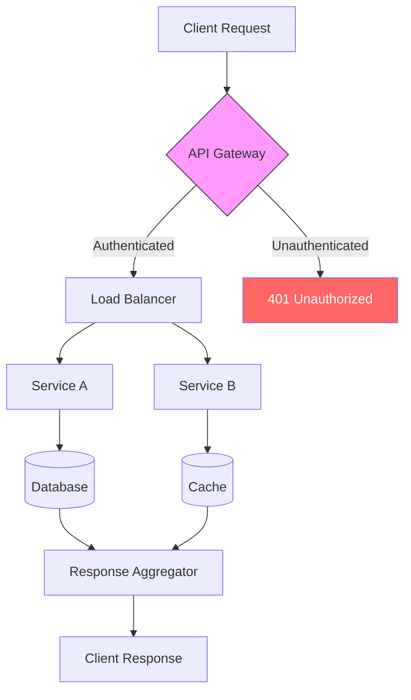

# Flowcharts

Best for process flows, decision trees, and general system interaction diagrams.

## Directions

```
graph TD          %% Top-Down
graph LR          %% Left-Right
graph BT          %% Bottom-Top
graph RL          %% Right-Left
```

## Node Shapes

```
A[Rectangle]
B(Rounded)
C([Stadium])
D[[Subroutine]]
E[(Database)]
F((Circle))
G{Diamond/Decision}
H{{Hexagon}}
I[/Parallelogram/]
J[\Reverse Parallelogram\]
K[/Trapezoid\]
L[\Reverse Trapezoid/]
M>Asymmetric]
```

## Edge Types

```
A --> B           %% Arrow
A --- B           %% Line
A -.- B           %% Dotted line
A -.-> B          %% Dotted arrow
A ==> B           %% Thick arrow
A -- text --> B   %% Arrow with text
A -. text .-> B   %% Dotted with text
A == text ==> B   %% Thick with text
A <--> B          %% Bidirectional
```

## Subgraphs

```
subgraph Title
  direction TB
  A --> B
end
```

## Styling

```
style A fill:#f9f,stroke:#333,stroke-width:4px
classDef className fill:#f96,stroke:#333
class A,B className
```

## Example — Request Processing Flow


