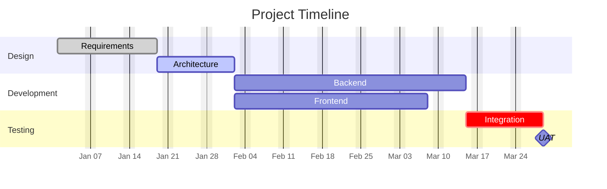

# Gantt Charts

For project schedules, timelines, and dependency tracking.

## Syntax

**Tags:** `done`, `active`, `crit`, `milestone`
**Dependencies:** `after taskId`
**Duration:** `14d` (days), or explicit end date
**Excludes:** `weekends`, specific dates `YYYY-MM-DD`, weekday names
