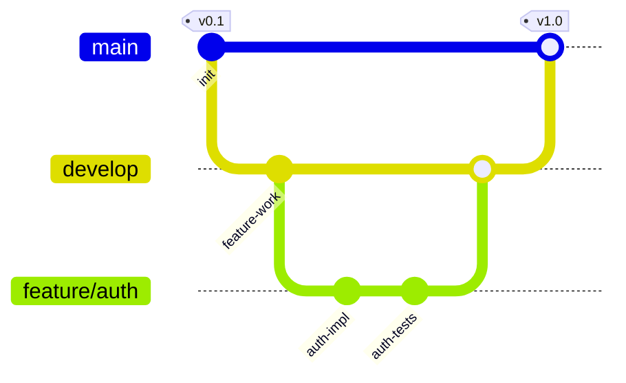

# Git Graphs

For branch and merge history visualization.

## Syntax

**Commands:** `commit`, `branch`, `checkout`, `merge`, `cherry-pick`
**Commit types:** `NORMAL` (default), `REVERSE` (crossed circle), `HIGHLIGHT` (filled rect)
**Orientation:** `gitGraph LR:` or `gitGraph TB:` or `gitGraph BT:`
