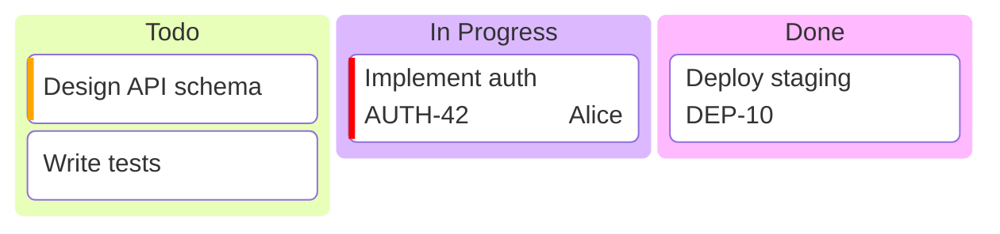

# Kanban Boards

For task workflow visualization.

## Syntax

**Metadata:** `@{assigned: "name", ticket: "ID", priority: "High"}`
**Priority values:** `Very High`, `High`, `Low`, `Very Low`
**Config:** `ticketBaseUrl: 'https://jira.example.com/browse/#TICKET#'` makes tickets clickable.
