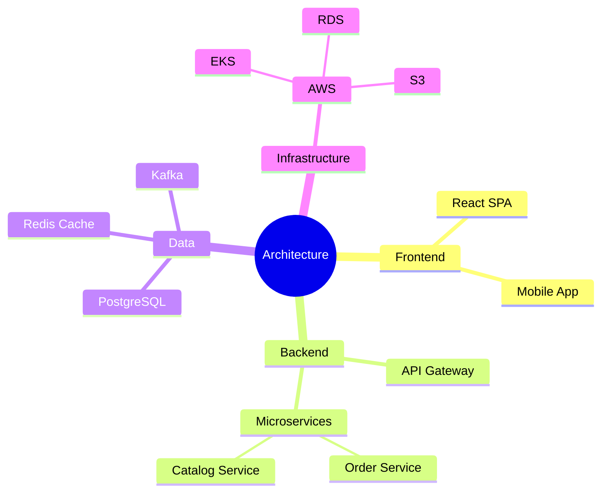

# Mindmaps

For architecture decision exploration and capability mapping.

## Syntax

**Node shapes:** `((Circle))`, `(Rounded)`, `[Square]`, `{{Hexagon}}`, `)Cloud(`, default (no brackets).
Indentation defines hierarchy.
