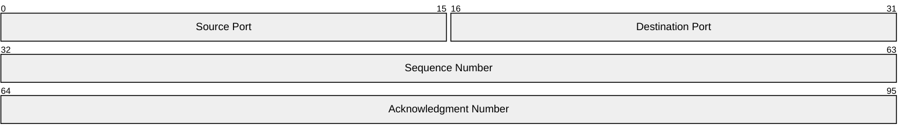

# Packet Diagrams

For network packet structure visualization.

## Syntax

**Bits syntax (v11.7.0+):** `+8: "Field"` auto-increments bit position.
**Config:** `bitsperrow` (default 32), `bitwidth`, `showbits` (true/false).
