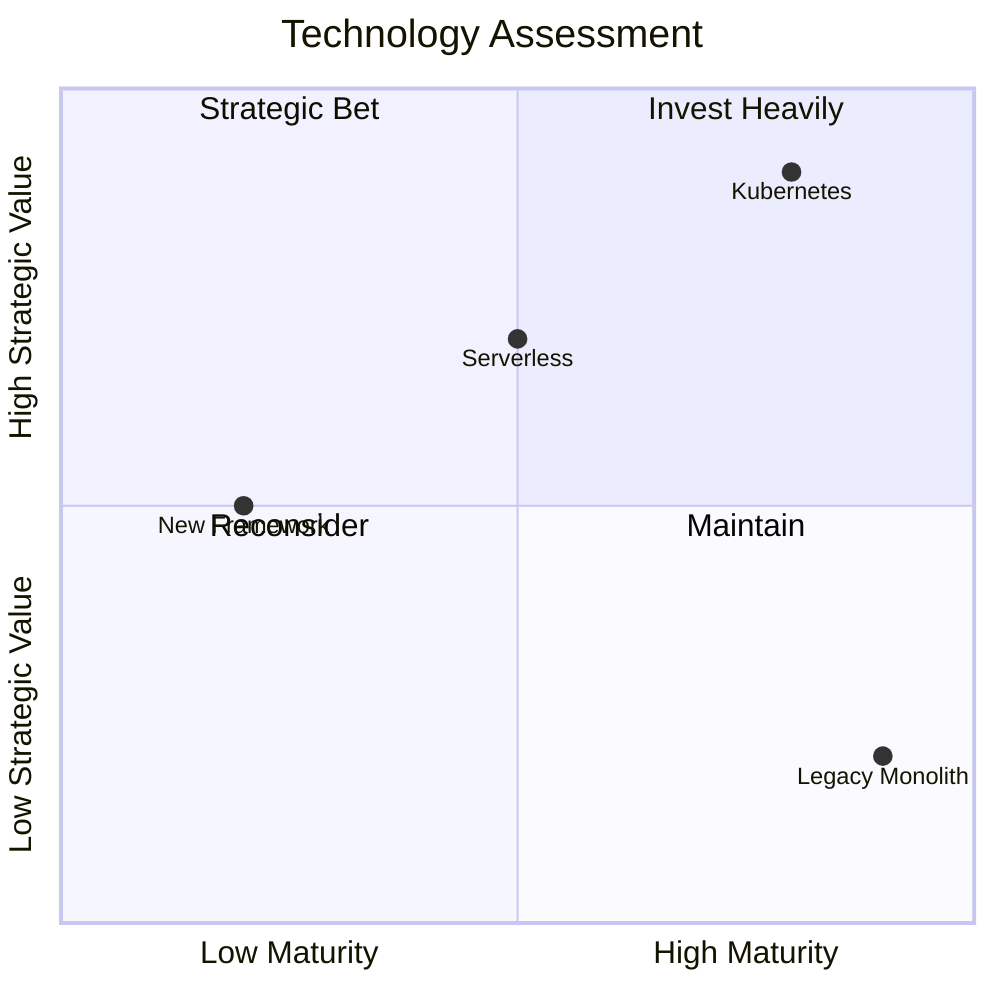

# Quadrant Charts

For technology assessments, build-vs-buy, risk matrices.

## Syntax Rules (strict parser)

- **quadrant-1** = top right, **quadrant-2** = top left, **quadrant-3** = bottom left, **quadrant-4** = bottom right
- Data point coordinates must be between 0 and 1: `Label: [x, y]`
- **Labels must be plain text** — no em dashes, parentheses, or special Unicode. Use hyphens (`-`) instead.
- Optional per-point styling: `Point: [0.5, 0.5] color: #ff3300, radius: 10`
- Optional CSS classes: `Point:::className: [0.5, 0.5]` with `classDef className color: #109060`

## Example

