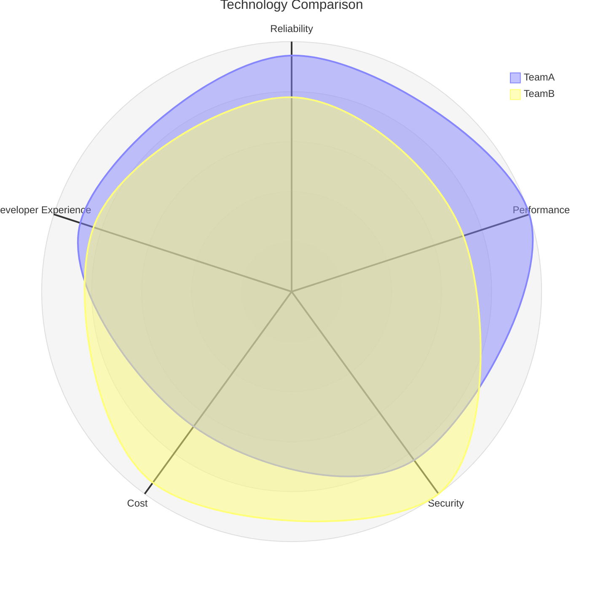

# Radar Charts

For multi-axis comparison (experimental).

## Syntax

**Config options:** `showLegend` (true/false), `max`/`min` (scale bounds), `ticks` (ring count), `graticule` (`circle` or `polygon`)
**Values:** Positional `{10, 20, 30}` or key-value `{axisId: 10, axisId2: 20}`
