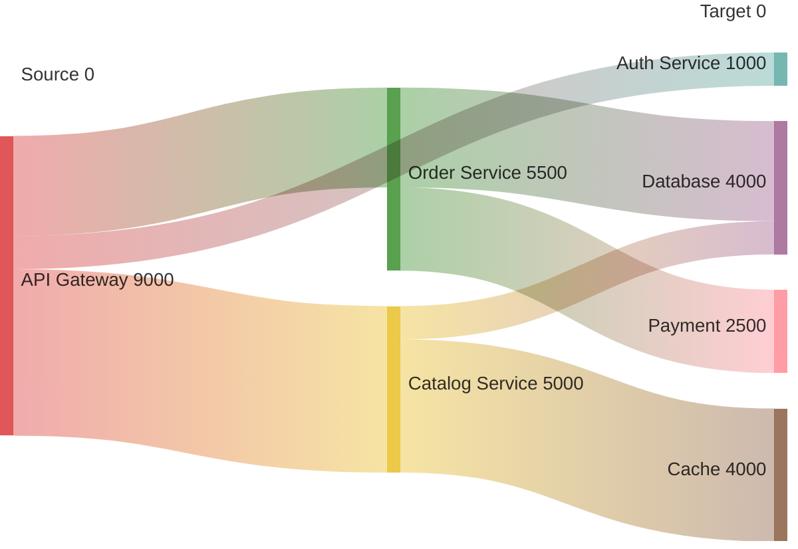

# Sankey Diagrams

For data flow volume visualization (e.g., request routing, data pipelines).

## Syntax

CSV format: `Source,Target,Value`. Values must be positive numbers. No quotes needed unless names contain commas.
