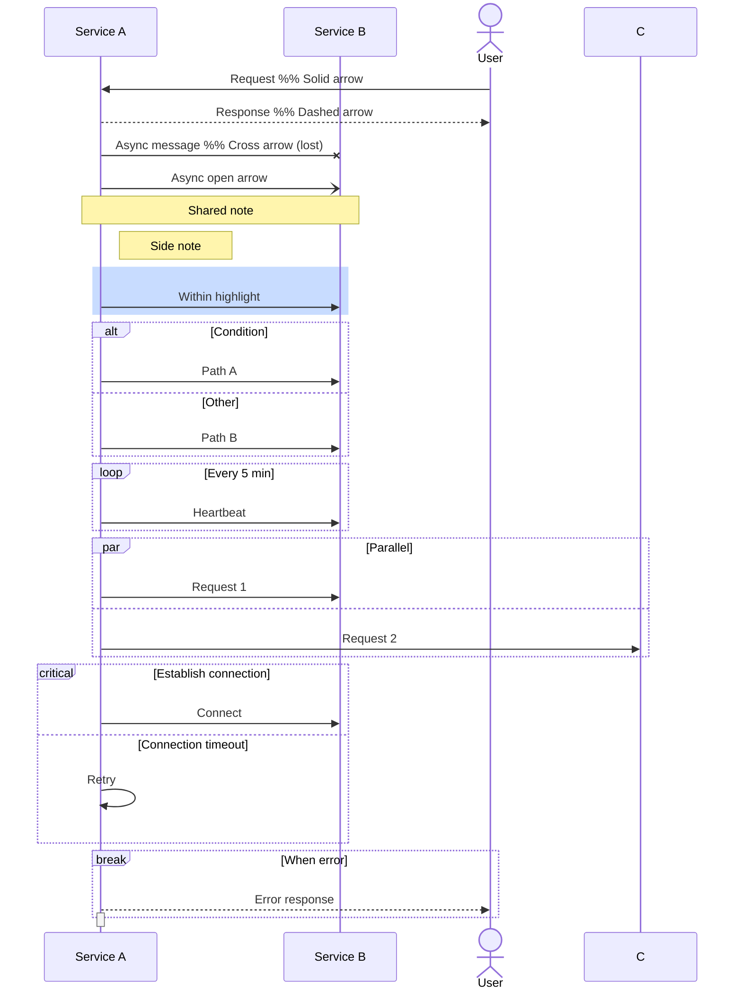
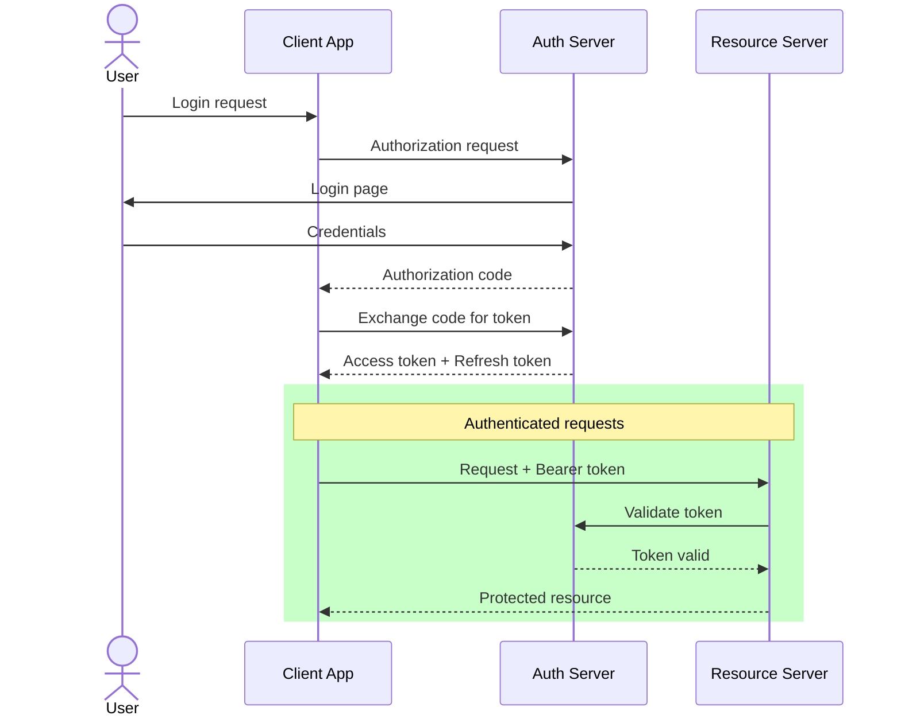

# Sequence Diagrams

Perfect for showing service-to-service interactions, API call flows, authentication flows.

## Syntax



## Activate/Deactivate — Two Syntaxes

1. **Explicit:** `activate X` / `deactivate X` as standalone lines
2. **Shorthand (preferred):** Append `+`/`-` to message arrows:
```
  A->>+B: Request    %% activates B
  B-->>-A: Response  %% deactivates B
```

## Activate/Deactivate Rules (critical — common source of syntax errors)

- Every `activate X` needs exactly one `deactivate X` — they must be balanced
- **Never deactivate inside both branches of `alt/else`** — this causes "inactivate an inactive participant" errors
- Instead, deactivate BEFORE the `alt` or AFTER the `end`:
- Activations can be stacked on the same participant (shows recursive/re-entrant calls)

```
  %% WRONG — RL deactivated in both branches = error in second branch:
  activate RL
  alt Condition
    RL-->>GW: A
    deactivate RL
  else
    RL-->>GW: B
    deactivate RL    %% ERROR: already inactive
  end

  %% CORRECT — deactivate before the branch:
  activate RL
  RL-->>GW: Response
  deactivate RL
  alt Condition
    GW-->>Client: Path A
  else
    GW-->>Client: Path B
  end
```

## Example — OAuth2 Flow


