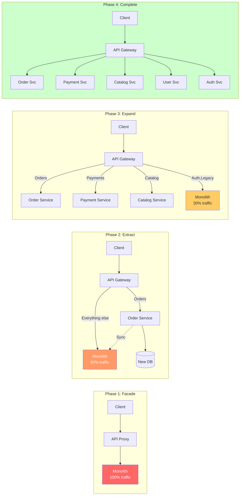
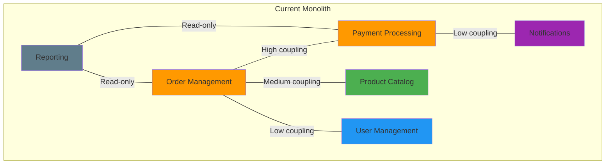
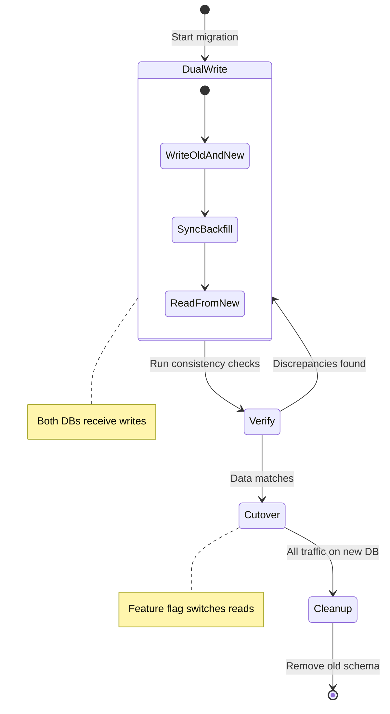
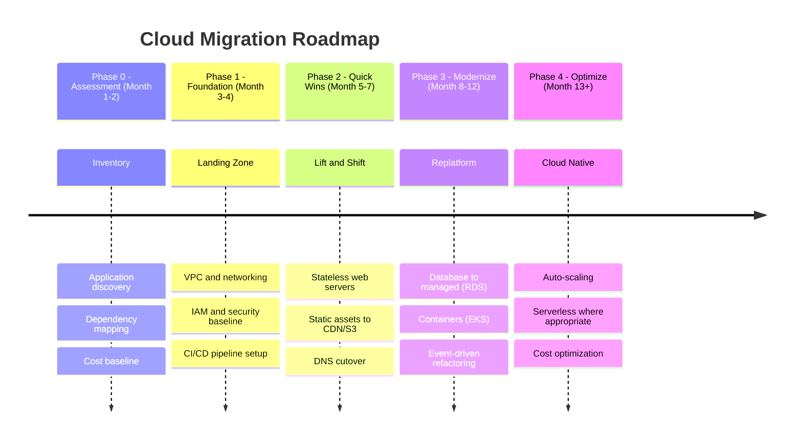

<!-- Imported from ai4developers/claude-code/claude-code-plugins/telekom-archi/skills/migration-planning by codex-knowledge-curation/scripts/persist_project_skills.py. -->

# Migration Planning Skill

You help users plan safe, incremental migrations between architectures. The cardinal rule: never do a big bang rewrite. Migrations succeed through small, reversible steps with continuous delivery of value.

## Migration Strategies (The 7 Rs)

| Strategy | Description | When to Use | Risk | Effort |
|----------|-------------|-------------|------|--------|
| **Rehost** (Lift & Shift) | Move as-is to cloud | Quick win, minimal changes needed | Low | Low |
| **Replatform** (Lift & Reshape) | Minor optimizations during move | Database upgrade, managed services | Low | Medium |
| **Refactor** | Re-architect for cloud-native | Performance, scalability needs | Medium | High |
| **Repurchase** | Replace with SaaS/COTS | Commodity functionality (CRM, HR) | Medium | Medium |
| **Retire** | Decommission | No longer needed | Low | Low |
| **Retain** | Keep as-is | Too risky/costly to move now | Low | None |
| **Relocate** | Move to different cloud region/provider | Compliance, latency, cost | Low | Medium |

## Monolith to Microservices

### Strangler Fig Pattern

The safest approach — gradually replace monolith functionality with new services:

### Decomposition Strategy

**Step 1: Identify Bounded Contexts**

**Step 2: Prioritize extraction** by:
1. Business value of independent deployment
2. Team ownership clarity
3. Coupling level (extract loosely-coupled first)
4. Technical risk

**Step 3: Extract one service at a time:**
1. Create the new service with its own database
2. Implement the Anti-Corruption Layer (ACL) between old and new
3. Dual-write or CDC to sync data during transition
4. Route traffic gradually (canary/feature flags)
5. Validate, then cut over
6. Remove old code from monolith

### Data Migration Strategy

## Cloud Migration

### Migration Roadmap (Timeline)

### Migration Risk Checklist

- [ ] Rollback plan for every migration step
- [ ] Data backup verified and tested
- [ ] Performance baseline established (before vs after)
- [ ] Network latency between cloud and on-prem measured
- [ ] DNS TTL lowered before cutover
- [ ] Feature flags for gradual traffic shifting
- [ ] Monitoring and alerting in place for new environment
- [ ] Team trained on new platform
- [ ] Compliance review completed
- [ ] Cost projections validated

## Technology Stack Migration

For framework/language migrations (e.g., Java 8 to 17, Angular to React):

1. **Assess** — Inventory all affected components, estimate effort
2. **Isolate** — Create adapter/facade around the component being migrated
3. **Implement** — Build new version behind the facade
4. **Test** — Run old and new in parallel, compare results
5. **Switch** — Gradual traffic shift
6. **Cleanup** — Remove old implementation and facade

## Output Format

Produce:
1. **Current state diagram** (C4 Context or Container)
2. **Target state diagram** (C4 Context or Container)
3. **Migration roadmap** (Mermaid timeline)
4. **Phase breakdown** with deliverables and risks per phase
5. **Strangler fig / decomposition plan** (Mermaid flowchart)
6. **Risk checklist**

Save to `docs/architecture/migration-plan.md`.
