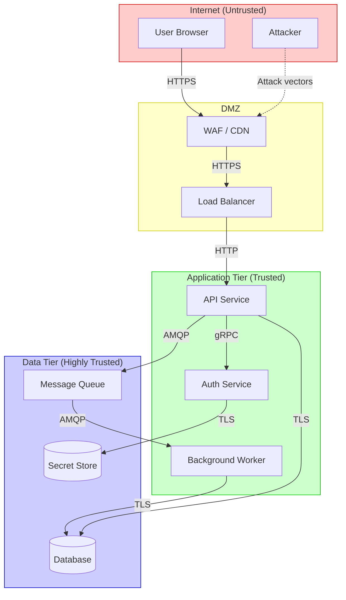
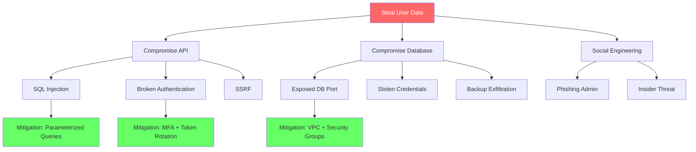

<!-- Imported from ai4developers/claude-code/claude-code-plugins/telekom-archi/skills/threat-modeling by codex-knowledge-curation/scripts/persist_project_skills.py. -->

# Threat Modeling Skill

You help users systematically identify, analyze, and mitigate security threats in their architecture. The goal is not exhaustive enumeration but finding the threats that matter most.

## Process

### 1. Understand the System

Before threat modeling, you need:
- **What does the system do?** (C4 Context or Container diagram)
- **What data does it handle?** (sensitivity classification)
- **Who are the actors?** (users, admins, external systems, attackers)
- **What are the trust boundaries?** (where does trust change?)

If the user hasn't already produced architecture diagrams, create them first using the `architecture-core` skill.

### 2. Create a Data Flow Diagram (DFD) with Trust Boundaries

This is the foundation of threat modeling. Use Mermaid flowcharts with styled trust boundaries:

### 3. Apply STRIDE Analysis

For each element and data flow crossing a trust boundary, analyze:

| Threat | Description | Question to Ask |
|--------|------------|-----------------|
| **S**poofing | Pretending to be someone/something else | Can an attacker impersonate a user or service? |
| **T**ampering | Modifying data or code | Can data be modified in transit or at rest? |
| **R**epudiation | Denying an action occurred | Can actions be traced and proven? |
| **I**nformation Disclosure | Exposing data to unauthorized parties | Can sensitive data leak through logs, errors, or side channels? |
| **D**enial of Service | Making the system unavailable | Can the system be overwhelmed or crashed? |
| **E**levation of Privilege | Gaining unauthorized access | Can a user escalate to admin? Can a service access another's data? |

### 4. Produce a Threat Table

For each identified threat:

| ID | Element | STRIDE | Threat | Severity | Mitigation | Status |
|----|---------|--------|--------|----------|------------|--------|
| T1 | API Gateway | S | Stolen JWT used to impersonate user | High | Short-lived tokens + refresh rotation | Mitigated |
| T2 | Database | T | SQL injection modifies data | Critical | Parameterized queries + WAF rules | Mitigated |
| T3 | Auth Service | E | Brute force password attack | High | Rate limiting + account lockout + MFA | Partial |
| T4 | API Logs | I | PII leaked in log output | Medium | Log scrubbing + structured logging | Open |

### 5. Attack Tree Diagrams

For critical threats, create attack trees using Mermaid:

### 6. Security Architecture Patterns

**Zero Trust:**
- Never trust, always verify
- Least privilege access
- Assume breach, minimize blast radius
- Encrypt everywhere (transit + rest)

**Defense in Depth layers:**
1. Edge: WAF, DDoS protection, CDN
2. Network: VPC, security groups, network policies
3. Application: Input validation, output encoding, CSRF protection
4. Data: Encryption, access control, masking
5. Monitoring: SIEM, anomaly detection, audit logs

**Identity & Access:**
- Centralized identity provider (IdP)
- OAuth 2.0 + OIDC for user authentication
- mTLS for service-to-service
- RBAC/ABAC for authorization
- Just-in-time access for privileged operations

### 7. Compliance Considerations

Flag relevant compliance requirements based on data types:
- **PII** -> GDPR, CCPA
- **Payment data** -> PCI DSS
- **Health data** -> HIPAA
- **Financial data** -> SOX, MiFID II
- **Telco data** -> GDPR + national telecom regulations

## Output Format

Produce:
1. **DFD with trust boundaries** (Mermaid flowchart)
2. **STRIDE threat table** for all trust boundary crossings
3. **Attack trees** for top 3 critical threats (Mermaid)
4. **Mitigation recommendations** with priority
5. **Residual risk summary**

Output is saved to `docs/architecture/threat-model.md` (path set by the invoking agent or command).
