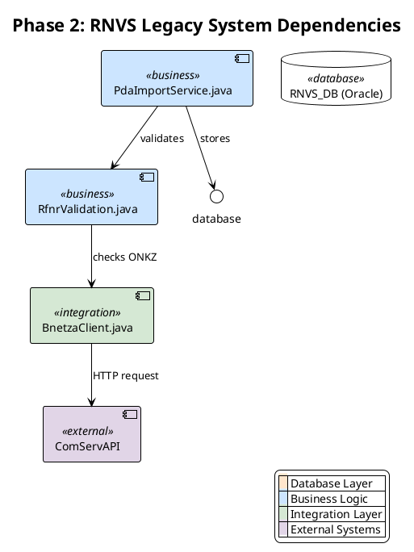
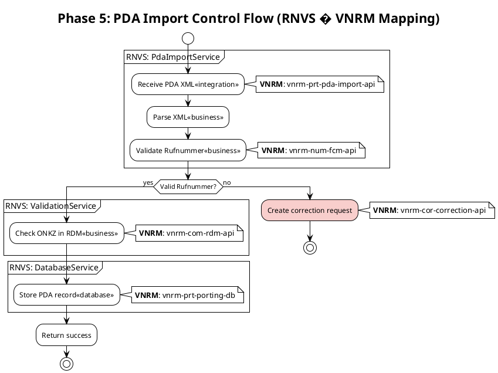
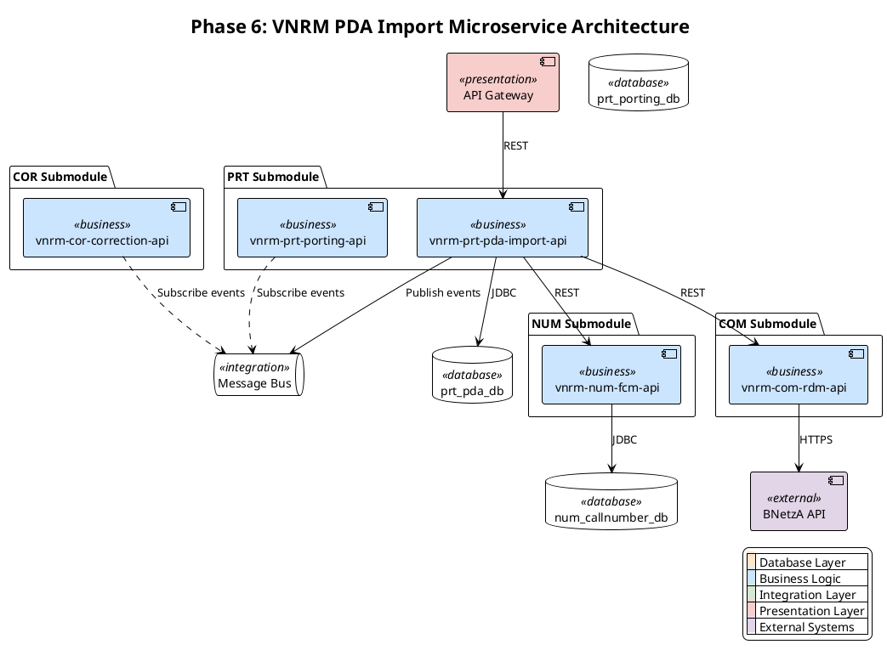
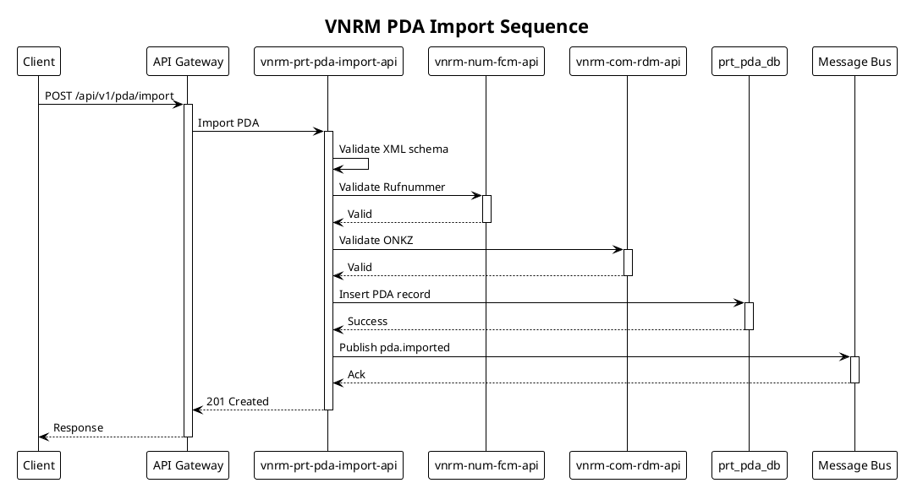

# PlantUML Generator - Usage Examples

Practical examples of generating PlantUML diagrams for RNVS�VNRM architecture visualization during phases 2, 5, 6, and 7.

## Example 1: Phase 2 - Legacy RNVS Dependency Diagram

### Scenario
Create component diagram showing legacy RNVS system dependencies after code analysis.

### Generated Diagram


---

## Example 2: Phase 5 - RNVS Control Flow with Mapping

### Scenario
Create activity diagram showing legacy control flow with RNVS�VNRM component mapping.

### Generated Diagram


---

## Example 3: Phase 6 - VNRM Microservice Architecture

### Scenario
Design component diagram for new VNRM PDA Import microservice architecture.

### Generated Diagram


---

## Example 4: Phase 7 - VNRM Control Flow with Resilience

### Scenario
Design activity diagram with circuit breakers and retry logic for VNRM.

### Generated Diagram
```plantuml
@startuml
!theme plain
title Phase 7: VNRM PDA Import with Resilience Patterns

skinparam activity {
  BackgroundColor<<business>> #CCE5FF
  BackgroundColor<<integration>> #D5E8D4
}

start

|vnrm-prt-pda-import-api|
:Receive PDA XML<<integration>>;

:Validate XML schema<<business>>;

if (Valid XML?) then (yes)
  :Parse PDA data<<business>>;

  partition "Validate Rufnummer (with retry)" {
    repeat
      :Call vnrm-num-fcm-api<<integration>>;
      note right
        **Retry**: 3 attempts
        **Backoff**: Exponential
      end note
    repeat while (Success?) is (no) not (yes)
  }

  partition "Validate ONKZ (with circuit breaker)" {
    if (Circuit breaker open?) then (yes)
      #FFF4CC:Use cached RDM data;
      note right
        **Circuit Breaker**
        Threshold: 50% failures
        Timeout: 30s
      end note
    else (no)
      :Call vnrm-com-rdm-api<<integration>>;
    endif
  }

  if (All validations pass?) then (yes)
    :Store in prt_pda_db<<business>>;
    :Publish pda.imported event;
    :Return 201 Created;
    stop
  else (no)
    #F8CECC:Create correction request;
    :Publish pda.correction.required event;
    :Return 202 Accepted;
    stop
  endif
else (no)
  #F8CECC:Return 400 Bad Request;
  stop
endif

@enduml
```

---

## Example 5: Sequence Diagram - Service Interaction

### Scenario
Show interaction between services during PDA import with validation.

### Generated Diagram


---

## Example 6: Using Python CLI Tool

### Scenario
Generate diagrams programmatically from JSON configuration.

### Component Diagram from JSON
```bash
python scripts/plantuml_generator.py generate component \
  --input examples/component-example.json \
  --output phase6_architecture.puml
```

**Input JSON** (`examples/component-example.json`):
```json
{
  "title": "VNRM PDA Import Architecture",
  "components": [
    {
      "name": "vnrm-prt-pda-import-api",
      "type": "business",
      "description": "PDA import service"
    },
    {
      "name": "prt_pda_db",
      "type": "database",
      "description": "PostgreSQL database"
    },
    {
      "name": "Message Bus",
      "type": "integration",
      "description": "Message broker"
    }
  ],
  "dependencies": [
    {
      "from": "vnrm-prt-pda-import-api",
      "to": "prt_pda_db",
      "label": "JDBC"
    },
    {
      "from": "vnrm-prt-pda-import-api",
      "to": "Message Bus",
      "label": "Publish events"
    }
  ],
  "color_scheme": {
    "database": "#FFE6CC",
    "business": "#CCE5FF",
    "integration": "#D5E8D4"
  }
}
```

### Activity Diagram from JSON
```bash
python scripts/plantuml_generator.py generate activity \
  --input examples/activity-example.json \
  --output phase7_workflow.puml
```

---

## Best Practices Demonstrated

### 1. Consistent Color Scheme
-  Use standard RNVS/VNRM colors across all diagrams
-  Always include legend for clarity
-  Apply colors via skinparam and stereotypes

### 2. Clear Labels and Notes
-  Descriptive component names
-  Notes for RNVS�VNRM mapping (Phase 5)
-  Notes for resilience patterns (Phase 7)

### 3. Layered Architecture
-  Separate presentation, business, integration, database layers
-  Show external systems distinctly
-  Use packages for logical grouping

### 4. Control Flow Clarity
-  Use swimlanes for multi-actor workflows
-  Show decision points clearly
-  Highlight error paths with red background

### 5. Validation Before Saving
-  Always validate syntax with `validate_syntax()`
-  Check for unclosed blocks
-  Verify stereotypes are defined
-  Test rendering before committing
