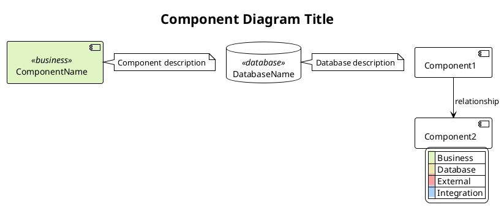
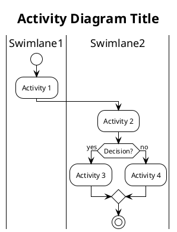
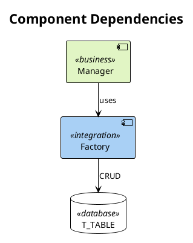
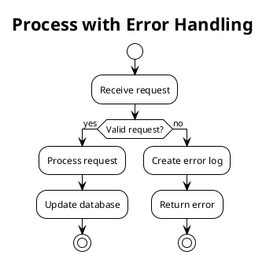
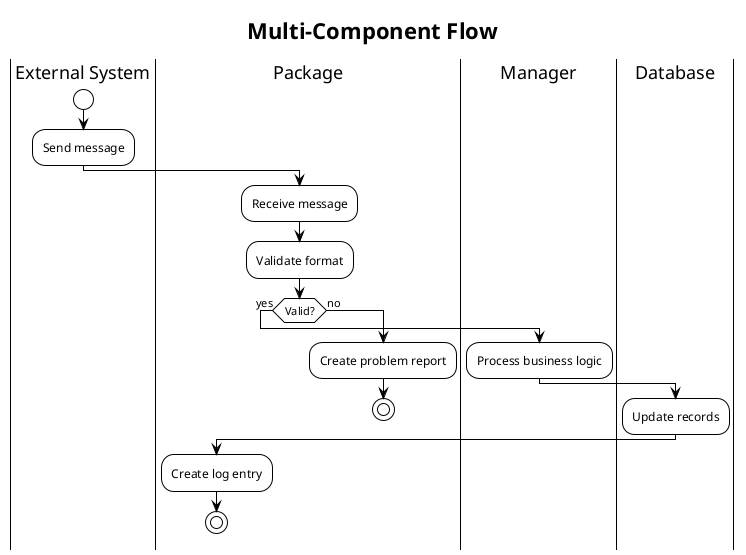

<!-- Imported from ai4developers/legacy-code-migration/rnvs-marketplace/rnvs-plugin/foundation/skills/plantuml-syntax by codex-knowledge-curation/scripts/persist_project_skills.py. -->

# PlantUML Diagram Syntax Expert

You are an expert in PlantUML diagram syntax. Provide accurate PlantUML code for component diagrams and activity diagrams following RNVS/VNRM standards.

## Component Diagram Syntax

### Basic Structure



### Component Types

- `[ComponentName]` - Regular component (use for managers, use cases)
- `database "Name"` - Database tables
- `[ExternalSystem]` - External systems
- `component "Name"` - Explicit component keyword (rarely needed)

### Component Naming Conventions

When the component name from Phase1 includes type information in parentheses, preserve it:
- `database "p_rnb (PL/SQL Package)" as p_rnb` - Use alias for references
- `[RNBManager]` - Simple component names don't need quotes
- `database "T_RNB"` - Database tables use quotes

### Stereotypes

- `<<business>>` - Business logic components (managers, use cases, orchestrators)
- `<<database>>` - Database tables
- `<<external>>` - External systems (CORBA, BNetzA, Oracle DB)
- `<<integration>>` - Integration layer (factories, repositories, adapters)

### Dependencies

```plantuml
[Component1] --> [Component2] : relationship label
database "T_TABLE" --> [Component] : SELECT/UPDATE
[Component] --> [ExternalSystem] : API call
```

### Notes

```plantuml
note right of [Component]
  Multi-line description
  of the component's
  responsibilities
end note

note left of database "T_TABLE"
  Table description
end note
```

### Legend

Always include a legend showing the color scheme:

```plantuml
legend right
  |<back:#E1F5C4>   </back>| Business |
  |<back:#EDE7B1>   </back>| Database |
  |<back:#FAA0A0>   </back>| External |
  |<back:#A9D0F5>   </back>| Integration |
endlegend
```

## Activity Diagram Syntax (New Beta Syntax)

### Important: Always Use New Beta Syntax

The old syntax with `(*)` is deprecated. Always use:
- `start` and `stop` keywords
- `if/endif` blocks
- `:Activity;` format (colon before, semicolon after)

### Basic Structure



### Key Elements

**Start and Stop**:
```plantuml
start
:First Activity;
:Second Activity;
stop
```

**Activities**:
```plantuml
:Single line activity;

:Multi-line
activity with
line breaks;

:Activity with method name
methodName()
Details here;
```

**Decisions (if/then/else/endif)**:
```plantuml
if (Condition?) then (yes)
  :Execute yes branch;
else (no)
  :Execute no branch;
endif
```

**Nested Decisions**:
```plantuml
if (First condition?) then (yes)
  if (Second condition?) then (yes)
    :Both conditions true;
  else (no)
    :First true, second false;
  endif
else (no)
  :First condition false;
endif
```

**Multiple End Points**:
```plantuml
if (Valid?) then (yes)
  :Process;
  stop
else (no)
  :Error handling;
  stop
endif
```

**Swimlanes**:
```plantuml
|Swimlane Name|
:Activity in this lane;

|Another Swimlane|
:Activity in different lane;

|Back to First|
:Activity in first lane again;
```

**Notes**:
```plantuml
:Activity;
note right
  Explanation of
  this activity
  and its rules
end note

:Another Activity;
note left
  Left-side note
end note
```

**Legend**:
```plantuml
legend right
  |<#90EE90>  | Start |
  |<#FFB6C1>  | End |
  |<#E1F5C4>  | Activity/Process |
  |<#FFD700>  | Decision Point |
endlegend
```

## Critical Rules for Activity Diagrams

1. **Do NOT use skinparam linetype ortho** - Causes syntax errors in activity diagrams
2. **Do NOT use stereotypes** - Activity syntax doesn't support `<<type>>` on activities
3. **Do NOT use old syntax** - No `(*)`, `-->`, `if/else/endif` with arrows
4. **Always match if/endif** - Every `if` must have exactly one `endif`
5. **Swimlane format** - Use `|Name|` with pipes, place before activities
6. **Activity format** - Always `:text;` with colon and semicolon

## RNVS/VNRM Color Scheme

### Component Diagrams
- **Business**: `#E1F5C4` (light green) - Core logic components
- **Database**: `#EDE7B1` (beige) - Database tables
- **External**: `#FAA0A0` (light red) - Third-party systems
- **Integration**: `#A9D0F5` (light blue) - Adapters, factories

### Activity Diagrams
- **Start**: `#90EE90` (light green)
- **End**: `#FFB6C1` (light pink)
- **Activity**: `#E1F5C4` (light green)
- **Decision**: `#FFD700` (gold)

## Common Patterns

### Component Diagram with Factories and Databases



### Activity Diagram with Error Handling



### Complex Flow with Multiple Swimlanes



## Examples

See the examples directory for complete working examples:
- `examples/component-example.puml` - Full component diagram
- `examples/activity-example.puml` - Basic activity diagram
- `examples/complex-flow.puml` - Complex multi-swimlane flow

## Troubleshooting

### If/endif mismatch errors
- Count your `if` statements
- Count your `endif` statements
- They must match exactly
- Check for properly nested structures

### Diagram not rendering
- Verify `@startuml` and `@enduml` are present
- Check for syntax errors in activities (missing semicolons)
- Ensure all decisions have endif
- Remove any `skinparam linetype ortho` from activity diagrams

### Swimlanes not working
- Use `|Name|` format with pipes
- Place swimlane declaration before activities
- Can switch swimlanes multiple times

## Best Practices

1. **Component Diagrams**:
   - Group related components visually
   - Use consistent stereotype naming
   - Include notes for non-obvious relationships
   - Always add a legend

2. **Activity Diagrams**:
   - Use swimlanes to show component interactions
   - Add notes for business rules
   - Keep decision logic clear
   - Show all end states (success, error)

3. **General**:
   - Use consistent naming from Phase1 analysis
   - Add descriptive titles
   - Include layout pragmas for better rendering
   - Test diagrams render before committing
