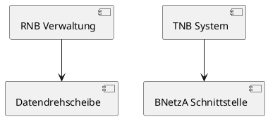
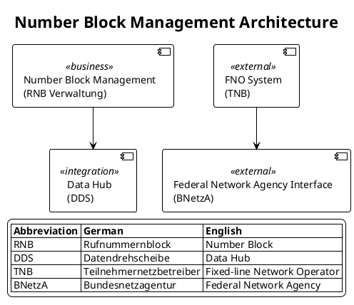

# German Glossary Usage Examples

Practical examples of using the german-glossary skill for RNVS/VNRM terminology translation.

---

## Example 1: Variable Translation

### Scenario
Analyzing Java code with German variable names:

```java
public class PortingService {
    private String rfnr;
    private RNB rnb;
    private String onkz;
    private String tnbKennung;

    public void processPortierung(String pdaExport) {
        // Business logic
    }
}
```

### Translation Process

1. **Look up each variable** in REFERENCE.md Variable Glossary
2. **Apply translations**:
   - `rfnr` → `callNumber` (Rufnummer - Phone number)
   - `rnb` → `numberBlock` (Rufnummernblock - Number block)
   - `onkz` → `areaCode` (Ortsnetzkennzahl - Area code)
   - `tnbKennung` → `fnoIdentifier` (Teilnehmernetzbetreiber-Kennung - FNO identifier)
   - `pdaExport` → `portingDataExport` (Portierungsdaten Austausch Export)

### Output Format

```markdown
# Variable Translation Table

| German Original | English Translation | German Full Form | Type | Location |
|----------------|---------------------|------------------|------|----------|
| rfnr | callNumber | Rufnummer | String | PortingService.java:2 |
| rnb | numberBlock | Rufnummernblock | Object | PortingService.java:3 |
| onkz | areaCode | Ortsnetzkennzahl | String | PortingService.java:4 |
| tnbKennung | fnoIdentifier | Teilnehmernetzbetreiber-Kennung | String | PortingService.java:5 |
| pdaExport | portingDataExport | Portierungsdaten Austausch Export | String | PortingService.java:7 |
```

---

## Example 2: Abbreviation Expansion in Documentation

### Scenario
Creating documentation with German abbreviations:

```
The RNB allocation process involves TNB coordination with BNetzA.
The PDA process uses DDS for data exchange between providers.
```

### Translation Process

1. **Look up abbreviations** in REFERENCE.md Technical Abbreviations
2. **Expand on first use**:
   - RNB → Rufnummernblock (Number Block)
   - TNB → Teilnehmernetzbetreiber (Fixed-line Network Operator)
   - BNetzA → Bundesnetzagentur (Federal Network Agency)
   - PDA → Portierungsdaten Austausch (Porting Data Exchange)
   - DDS → Datendrehscheibe (Data Hub)

### Output Format

```markdown
# Glossary

- **RNB** (Rufnummernblock): Number Block - Block of telephone numbers allocated by BNetzA
- **TNB** (Teilnehmernetzbetreiber): Fixed-line Network Operator - Telecom service provider
- **BNetzA** (Bundesnetzagentur): Federal Network Agency - German telecommunications regulator
- **PDA** (Portierungsdaten Austausch): Porting Data Exchange - Number portability process
- **DDS** (Datendrehscheibe): Data Hub - File exchange platform
```

---

## Example 3: PlantUML Diagram with German Terms

### Scenario
Creating a component diagram with German component names:



### Translation Process

1. **Translate component names**:
   - `RNB Verwaltung` → `Number Block Management (RNB Verwaltung)`
   - `Datendrehscheibe` → `Data Hub (DDS)`
   - `TNB System` → `FNO System (TNB)`
   - `BNetzA Schnittstelle` → `Federal Network Agency Interface (BNetzA)`

2. **Add legend with expansions**

### Output Format



---

## Example 4: Context-Aware Translation

### Scenario
Translating ambiguous German terms based on context:

#### Context 1: Porting Documentation
```
Der aktuelle Besitzer der Rufnummer ist TNB-A.
Der Eigentümer bleibt D001 (DTAG).
```

**Translation**:
- `Besitzer` → **possessor** (in porting context, current holder)
- `Eigentümer` → **owner** (legal owner)

**Output**:
```
The current possessor of the phone number is FNO-A.
The owner remains D001 (DTAG).
```

**Rationale**: In porting, we distinguish between the possessor (current user) and owner (legal originator).

#### Context 2: Booking System
```
Der Auftrag wurde erfolgreich gebucht.
```

**Translation**:
- `Auftrag` → **order** (booking context)

**Output**:
```
The order was successfully booked.
```

**Rationale**: In booking context, Auftrag means "order" not "task".

#### Context 3: Task Assignment
```
Der Auftrag wurde an Team B zugewiesen.
```

**Translation**:
- `Auftrag` → **task** (work assignment context)

**Output**:
```
The task was assigned to Team B.
```

**Rationale**: In work assignment context, Auftrag means "task".

---

## Example 5: Compound Word Decomposition

### Scenario
Breaking down long German compound words:

```
Rufnummernverwaltungssystem
Teilnehmernetzbetreiber
Muttervermittlungsstelle
```

### Translation Process

1. **Look up in REFERENCE.md Compound Words section**
2. **Identify component parts**
3. **Translate each part**
4. **Combine in English**

### Detailed Breakdown

#### Rufnummernverwaltungssystem
- **Parts**: Rufnummer + Verwaltung + System
- **Translations**: Call Number + Management + System
- **Combined**: Phone Number Management System
- **Abbreviation**: RNVS
- **Usage**: Keep as "RNVS" in technical documentation

#### Teilnehmernetzbetreiber
- **Parts**: Teilnehmer + Netz + Betreiber
- **Translations**: Subscriber + Network + Operator
- **Combined**: Fixed-line Network Operator
- **Abbreviation**: TNB (German), FNO (English)
- **Usage**: Use "FNO" in English documentation

#### Muttervermittlungsstelle
- **Parts**: Mutter + Vermittlung + Stelle
- **Translations**: Parent + Switching + Station
- **Combined**: Parent Exchange
- **Abbreviation**: MVSt
- **Usage**: "Parent Exchange (MVSt)" on first mention

---

## Example 6: Business Rules Documentation (German)

### Scenario
Documenting business rules with German terminology:

```markdown
Regel R001: Rufnummernvalidierung

Beschreibung:
Das System muss sicherstellen, dass die RNB-Buchung nur für
gültige ONKZ-Bereiche erfolgt, die von BNetzA freigegeben sind.

Validierung:
- ONKZ muss in der BNetzA-Liste vorhanden sein
- RNB muss für den TNB reserviert sein
- Keine aktive Portierung (PDA-Status = frei)
```

### Translation Process

1. **Keep German rule name** for traceability
2. **Add glossary section** with translations
3. **Provide English translation** if needed

### Output Format

```markdown
# Regel R001: Rufnummernvalidierung

## Beschreibung (Description)
Das System muss sicherstellen, dass die RNB-Buchung nur für
gültige ONKZ-Bereiche erfolgt, die von BNetzA freigegeben sind.

The system must ensure that number block (RNB) allocation only occurs
for valid area codes (ONKZ) that are approved by the Federal Network Agency (BNetzA).

## Glossar (Glossary)
- **RNB** (Rufnummernblock): Number Block - Block of telephone numbers
- **ONKZ** (Ortsnetzkennzahl): Area Code - Geographic area identifier
- **BNetzA** (Bundesnetzagentur): Federal Network Agency - German telecom regulator
- **TNB** (Teilnehmernetzbetreiber): Fixed-line Network Operator
- **PDA** (Portierungsdaten Austausch): Porting Data Exchange

## Validation Rules
- ONKZ must exist in BNetzA-approved list
- RNB must be reserved for the FNO (TNB)
- No active porting (PDA status = free)
```

---

## Example 7: Code Comments Translation

### Scenario
German code comments that need translation:

```java
/**
 * Prüft ob die ONKZ für den TNB gültig ist.
 * Berücksichtigt aktuelle Portierungen und Besitzer.
 */
public boolean validateONKZ(String onkz, String tnb) {
    // Prüfe BNetzA-Liste
    // Prüfe Besitzer vs Eigentümer
}
```

### Translation Process

1. **Translate comments** using glossary
2. **Preserve German terms in parentheses** for traceability
3. **Expand abbreviations**

### Output Format

```java
/**
 * Checks if the area code (ONKZ) is valid for the fixed-line network operator (TNB).
 * Considers current portings and possessor (Besitzer).
 *
 * ONKZ = Ortsnetzkennzahl (Area Code)
 * TNB = Teilnehmernetzbetreiber (Fixed-line Network Operator)
 */
public boolean validateAreaCode(String areaCode, String fnoIdentifier) {
    // Check Federal Network Agency (BNetzA) list
    // Check possessor (Besitzer) vs owner (Eigentümer)
}
```

---

## Example 8: Jira Story with German Terms

### Scenario
Creating a Jira story for Magenta Business (German audience):

```markdown
Als Product Owner möchte ich die RNB-Verwaltung für TNB-Kunden
über das ECC-Portal ermöglichen, damit die Buchung vereinfacht wird.

Akzeptanzkriterien:
- TNB kann RNB über ECC-Portal buchen
- BNetzA-Validierung erfolgt automatisch
- DDS-Export wird triggerd
```

### Translation Process

1. **Keep story in German** (target audience is German)
2. **Add glossary** for abbreviations
3. **Provide English summary** for international stakeholders

### Output Format

```markdown
# User Story (German)

**Als** Product Owner
**möchte ich** die RNB-Verwaltung für TNB-Kunden über das ECC-Portal ermöglichen,
**damit** die Buchung vereinfacht wird.

## Glossar
- **RNB**: Rufnummernblock (Number Block)
- **TNB**: Teilnehmernetzbetreiber (Fixed-line Network Operator)
- **ECC**: Magenta Business Portal
- **BNetzA**: Bundesnetzagentur (Federal Network Agency)
- **DDS**: Datendrehscheibe (Data Hub)

## Akzeptanzkriterien
1. TNB kann RNB über ECC-Portal buchen
2. BNetzA-Validierung erfolgt automatisch
3. DDS-Export wird getriggert

---

# English Summary

**As** Product Owner
**I want** to enable number block (RNB) management for fixed-line network operators (TNB) via the ECC portal,
**so that** the booking process is simplified.

## Acceptance Criteria
1. FNO can book number blocks via ECC portal
2. Federal Network Agency (BNetzA) validation happens automatically
3. Data Hub (DDS) export is triggered
```

---

## Example 9: Batch Translation

### Scenario
Multiple German terms found in a code file:

```
rfnr, rnb, onkz, tnbKennung, RNB, TNB, ONKZ, BNetzA, portierung,
Rufnummernverwaltungssystem
```

### Translation Process

1. **Group by type**:
   - Variables: rfnr, rnb, onkz, tnbKennung, portierung
   - Abbreviations: RNB, TNB, ONKZ, BNetzA
   - Compound: Rufnummernverwaltungssystem

2. **Look up each** in appropriate REFERENCE.md section

### Output Format

```markdown
# Batch Translation Results

## Variables
| German | English | Full Form | Type |
|--------|---------|-----------|------|
| rfnr | callNumber | Rufnummer | String |
| rnb | numberBlock | Rufnummernblock | Object |
| onkz | areaCode | Ortsnetzkennzahl | String |
| tnbKennung | fnoIdentifier | Teilnehmernetzbetreiber-Kennung | String |
| portierung | porting | Portierung | Object |

## Abbreviations
| Abbr | German | English | Context |
|------|--------|---------|---------|
| RNB | Rufnummernblock | Number Block | Block of telephone numbers |
| TNB | Teilnehmernetzbetreiber | Fixed-line Network Operator | Telecom service provider |
| ONKZ | Ortsnetzkennzahl | Area Code | Geographic area identifier |
| BNetzA | Bundesnetzagentur | Federal Network Agency | German telecom regulator |

## Compound Words
| German | Parts | English | Abbr |
|--------|-------|---------|------|
| Rufnummernverwaltungssystem | Rufnummer + Verwaltung + System | Phone Number Management System | RNVS |
```

---

## Best Practices Summary

1. **Always consult REFERENCE.md** for accurate translations
2. **Provide both forms**: German (English) for traceability
3. **Use context clues** for ambiguous terms (Besitzer, Auftrag)
4. **Expand abbreviations** on first use
5. **Keep system names** (RNVS, VNRM, DDS) as-is
6. **Document unknowns** if a term isn't in the glossary
7. **Use appropriate context** (porting vs legal vs booking)
8. **Include glossary sections** in documentation
9. **Preserve German** in business documentation for German audiences
10. **Add English summaries** for international stakeholders
