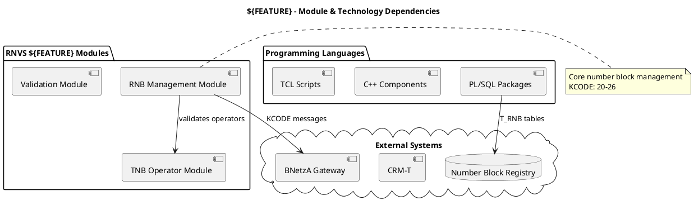
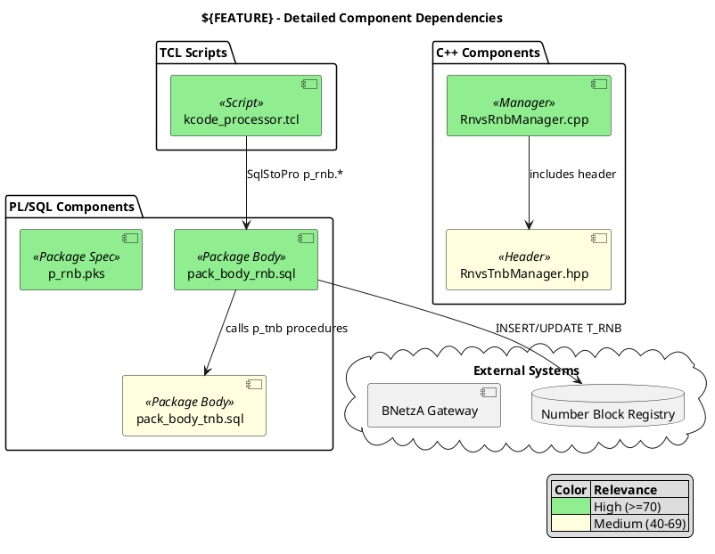

# PlantUML Patterns for RNVS Dependency Diagrams

RNVS-specific PlantUML templates and styling patterns.

---

## Module Diagram Template (dependencies.puml)



---

## Detailed Diagram Template (dependencies_detailed.puml)



---

## Essential PlantUML Syntax

**Aliases** (for long file names):
```plantuml
[pack_body_rnb.sql] as RNB_BODY
```

**Stereotypes** (for component types):
```plantuml
[file.sql] <<Package Body>>
[file.cpp] <<Manager>>
[file.tcl] <<Script>>
```

**Color coding**:
```plantuml
RNB_BODY #LightGreen   ' High relevance
TNB_BODY #LightYellow  ' Medium relevance
```

**Layout hints** (for cleaner diagrams):
```plantuml
A -down-> B    ' Force downward
A -right-> B   ' Force rightward
```

**Notes** (for business context):
```plantuml
note right of RNB
  KCODE 20-26 processing
end note
```

---

## RNVS Naming Conventions

| File Pattern | Stereotype | Typical Relevance |
|--------------|------------|-------------------|
| `pack_body_*.sql` | <<Package Body>> | High (core logic) |
| `p_*.pks` | <<Package Spec>> | High |
| `*Manager.cpp` | <<Manager>> | High |
| `*.hpp` | <<Header>> | Medium |
| `*_processor.tcl` | <<Script>> | Medium-High |
| `*_utils.tcl` | <<Utility>> | Low-Medium |
