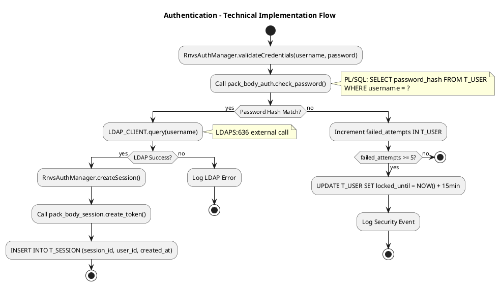
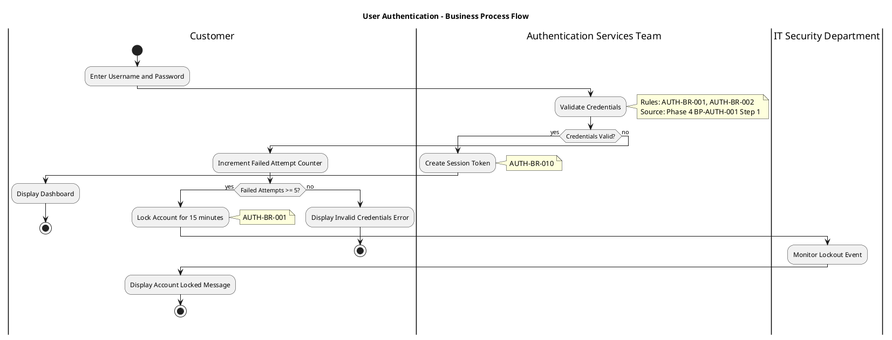

# PlantUML Control Flow Patterns

Domain-specific PlantUML patterns for RNVS control flow diagrams.

---

## Technical Diagram Pattern (No Swimlanes)



---

## Business Diagram Pattern (With Swimlanes)



---

## Key PlantUML Elements

| Element | Syntax | Count as Node? |
|---------|--------|----------------|
| Start | `start` | Yes |
| Stop/End | `stop` | Yes |
| Activity | `:Activity Name;` | Yes |
| Decision | `if (Condition?) then (yes) ... else (no) ... endif` | Yes (1 per if) |
| Swimlane | `\|Stakeholder Name\|` | No |
| Note | `note right ... end note` | No |
| Parallel | `fork ... fork again ... end fork` | Yes (3 total) |

---

## Sub-Diagram Referencing

When a diagram exceeds 15 nodes, extract complex sub-processes:

```plantuml
' Main diagram
:User Login Request;

:Execute Authentication Workflow;
note right
  **See sub-diagram**: control-flow-diagram-auth-validation.puml
  Details: Credential validation, LDAP integration, error handling
  Nodes: 8 (under 15 limit)
end note

:Display Dashboard;
```

---

## Source Citation Annotations

Always cite Phase sources in notes:

```plantuml
:Validate Credentials;
note right
  Rules: AUTH-BR-001, AUTH-BR-002
  Source: Phase 4 BP-AUTH-001 Step 1
  Owner: Authentication Services Team
end note
```

For technical diagrams:

```plantuml
:pack_body_auth.check_password();
note right
  PL/SQL Procedure
  Database: SELECT FROM T_USER
  Source: Phase 1 dependency-graph.json
end note
```

---

## RNVS-Specific Patterns

### BNetzA Integration (KCODE Processing)

```plantuml
|BNetzA Gateway|
:Receive KCODE Message;

|RNVS RNB Team|
:Parse KCODE Header;

if (KCODE Type?) then (20-Assignment)
  :Process Number Block Assignment;
  note right: KCODE 20 - NBM-BR-001
else (2100-Modification)
  :Process Block Modification;
  note right: KCODE 2100 - NBM-BR-015
endif
```

### Porting Workflow (PDA)

```plantuml
|Carrier A (Abgebend)|
:Send PDA Portierungsanfrage;

|RNVS Porting System|
:Validate PDA Message Syntax;
note right: PDA-BR-001 - AT timing rules

if (Valid Syntax?) then (yes)
  :Check Number Ownership;
  if (Owner Matches?) then (yes)
    :Schedule Porting Date;
    |Carrier B (Aufnehmend)|
    :Confirm Porting Request;
    stop
  else (no)
    :Reject - Invalid Owner;
    stop
  endif
else (no)
  :Reject - Syntax Error;
  stop
endif
```
