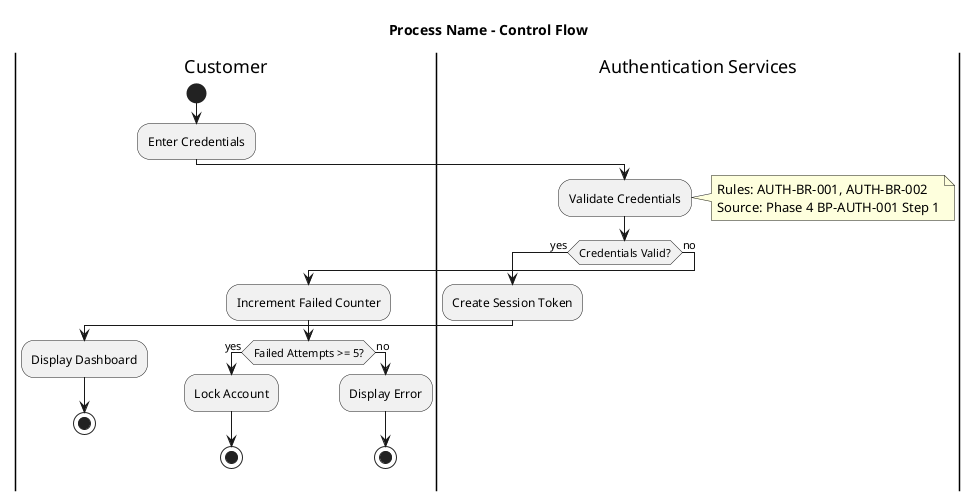

<!-- Imported from ai4developers/legacy-code-migration/rnvs-marketplace/rnvs-plugin/workflow/skills/05-control-flow-visualization-workflow by codex-knowledge-curation/scripts/persist_project_skills.py. -->

<required_reading>
Read `results/${FEATURE}/.workflow-state.md` before any operation.
This provides workflow mode, completed phases, and session context.
</required_reading>

# Phase 5: Control Flow Visualization Workflow

**Purpose**: Create PlantUML flow diagrams from technical and business analysis to document RNVS system processes.

**When to use**: After Phase 3 (Business Rule Extraction) and Phase 4 (Business Documentation) are complete.

---

## Prerequisites

<prerequisites>
**Feature Identification** - check in order, stop at first match:

1. **User provided feature name** (e.g., "/05-control-flow-visualization-workflow NBM") → use directly
2. **Conversation context** → use feature from earlier in session
3. **Single feature in results/** → `Glob results/*/feature-definition.json` - if exactly one, use it
4. **Multiple features** → use AskUserQuestion to let user select
5. **No features** → "Run /00-feature-definition-workflow first"

**Verify Phase 4 outputs exist**:
- `results/${FEATURE}/phase4/business-documentation.json`
- `results/${FEATURE}/phase4/business-process.json`

If missing → "Complete /04-business-documentation-workflow first."
</prerequisites>

---

## Step 0: Load Workflow State

Read `results/${FEATURE}/.workflow-state.md` and verify:

1. **Phase Check**: Phase 4 must be ✅ Complete
2. **Status**: Should be "In Progress"

If state file missing: "Run /00-feature-definition-workflow first to initialize workflow state."

**Update state**: Set Phase 5 to 🔄 In Progress, update Last Activity.

---

## Workflow Overview

1. **Load Phase 1-4 results** - Technical components (Phase 1-2) and business processes (Phase 3-4)
2. **Create technical diagrams FIRST** - Component interactions, database operations, system calls
3. **Create business diagrams SECOND** - Stakeholder interactions, business decisions, process flows
4. **User validation** - Present diagrams grouped by business process
5. **Generate outputs** - control-flow-diagram.puml and control-flow-mapping.json

---

## Key Principles

### 1. Source Priority

**Technical Control Flow Diagrams** (Created FIRST):
- **Audience**: Developers, DBAs, DevOps Engineers
- **Sources**: Phase 1 file-inventory.json (PRIMARY) → Phase 2 dependencies.puml → Phase 3 ruletable.json
- **Focus**: Component-to-component interactions, database operations, external system calls, technical error handling
- **No swimlanes** (technical components don't need stakeholder separation)

**Business Control Flow Diagrams** (Created SECOND):
- **Audience**: Business stakeholders, Product Owners, Business Analysts
- **Sources**: Phase 4 business-process.json (PRIMARY) → Phase 3 ruletable.json → Technical diagrams (REFERENCE)
- **Focus**: Stakeholder interactions, business decisions, regulatory compliance steps
- **Swimlanes**: Separate lanes per stakeholder group

### 2. Node Count Limit

**CRITICAL: Maximum 15 nodes per diagram** (all diagram types)

- **Node definition**: Process steps (`:Step;`), decision points (`if/endif`), start/end nodes
- If exceeded: Create sub-diagrams and reference in main diagram with notes
- Document node count in control-flow-mapping.json

### 3. Anti-Hallucination

**Source-backed only**:
- Flow steps from Phase 4 business_processes.process_steps
- Decision points from Phase 3 conditional rules
- Stakeholder swimlanes from Phase 4 stakeholder_analysis
- External systems from Phase 2 dependencies.puml

**NOT allowed**:
- Inventing process steps not in Phase 4
- Adding decision logic without corresponding Phase 3 rule
- Creating swimlanes for undocumented stakeholders

For complete checklist, see [ANTI-HALLUCINATION.md](ANTI-HALLUCINATION.md).

---

## PlantUML Control Flow Patterns

Consult **plantuml-syntax** skill for comprehensive PlantUML syntax reference.

**Key Elements for Control Flow**:



For more PlantUML patterns, see [PLANTUML-PATTERNS.md](PLANTUML-PATTERNS.md).

---

## Diagram Planning

**Single Diagram**: ≤3 processes AND ≤12 steps AND all processes under 15 nodes
**Master + Detailed**: ≤8 processes AND some exceed single diagram capacity
**Layered Approach**: >8 processes - executive summary + detailed per process

**Sub-Diagram Referencing** (when >15 nodes):

```plantuml
:Execute Authentication Workflow;
note right
  **See sub-diagram**: control-flow-diagram-auth-details.puml
  Sub-process: Credential validation
end note
```

---

## Foundation Skills

- **plantuml-syntax**: PlantUML syntax reference for activity diagrams
- **diagram-validator**: Diagram quality validation
- **german-glossary**: German terminology translation for RNVS terms

---

## Output Files

- `results/${FEATURE}/phase5/control-flow-diagram.puml` (or master + detailed)
- `results/${FEATURE}/phase5/control-flow-mapping.json`
- `results/${FEATURE}/phase5/PHASE5_SUMMARY.md`

For JSON schema, see [OUTPUT-SCHEMA.md](OUTPUT-SCHEMA.md).

---

## Success Criteria

Phase 5 succeeds when:

1. control-flow-diagram.puml exists and passes PlantUML syntax validation
2. control-flow-mapping.json exists with complete flow element mapping
3. All flow nodes traced to Phase 4 business-process.json
4. All decision points backed by Phase 3 conditional rules
5. All stakeholder swimlanes from Phase 4 stakeholder_analysis
6. Node count ≤15 per diagram (sub-diagrams created if exceeded)
7. User has validated diagrams
8. Ready for Phase 6

---

## Final Step: Update Workflow State

After user validates diagrams, update `results/${FEATURE}/.workflow-state.md`:

1. **Phase 5**: Set to ✅ Complete with timestamp
2. **Last Activity**: "Completed Phase 5 control flow visualization"
3. **Next Action**: Depends on workflow mode:
   - **Mode UNKNOWN**: "Choose next phase: /06-vnrm-analysis-workflow (CHANGE mode) or /07-0-microservice-design-workflow (NEW mode)"
   - **Mode already set**: Appropriate next phase
4. **Decisions Log**: Add any flow diagram decisions

---

## Quick Reference

| Document | Purpose |
|----------|---------|
| [PLANTUML-PATTERNS.md](PLANTUML-PATTERNS.md) | PlantUML control flow syntax and examples |
| [OUTPUT-SCHEMA.md](OUTPUT-SCHEMA.md) | JSON schema for control-flow-mapping.json |
| [ANTI-HALLUCINATION.md](ANTI-HALLUCINATION.md) | Source verification checklist |

---

**Remember**: Phase 5 transforms business processes into visual control flow diagrams. Create technical diagrams first (Phase 1-3 sources), then business diagrams (Phase 3-4 sources). Maximum 15 nodes per diagram. All flow elements must be backed by sources - no speculation.
