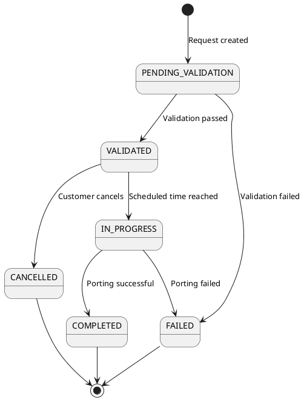

# State Machine Delta Design Patterns

**Purpose**: Design patterns for state machine changes in delta model (new_states, new_transitions).

**Context**: Phase 7.1 captures ONLY new states and transitions added to existing microservice state machines.

---

## New States

### Requirements

Every state in `new_states` MUST include:

1. **State Name**: Clear, descriptive state identifier (UPPER_SNAKE_CASE)
2. **Description**: What this state represents in business terms
3. **State Type**: Initial, intermediate, terminal (final)
4. **Allowed Transitions**: What states can follow this state
5. **Business Rules**: Rules enforced in this state

### State Naming Conventions

**Pattern**: `{ENTITY}_{STATUS}` or `{WORKFLOW_STAGE}`

**Examples**:
- `PORTABILITY_REQUEST_PENDING_VALIDATION`
- `PORTABILITY_REQUEST_VALIDATED`
- `PORTABILITY_REQUEST_IN_PROGRESS`
- `PORTABILITY_REQUEST_COMPLETED`
- `PORTABILITY_REQUEST_FAILED`
- `PORTABILITY_REQUEST_CANCELLED`

**State Types**:
- **Initial**: Starting state when entity is created
- **Intermediate**: Transient states during workflow
- **Terminal**: Final states (success or failure, no further transitions)

### Template

```json
{
  "state_name": "ENTITY_STATUS",
  "description": "Business meaning of this state",
  "state_type": "initial | intermediate | terminal",
  "allowed_next_states": ["STATE_1", "STATE_2"],
  "business_rules_enforced": ["BR-XXX", "BR-YYY"],
  "entry_actions": ["Actions performed when entering this state"],
  "exit_actions": ["Actions performed when leaving this state"]
}
```

### Complete Example: Portability Request States

```json
{
  "new_states": [
    {
      "state_name": "PENDING_VALIDATION",
      "description": "Portability request created but not yet validated. Awaiting validation service processing.",
      "state_type": "initial",
      "allowed_next_states": ["VALIDATED", "FAILED"],
      "business_rules_enforced": [
        "BR-PORT-001: Request must have all required fields",
        "BR-PORT-004: Customer consent must be true"
      ],
      "entry_actions": [
        "Publish prt.portability-request.created event",
        "Create validation task in queue"
      ],
      "exit_actions": [],
      "average_duration": "30 seconds (time until validation completes)",
      "sla": "Validation must complete within 2 minutes"
    },
    {
      "state_name": "VALIDATED",
      "description": "Portability request passed all validations. Ready for carrier notification and scheduling.",
      "state_type": "intermediate",
      "allowed_next_states": ["IN_PROGRESS", "CANCELLED"],
      "business_rules_enforced": [
        "BR-PORT-003: Desired port date must be at least 7 days in future"
      ],
      "entry_actions": [
        "Publish prt.portability-request.validated event",
        "Send notification to donor carrier",
        "Send notification to recipient carrier",
        "Schedule port execution job for desired_port_date"
      ],
      "exit_actions": [],
      "average_duration": "Variable (days until desired_port_date)"
    },
    {
      "state_name": "IN_PROGRESS",
      "description": "Porting process actively executing. Number transfer in progress between carriers.",
      "state_type": "intermediate",
      "allowed_next_states": ["COMPLETED", "FAILED", "CANCELLED"],
      "business_rules_enforced": [
        "BR-PORT-010: Porting window must be during business hours (8am-6pm)",
        "BR-PORT-011: Porting must not exceed 4-hour window"
      ],
      "entry_actions": [
        "Publish prt.portability-request.in-progress event",
        "Initiate number release at donor carrier",
        "Initiate number activation at recipient carrier",
        "Update MNP-DB (Mobile Number Portability Database)"
      ],
      "exit_actions": [],
      "average_duration": "2 hours (porting execution window)",
      "sla": "Must complete within 4 hours or rollback"
    },
    {
      "state_name": "COMPLETED",
      "description": "Portability successfully completed. Number now active at recipient carrier.",
      "state_type": "terminal",
      "allowed_next_states": [],
      "business_rules_enforced": [],
      "entry_actions": [
        "Publish prt.portability-request.completed event",
        "Update number ownership in number registry",
        "Send completion notification to customer",
        "Archive request (soft delete after 90 days)"
      ],
      "exit_actions": [],
      "terminal_state_reason": "Success - workflow completed normally"
    },
    {
      "state_name": "FAILED",
      "description": "Portability failed due to validation errors or technical issues. Requires manual investigation.",
      "state_type": "terminal",
      "allowed_next_states": [],
      "business_rules_enforced": [],
      "entry_actions": [
        "Publish prt.portability-request.failed event",
        "Create incident ticket for ops team",
        "Send failure notification to customer",
        "Rollback any partial changes"
      ],
      "exit_actions": [],
      "terminal_state_reason": "Failure - validation failed or technical error",
      "error_categorization": ["VALIDATION_ERROR", "TECHNICAL_ERROR", "CARRIER_REJECTION"]
    },
    {
      "state_name": "CANCELLED",
      "description": "Portability cancelled by customer or carrier before completion.",
      "state_type": "terminal",
      "allowed_next_states": [],
      "business_rules_enforced": [
        "BR-PORT-015: Cancellation only allowed before IN_PROGRESS state"
      ],
      "entry_actions": [
        "Publish prt.portability-request.cancelled event",
        "Send cancellation notification to carriers",
        "Release any reserved resources"
      ],
      "exit_actions": [],
      "terminal_state_reason": "Cancelled by user or carrier"
    }
  ]
}
```

---

## New Transitions

### Requirements

Every transition in `new_transitions` MUST include:

1. **From State**: Source state
2. **To State**: Target state
3. **Trigger**: Event or API call that causes transition
4. **Validation**: Business rules checked before transition
5. **Actions**: Side effects when transition occurs
6. **Authorization**: Who can trigger this transition

### Template

```json
{
  "from_state": "SOURCE_STATE",
  "to_state": "TARGET_STATE",
  "trigger": {
    "type": "event | api | timer | external",
    "description": "What causes this transition"
  },
  "validation": {
    "business_rules": ["BR-XXX"],
    "preconditions": ["Conditions that must be true"]
  },
  "actions": {
    "database_updates": ["What data changes"],
    "events_published": ["Events to publish"],
    "external_calls": ["External APIs to call"]
  },
  "authorization": {
    "roles": ["Who can trigger"],
    "special_conditions": ["Additional authorization rules"]
  }
}
```

### Complete Example: Portability Request Transitions

```json
{
  "new_transitions": [
    {
      "from_state": "PENDING_VALIDATION",
      "to_state": "VALIDATED",
      "trigger": {
        "type": "event",
        "event_name": "prt.validation.completed",
        "description": "Validation service publishes validation result event"
      },
      "validation": {
        "business_rules": [
          "BR-PORT-001: MSISDN valid German mobile number",
          "BR-PORT-002: Donor and recipient carriers different",
          "BR-PORT-003: Desired port date at least 7 days in future"
        ],
        "preconditions": [
          "Donor carrier exists and is active",
          "Recipient carrier exists and is active",
          "Number ownership verified"
        ]
      },
      "actions": {
        "database_updates": [
          "UPDATE portability_requests SET status = 'VALIDATED', updated_at = NOW() WHERE id = ?"
        ],
        "events_published": ["prt.portability-request.validated"],
        "external_calls": [
          "POST /carriers/{donor_id}/notifications (inform donor)",
          "POST /carriers/{recipient_id}/notifications (inform recipient)"
        ]
      },
      "authorization": {
        "system_only": true,
        "description": "Only validation service can trigger this transition"
      },
      "rollback_on_failure": "Revert to PENDING_VALIDATION and create retry task"
    },
    {
      "from_state": "PENDING_VALIDATION",
      "to_state": "FAILED",
      "trigger": {
        "type": "event",
        "event_name": "prt.validation.failed",
        "description": "Validation service reports validation failure"
      },
      "validation": {
        "business_rules": [],
        "preconditions": ["Validation errors present in event payload"]
      },
      "actions": {
        "database_updates": [
          "UPDATE portability_requests SET status = 'FAILED', failure_reason = ?, updated_at = NOW() WHERE id = ?"
        ],
        "events_published": ["prt.portability-request.failed"],
        "external_calls": [
          "POST /notifications/send (notify customer of failure)"
        ]
      },
      "authorization": {
        "system_only": true
      }
    },
    {
      "from_state": "VALIDATED",
      "to_state": "IN_PROGRESS",
      "trigger": {
        "type": "timer",
        "description": "Scheduled job on desired_port_date triggers porting execution"
      },
      "validation": {
        "business_rules": [
          "BR-PORT-010: Current time within business hours (8am-6pm)",
          "BR-PORT-012: No conflicting portability requests for MSISDN"
        ],
        "preconditions": [
          "Current date >= desired_port_date",
          "Carrier systems available (health check)"
        ]
      },
      "actions": {
        "database_updates": [
          "UPDATE portability_requests SET status = 'IN_PROGRESS', actual_port_date = NOW(), updated_at = NOW() WHERE id = ?"
        ],
        "events_published": ["prt.portability-request.in-progress"],
        "external_calls": [
          "POST /carriers/{donor_id}/release-number",
          "POST /carriers/{recipient_id}/activate-number",
          "POST /mnp-db/update (update MNP database)"
        ]
      },
      "authorization": {
        "system_only": true,
        "requires_scheduler_role": true
      },
      "timeout": "4 hours (if not completed or failed, trigger automatic rollback)"
    },
    {
      "from_state": "VALIDATED",
      "to_state": "CANCELLED",
      "trigger": {
        "type": "api",
        "endpoint": "DELETE /portability/requests/{id}",
        "description": "Customer or carrier cancels request before execution"
      },
      "validation": {
        "business_rules": [
          "BR-PORT-015: Cancellation only allowed before IN_PROGRESS"
        ],
        "preconditions": [
          "Request not yet started (status != IN_PROGRESS)"
        ]
      },
      "actions": {
        "database_updates": [
          "UPDATE portability_requests SET status = 'CANCELLED', cancelled_by = ?, cancelled_at = NOW(), updated_at = NOW() WHERE id = ?"
        ],
        "events_published": ["prt.portability-request.cancelled"],
        "external_calls": [
          "POST /carriers/{donor_id}/notifications (inform cancellation)",
          "POST /carriers/{recipient_id}/notifications (inform cancellation)"
        ]
      },
      "authorization": {
        "roles": ["customer", "carrier_admin", "system_admin"],
        "special_conditions": [
          "Customer can only cancel own requests",
          "Carrier admin can cancel requests for their carrier"
        ]
      }
    },
    {
      "from_state": "IN_PROGRESS",
      "to_state": "COMPLETED",
      "trigger": {
        "type": "event",
        "event_name": "carriers.number-activation.success",
        "description": "Recipient carrier confirms number activation successful"
      },
      "validation": {
        "business_rules": [],
        "preconditions": [
          "Number released by donor carrier",
          "Number activated by recipient carrier",
          "MNP-DB updated successfully"
        ]
      },
      "actions": {
        "database_updates": [
          "UPDATE portability_requests SET status = 'COMPLETED', completed_at = NOW(), updated_at = NOW() WHERE id = ?",
          "UPDATE number_registry SET current_carrier_id = ? WHERE msisdn = ?"
        ],
        "events_published": ["prt.portability-request.completed"],
        "external_calls": [
          "POST /notifications/send (notify customer of completion)"
        ]
      },
      "authorization": {
        "system_only": true
      },
      "post_actions": [
        "Schedule archival job (soft delete after 90 days)"
      ]
    },
    {
      "from_state": "IN_PROGRESS",
      "to_state": "FAILED",
      "trigger": {
        "type": "event",
        "event_name": "carriers.number-activation.failed",
        "description": "Carrier reports technical failure during porting"
      },
      "validation": {
        "business_rules": [],
        "preconditions": []
      },
      "actions": {
        "database_updates": [
          "UPDATE portability_requests SET status = 'FAILED', failure_reason = ?, failed_at = NOW(), updated_at = NOW() WHERE id = ?"
        ],
        "events_published": ["prt.portability-request.failed"],
        "external_calls": [
          "POST /incident-management/create (create ops ticket)",
          "POST /notifications/send (notify customer)"
        ]
      },
      "authorization": {
        "system_only": true
      },
      "rollback_required": true,
      "rollback_actions": [
        "Revert number ownership to donor carrier",
        "Rollback MNP-DB changes",
        "Create compensation task for customer"
      ]
    }
  ]
}
```

---

## State Machine Diagrams

Use PlantUML to visualize state machine (see plantuml-generator skill):



---

## Best Practices

### State Design

✅ **DO**: Use clear, descriptive state names (UPPER_SNAKE_CASE)
✅ **DO**: Define terminal states (success and failure paths)
✅ **DO**: Document allowed transitions explicitly
✅ **DO**: Include business rules enforced at each state
✅ **DO**: Specify entry/exit actions for observability

❌ **DON'T**: Use generic state names (PROCESSING, DONE)
❌ **DON'T**: Allow transitions from terminal states (state machine should halt)
❌ **DON'T**: Create circular transitions without termination conditions
❌ **DON'T**: Mix different entity types in same state machine

### Transition Design

✅ **DO**: Validate business rules before transition
✅ **DO**: Publish events after successful transition
✅ **DO**: Include rollback logic for failed transitions
✅ **DO**: Log all state changes for audit trail
✅ **DO**: Use optimistic locking to prevent concurrent state changes

❌ **DON'T**: Skip validation (leads to invalid states)
❌ **DON'T**: Allow uncontrolled transitions (define explicit triggers)
❌ **DON'T**: Forget authorization checks (who can trigger transition)
❌ **DON'T**: Leave states without exit path (orphaned states)

### Error Handling

- **Transient Errors**: Retry transition (e.g., network timeout calling carrier API)
- **Permanent Errors**: Move to FAILED state with error details
- **Rollback**: For critical failures in IN_PROGRESS, rollback to previous state
- **Compensation**: For terminal failures, create compensation tasks

---

## Implementation Patterns

### Database Implementation

```sql
-- Store current state in entity table
ALTER TABLE portability_requests ADD COLUMN status VARCHAR(30) NOT NULL;
ALTER TABLE portability_requests ADD CONSTRAINT chk_port_req_status
  CHECK (status IN ('PENDING_VALIDATION', 'VALIDATED', 'IN_PROGRESS', 'COMPLETED', 'FAILED', 'CANCELLED'));

-- State transition history for audit
CREATE TABLE portability_request_state_history (
  id UUID PRIMARY KEY DEFAULT gen_random_uuid(),
  request_id UUID NOT NULL REFERENCES portability_requests(id),
  from_state VARCHAR(30),
  to_state VARCHAR(30) NOT NULL,
  transition_reason VARCHAR(200),
  triggered_by VARCHAR(100),
  transitioned_at TIMESTAMP NOT NULL DEFAULT CURRENT_TIMESTAMP
);
```

### Application Implementation (Spring State Machine)

```java
@Configuration
@EnableStateMachine
public class PortabilityRequestStateMachine extends StateMachineConfigurerAdapter<States, Events> {

  @Override
  public void configure(StateMachineStateConfigurer<States, Events> states) throws Exception {
    states
      .withStates()
        .initial(States.PENDING_VALIDATION)
        .state(States.VALIDATED)
        .state(States.IN_PROGRESS)
        .end(States.COMPLETED)
        .end(States.FAILED)
        .end(States.CANCELLED);
  }

  @Override
  public void configure(StateMachineTransitionConfigurer<States, Events> transitions) throws Exception {
    transitions
      .withExternal()
        .source(States.PENDING_VALIDATION).target(States.VALIDATED)
        .event(Events.VALIDATION_PASSED)
        .guard(validationGuard())
        .action(publishValidatedEvent())
      .and()
      .withExternal()
        .source(States.PENDING_VALIDATION).target(States.FAILED)
        .event(Events.VALIDATION_FAILED)
        .action(publishFailedEvent());
  }
}
```

---

## Related Patterns

- See `api-delta-patterns.md` for API endpoints that trigger state transitions
- See `event-delta-patterns.md` for events published during state changes
- See `database-delta-patterns.md` for state history tables
- See `../examples/` for complete state machine examples

---

**Use these patterns to ensure robust, well-defined state machines in your delta model.**
