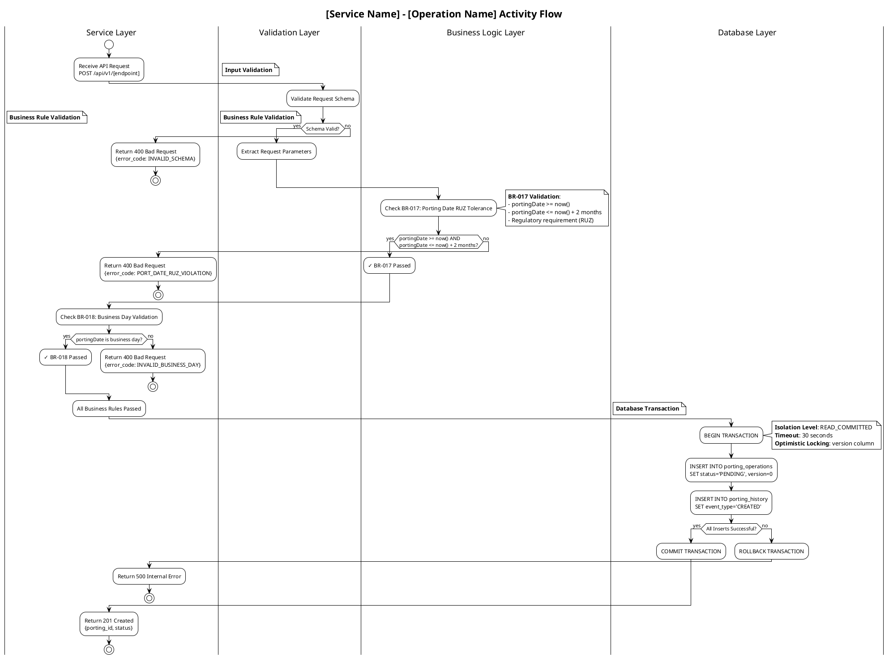

# Activity Diagram Patterns

## Critical PlantUML Syntax Rules

### PROHIBITED Syntax in Activity Diagrams

**DO NOT use the following in activity diagrams - they cause syntax errors:**

```plantuml
== Section Name ==          ❌ INVALID - Sequence diagram syntax only!
```

### VALID Alternatives for Section Separators

```plantuml
floating note: **Section Name**                    ✅ VALID
note right: **Section Name**                        ✅ VALID
partition "Section Name" { ... }                    ✅ VALID
|Swimlane Name|                                     ✅ VALID
' Comment: Section Name                             ✅ VALID (not rendered)
```

**Recommended approach**: Use `floating note: **Section Name**` for visual separators.

---

## Standard Activity Diagram Template



---

## Parallel Processing Pattern

```plantuml
|Processing Layer|
fork
  :Process Porting Request\nUpdate Database;
fork again
  :Publish Kafka Event\nprt.porting.created;
fork again
  :Update Audit Trail\nporting_history table;
end fork

:Synchronize Results;
```

---

## Saga Compensation Pattern

```plantuml
partition "Saga Step: Allocate Number Block" {
  |num-fcm Service|
  :POST /booking-orders;

  if (Allocation Successful?) then (yes)
    :Store allocation_id;
    :Continue to Next Saga Step;
  else (no)
    partition "Compensation" {
      :Trigger Saga Rollback;
      |prt-fcpm Service|
      :Update porting_operations\nSET status='FAILED';
      :Publish prt.porting.failed event;
      |Service Layer|
      :Return 500 Number Allocation Failed;
      stop
    }
  endif
}
```

---

## Error Handling Pattern

```plantuml
|Integration Layer|
:Call External Carrier API\nPDA Transmission;

if (API Call Successful?) then (yes)
  :Continue;
else (no)
  partition "Error Handling" {
    :Log Error to problem_messages table;

    if (Retryable Error?) then (yes)
      :Schedule Retry\nExponential Backoff;
      note right
        **Retry Policy**:
        - Attempt 1: 100ms delay
        - Attempt 2: 500ms delay
        - Attempt 3: 2s delay
        - Max attempts: 3
      end note
      :Retry API Call;
    else (no)
      :Move to Dead Letter Queue;
      :Publish prt.porting.failed event;
      |Service Layer|
      :Return 500 External Integration Failed;
      stop
    endif
  }
endif
```

---

## Validation Checklist

Before generating activity diagrams, verify:

- [ ] No `== Section ==` syntax used
- [ ] Section separators use `floating note:` or `partition { }`
- [ ] Swimlanes properly declared with `|Name|`
- [ ] Business rules annotated with rule IDs
- [ ] Database operations show transaction boundaries
- [ ] Error paths end with `stop`
- [ ] All branches properly closed with `endif`
