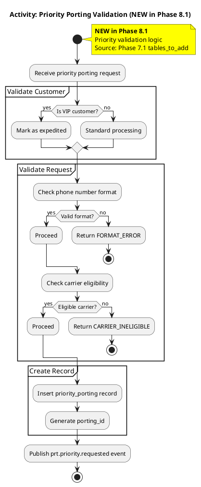
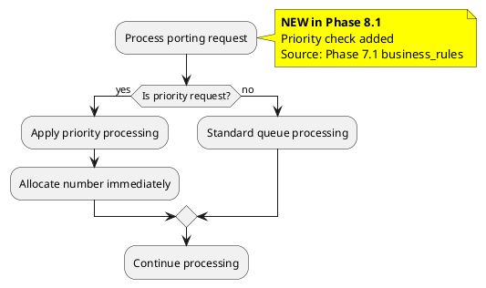
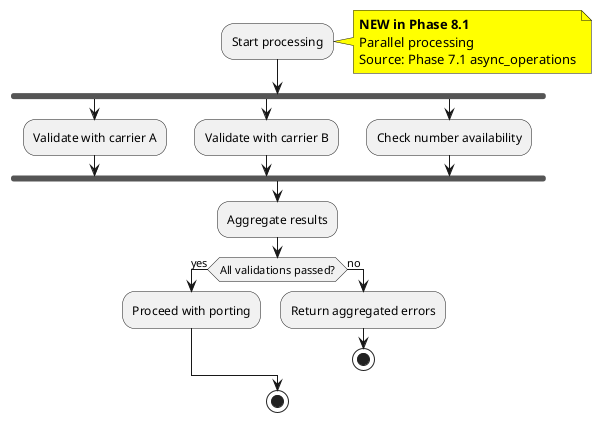
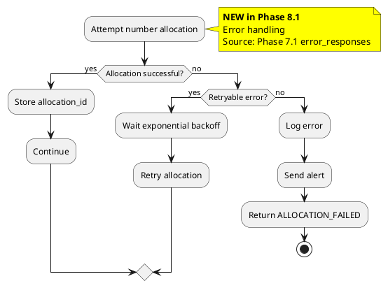
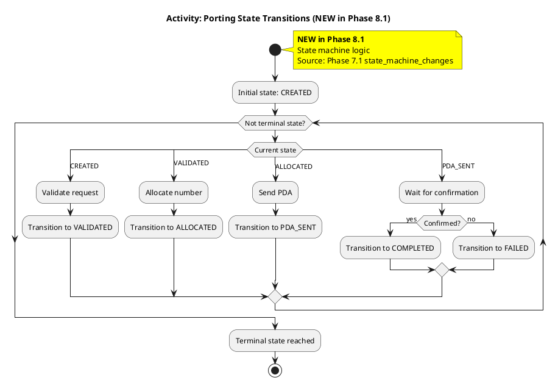
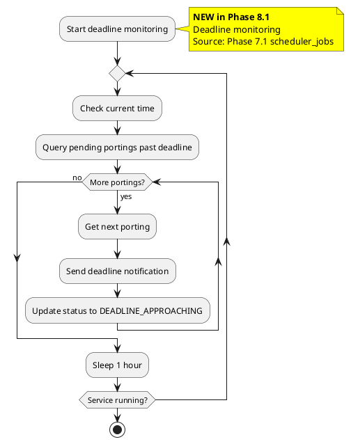

# Activity Diagram Delta Patterns

Patterns for modifying and adding activity diagrams in Phase 8.1.

**CRITICAL**: Do NOT use `==` separators in activity diagrams (PlantUML syntax issue).

---

## Pattern 1: New Validation Activity

When Phase 7.1 adds complex validation logic:



**When to Use**: Phase 7.1 added database table with complex business rules

---

## Pattern 2: Add Decision Point

When Phase 7.1 adds new business rule:



**When to Use**: Phase 7.1 added new business rule requiring branching logic

---

## Pattern 3: Add Parallel Processing

When Phase 7.1 enables concurrent operations:



**When to Use**: Phase 7.1 added async/parallel operations

---

## Pattern 4: Add Error Handling

When Phase 7.1 adds error codes or exception handling:



**When to Use**: Phase 7.1 added error handling or retry logic

---

## Pattern 5: State Machine Activity

When Phase 7.1 adds state transitions:



**When to Use**: Phase 7.1 added `new_states` or `new_transitions`

---

## Pattern 6: Timer/Deadline Activity

When Phase 7.1 adds deadline-based logic:



**When to Use**: Phase 7.1 added scheduled jobs or deadline handling

---

## VNRM Partition Colors

Use partitions to group related activities:

```plantuml
partition "Validation" #E3F2FD {
  :Validate input;
}

partition "Processing" #E8F5E9 {
  :Process request;
}

partition "Persistence" #FFF3E0 {
  :Save to database;
}
```

| Partition | Color | Purpose |
|-----------|-------|---------|
| Validation | #E3F2FD | Input validation |
| Processing | #E8F5E9 | Business logic |
| Persistence | #FFF3E0 | Database operations |
| Notification | #FCE4EC | Outbound communication |
| Error | #FFEBEE | Error handling |

---

## JSON Structure for activities_to_add

```json
{
  "diagram_name": "activity-priority-validation.puml",
  "operation": "Priority Porting Validation",
  "table_name": "priority_porting_requests",
  "decision_points": [
    "Is VIP customer?",
    "Valid format?",
    "Eligible carrier?"
  ],
  "plantuml_content": "@startuml\n...\n@enduml",
  "rationale": "Phase 7.1 added complex validation for priority porting",
  "source_change": "Phase 7.1 tables_to_add: priority_porting_requests"
}
```

---

## Syntax Rules

| Do | Don't |
|----|-------|
| ✅ `start` / `stop` | ❌ `==` separators |
| ✅ `if () then` | ❌ `switch` without `case` |
| ✅ `partition "Name"` | ❌ Deeply nested conditions |
| ✅ `fork` / `end fork` | ❌ `|swimlane|` (limited support) |
| ✅ `repeat` / `repeat while` | ❌ Complex loops |
| ✅ `note right` | ❌ Notes inside conditions |

---

## Best Practices

1. **Use partitions** to group related activities
2. **Keep conditions simple** (max 2 levels nesting)
3. **Use parallel forks** for concurrent operations
4. **Include error branches** for all operations
5. **Annotate ALL new logic** with yellow notes
6. **Avoid swimlanes** (limited PlantUML support)
