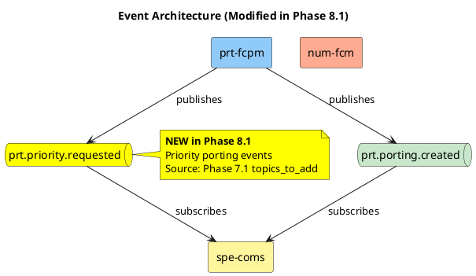
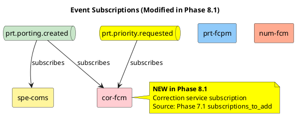
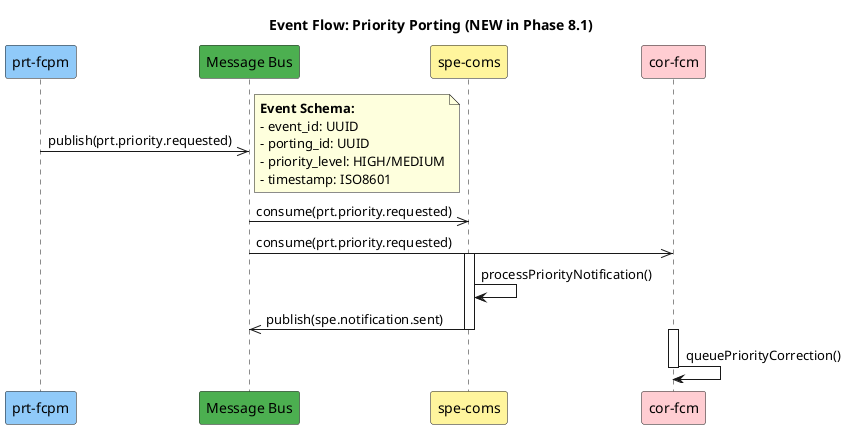
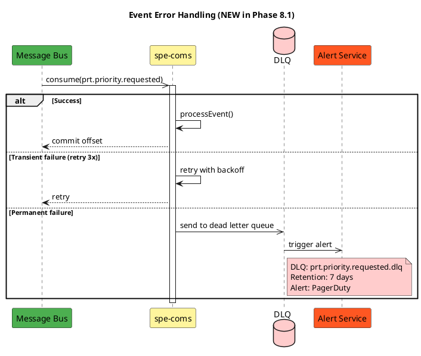
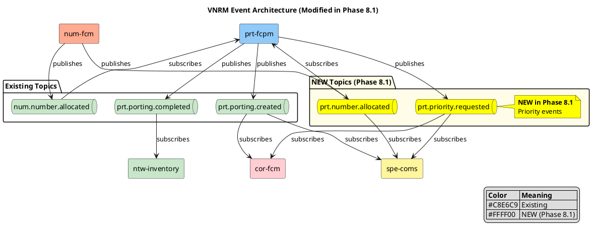

# Event Flow Delta Patterns

Patterns for modifying event architecture diagrams in Phase 8.1.

---

## When to Modify Event Architecture

Modify event architecture when Phase 7.1 introduces:
- **New Message Bus topics**
- **New event subscriptions**
- **New event publishers**
- **Modified event schemas**

---

## Pattern 1: Add New Topic

When Phase 7.1 adds `topics_to_add`:



**When to Use**: Phase 7.1 added `topics_to_add` array

---

## Pattern 2: Add New Subscription

When Phase 7.1 adds `subscriptions_to_add`:



**When to Use**: Phase 7.1 added `subscriptions_to_add` array

---

## Pattern 3: Event Flow Sequence

Show event processing flow:



**When to Use**: Show event-driven business process

---

## Pattern 4: Event with Dead Letter Queue

Show error handling:



**When to Use**: Phase 7.1 added error handling for events

---

## Pattern 5: Complete Event Architecture

Overview of all topics and subscriptions:



**When to Use**: Comprehensive event architecture view

---

## Event Schema Documentation

For each new topic, document:

```markdown
### Topic: prt.priority.requested

**Purpose**: Notify subscribers of priority porting request

**Publisher**: prt-fcpm

**Subscribers**:
- spe-coms: Send priority notification
- cor-fcm: Queue priority correction check

**Avro Schema**:
```json
{
  "type": "record",
  "name": "PriorityPortingRequested",
  "namespace": "com.telekom.vnrm.prt.events",
  "fields": [
    {"name": "event_id", "type": "string"},
    {"name": "event_timestamp", "type": {"type": "long", "logicalType": "timestamp-millis"}},
    {"name": "correlation_id", "type": "string"},
    {"name": "porting_id", "type": "string"},
    {"name": "priority_level", "type": {"type": "enum", "name": "PriorityLevel", "symbols": ["HIGH", "MEDIUM", "LOW"]}},
    {"name": "customer_id", "type": "string"},
    {"name": "phone_number", "type": "string"}
  ]
}
```

**Partitioning**: By `porting_id` (ensures ordering per porting)

**Retention**: 30 days

**Replication Factor**: 3
```

---

## JSON Structure for event_flows_to_modify

```json
{
  "diagram_name": "event-architecture.puml",
  "new_topics": [
    {
      "topic_name": "prt.priority.requested",
      "publisher": "prt-fcpm",
      "partition_key": "porting_id",
      "retention_days": 30,
      "replication_factor": 3
    }
  ],
  "new_subscriptions": [
    {
      "consumer": "spe-coms",
      "topic": "prt.priority.requested",
      "consumer_group": "spe-coms-priority-consumer",
      "idempotency": "event_id deduplication"
    },
    {
      "consumer": "cor-fcm",
      "topic": "prt.priority.requested",
      "consumer_group": "cor-fcm-priority-consumer",
      "idempotency": "event_id deduplication"
    }
  ],
  "plantuml_content": "@startuml\n...\n@enduml",
  "rationale": "Phase 7.1 added priority porting events",
  "source_change": "Phase 7.1 topics_to_add: prt.priority.requested"
}
```

---

## Topic Naming Convention

```
{submodule}.{entity}.{event-type}
```

| Component | Values |
|-----------|--------|
| submodule | prt, num, cor, ntw, spe, com |
| entity | porting, number, correction, etc. |
| event-type | created, updated, completed, failed, requested |

**Examples**:
- `prt.porting.created`
- `prt.priority.requested`
- `num.number.allocated`
- `cor.correction.completed`

---

## Best Practices

1. **Use consistent topic naming** following convention
2. **Include standard event fields** (event_id, timestamp, correlation_id)
3. **Document partitioning strategy** for ordering guarantees
4. **Specify idempotency strategy** for consumers
5. **Include DLQ configuration** for error handling
6. **Annotate ALL new topics/subscriptions** with yellow notes
