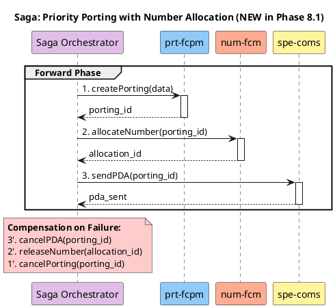
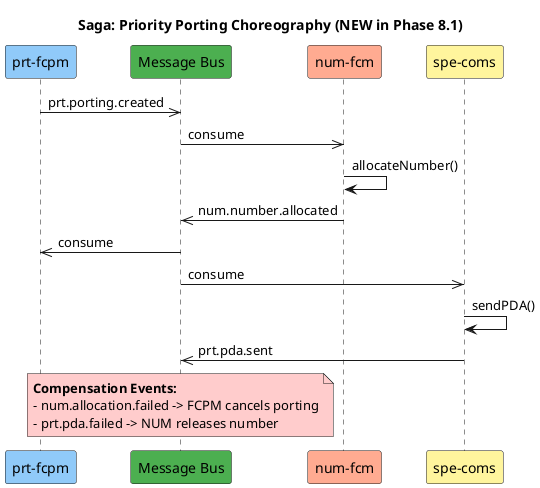
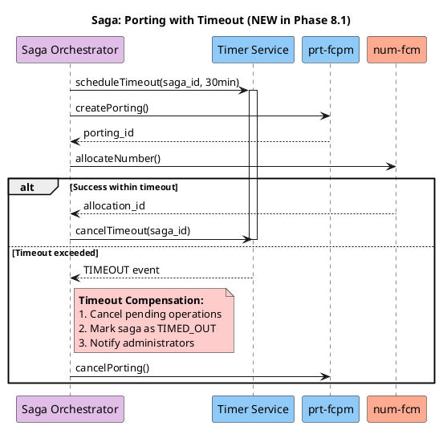
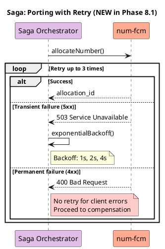

# Saga Choreography Delta Patterns

Patterns for adding saga choreography diagrams in Phase 8.1.

---

## When to Create Saga Diagrams

Create saga diagrams when Phase 7.1 introduces:
- **Distributed transactions** spanning 2+ services
- **Compensating actions** required on failure
- **Long-running operations** with rollback needs
- **Cross-service consistency** requirements

---

## Pattern 1: Orchestrated Saga

Central orchestrator manages saga steps:



**When to Use**: Clear transaction steps with defined compensation

---

## Pattern 2: Choreographed Saga (Event-Driven)

Services react to events without central orchestrator:



**When to Use**: Loosely coupled services, event-driven architecture

---

## Pattern 3: Saga with Timeout

Saga with deadline handling:



**When to Use**: Operations with SLA or deadline requirements

---

## Pattern 4: Saga with Retry

Saga with retry logic:



**When to Use**: External service calls with retry requirements

---

## Saga Documentation Structure

For each saga, document:

### 1. Saga Overview

```markdown
## Saga: Priority Porting

**Purpose**: Ensure atomic operation across prt-fcpm and num-fcm

**Participants**:
- prt-fcpm: Creates porting record
- num-fcm: Allocates number
- spe-coms: Sends PDA

**Trigger**: POST /portings/priority

**Timeout**: 30 minutes
```

### 2. Forward Steps

```markdown
### Forward Steps

| Step | Service | Action | Success Output |
|------|---------|--------|----------------|
| 1 | prt-fcpm | createPorting() | porting_id |
| 2 | num-fcm | allocateNumber() | allocation_id |
| 3 | spe-coms | sendPDA() | pda_id |
```

### 3. Compensation Steps

```markdown
### Compensation Steps

| Step | Service | Compensation | Trigger |
|------|---------|--------------|---------|
| 3' | spe-coms | cancelPDA() | Step 3 failed |
| 2' | num-fcm | releaseNumber() | Step 2 or 3 failed |
| 1' | prt-fcpm | cancelPorting() | Any step failed |
```

### 4. Edge Cases

```markdown
### Edge Cases

1. **Timeout during step 2**:
   - Cancel allocated number if partially completed
   - Mark porting as TIMED_OUT

2. **Step 3 fails after retries**:
   - Release number allocation
   - Cancel porting
   - Notify administrator

3. **Duplicate saga detection**:
   - Use idempotency key
   - Return existing saga status
```

---

## JSON Structure for sagas_to_add

```json
{
  "diagram_name": "saga-priority-porting.puml",
  "saga_name": "Priority Porting Saga",
  "saga_type": "orchestrated",
  "steps": [
    {
      "order": 1,
      "service": "prt-fcpm",
      "action": "createPorting",
      "compensation": "cancelPorting"
    },
    {
      "order": 2,
      "service": "num-fcm",
      "action": "allocateNumber",
      "compensation": "releaseNumber"
    },
    {
      "order": 3,
      "service": "spe-coms",
      "action": "sendPDA",
      "compensation": "cancelPDA"
    }
  ],
  "timeout_minutes": 30,
  "compensation_required": true,
  "plantuml_content": "@startuml\n...\n@enduml",
  "rationale": "Distributed transaction across prt-fcpm and num-fcm",
  "source_change": "Phase 7.1 dependency_changes + database_changes"
}
```

---

## Best Practices

1. **Document compensation for every step**
2. **Use idempotency keys** for saga operations
3. **Include timeout handling** for long-running sagas
4. **Show both happy path and failure paths**
5. **Use retry for transient failures only**
6. **Annotate ALL saga elements** with yellow notes
