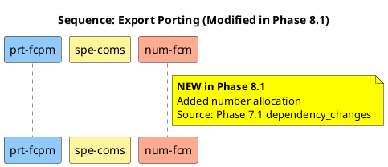
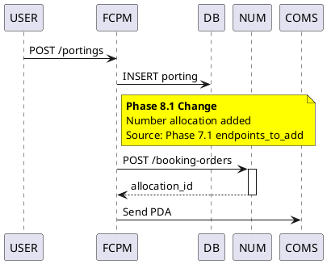
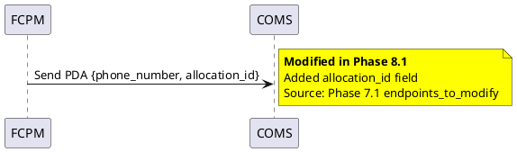
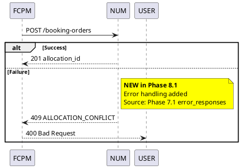
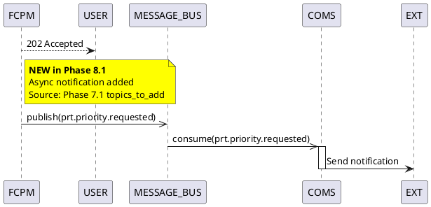
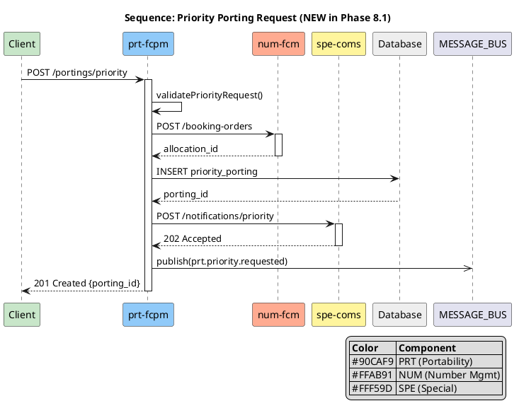

# Sequence Diagram Delta Patterns

Patterns for modifying and adding sequence diagrams in Phase 8.1.

---

## Pattern 1: Add New Participant

When Phase 7.1 adds a new service dependency:



**When to Use**: Phase 7.1 added `new_internal_dependencies` or API calls to new service

---

## Pattern 2: Add New Interaction

When Phase 7.1 adds a new API endpoint:



**When to Use**: Phase 7.1 added `endpoints_to_add` that requires new service call

---

## Pattern 3: Modify Existing Interaction

When Phase 7.1 changes request/response schema:



**When to Use**: Phase 7.1 added `endpoints_to_modify` with schema changes

---

## Pattern 4: Add Error Handling Branch

When Phase 7.1 adds validation or error handling:



**When to Use**: Phase 7.1 added error codes or validation rules

---

## Pattern 5: Add Async Notification

When Phase 7.1 adds Message Bus events:



**When to Use**: Phase 7.1 added `topics_to_add` with event subscriptions

---

## Pattern 6: New Sequence Diagram

When Phase 7.1 adds a new use case:



**When to Use**: Phase 7.1 adds new endpoint that represents new use case

---

## VNRM Color Scheme

Use consistent colors for VNRM submodules:

| Submodule | Color | Hex |
|-----------|-------|-----|
| COM (Common) | Light Gray | #CFD8DC |
| COR (Correction) | Light Red | #FFCDD2 |
| NTW (Network) | Light Green | #C8E6C9 |
| NUM (Number) | Light Orange | #FFAB91 |
| PRT (Porting) | Light Blue | #90CAF9 |
| SPE (Special) | Light Yellow | #FFF59D |

---

## JSON Structure for sequences_to_add

```json
{
  "diagram_name": "sequence-priority-porting.puml",
  "use_case": "Priority Porting Request",
  "participants": ["prt-fcpm", "num-fcm", "spe-coms"],
  "description": "Complete flow for priority porting with number allocation",
  "plantuml_content": "@startuml\n...\n@enduml",
  "rationale": "Phase 7.1 added POST /portings/priority endpoint",
  "source_change": "Phase 7.1 endpoints_to_add[0]"
}
```

---

## JSON Structure for sequences_to_modify

```json
{
  "diagram_name": "sequence-export-porting.puml",
  "modifications": {
    "type": "add_interaction",
    "new_participants": ["num-fcm"],
    "new_interactions": [
      {
        "from": "prt-fcpm",
        "to": "num-fcm",
        "message": "POST /booking-orders",
        "response": "allocation_id",
        "insert_after": "INSERT porting"
      }
    ],
    "plantuml_snippet": "FCPM -> NUM : POST /booking-orders\nNUM --> FCPM : allocation_id",
    "rationale": "Add number allocation before PDA transmission"
  },
  "source_change": "Phase 7.1 endpoints_to_add[1]"
}
```

---

## Best Practices

1. **Always use activate/deactivate** for clear lifeline representation
2. **Include legend** for diagrams with 4+ participants
3. **Use alt/else** for branching flows
4. **Use ->>** for async messages (Message Bus)
5. **Use -->** for response messages
6. **Use ->** for request messages
7. **Annotate ALL changes** with yellow notes
